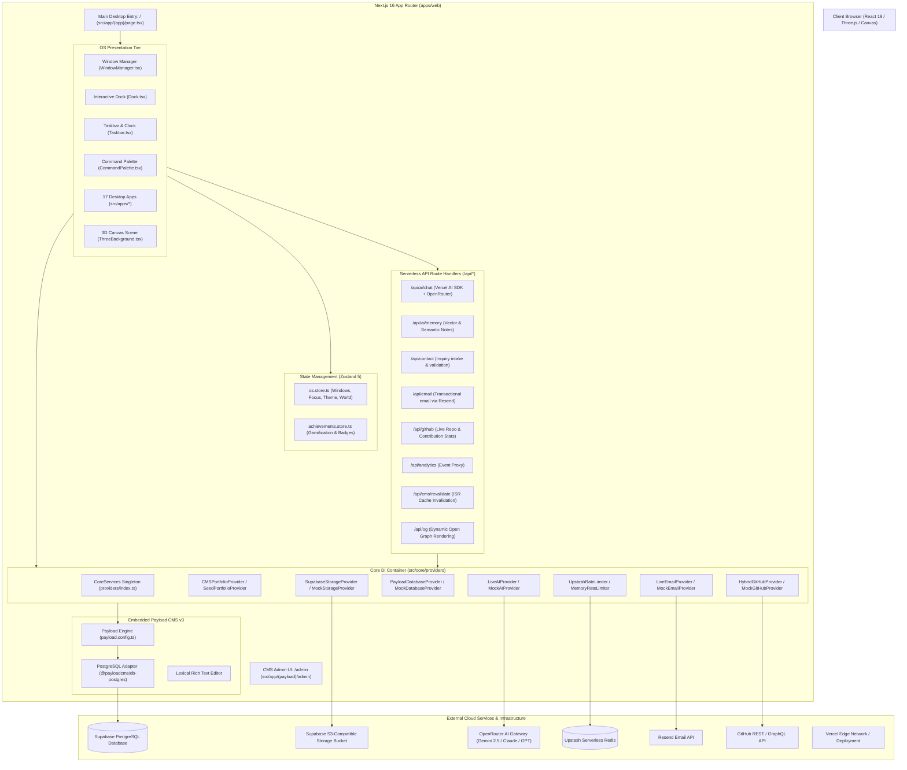

# ALLINET OS Architecture Specification

## 1. High-Level Architecture Overview

ALLINET OS is a web-based operating system portfolio built with **Next.js 16 (App Router)**, **React 19**, **TypeScript 5**, **Tailwind CSS v4**, and **Payload CMS v3**. It provides a dual-interface architecture:
1. **Public Web Shell / Interactive OS**: A desktop-style user interface featuring multi-window management, dock, taskbar, dynamic 3D backgrounds (Three.js / React Three Fiber), terminal emulator, and an embedded AI Assistant ("AION").
2. **Headless CMS & Administrative Control Plane**: An integrated Payload CMS instance with a PostgreSQL backend (Supabase Postgres), managing all portfolio content, system configuration, media, contact messages, and AI memory models.

---

## 2. Directory and Module Organization

| Directory / File Path | Responsibility & Contents |
|---|---|
| `apps/web/next.config.ts` | Next.js configuration, Payload wrapper (`withPayload`), transpilePackages, CSP headers |
| `apps/web/payload.config.ts` | Payload CMS v3 schema configuration: 16 collections, 3 globals, PostgreSQL adapter |
| `apps/web/src/app/(app)/` | Public OS route group: `page.tsx` (main shell), `layout.tsx`, `globals.css` |
| `apps/web/src/app/(payload)/` | Payload admin interface routes (`/admin/[[...segments]]`) and API handler (`/api/[...slug]`) |
| `apps/web/src/app/api/` | Custom backend API routes (`ai/chat`, `ai/memory`, `contact`, `email`, `github`, `og`, etc.) |
| `apps/web/src/apps/` | 17 modular window applications (`AIApp`, `ProjectsApp`, `TerminalApp`, `ResumeApp`, etc.) |
| `apps/web/src/components/boot/` | Hardware emulation boot screen (`BootSequence.tsx`) |
| `apps/web/src/components/os/` | Core OS shell components (`WindowManager`, `Desktop`, `Dock`, `Taskbar`, `CommandPalette`) |
| `apps/web/src/components/three/` | Three.js scene manager (`ThreeBackground.tsx`, `IntroScene.tsx`) |
| `apps/web/src/components/ui/` | Shared UI modals and widgets (`LuxuryImageModal.tsx`) |
| `apps/web/src/core/api/` | API helper middleware, standard response wrappers, and rate limiter bindings |
| `apps/web/src/core/providers/` | Dependency Injection container (`CoreServices`) and abstract/live/mock provider classes |
| `apps/web/src/core/registry/` | Application registry (`AppRegistry.ts`) defining window metadata, icons, and dimensions |
| `apps/web/src/lib/` | Reusable utilities: `validation.ts` (Zod schemas), `rate-limit.ts`, `ai/portfolio-data.ts` |
| `apps/web/src/store/` | Client-side reactive stores (`os.store.ts`, `achievements.store.ts`) powered by Zustand 5 |
| `apps/web/src/types/` | Global OS type definitions (`os.types.ts`) |

---

## 3. Core Subsystems

### 3.1 Window Management & OS Shell
- **Zustand Store (`os.store.ts`)**: Controls window open state, minimisation, maximisation, z-index layering, window coordinates, active theme (`cyber-gold`, `matrix-green`, `neon-blue`, etc.), active 3D world, audio mute status, and command palette visibility.
- **WindowManager (`WindowManager.tsx`)**: Renders active application windows inside dynamic Framer Motion wrappers with support for dragging, resizing, maximizing, and stacking orders.
- **AppRegistry (`AppRegistry.ts`)**: Maps application identifiers (`AppId`) to display titles, Lucide icons, default geometry (width/height), and lazy-loaded React components.

### 3.2 Dependency Injection Container (`CoreServices`)
Located in `src/core/providers/index.ts`, `CoreServices` manages environment-aware provider resolution. When required environment variables or production flags are missing, each service gracefully falls back to a deterministic Mock provider:
- **`DatabaseProvider`**: Resolves to `PayloadDatabaseProvider` (reads from Payload CMS PostgreSQL) or `MockDatabaseProvider`.
- **`PortfolioProvider`**: Resolves to `CMSPortfolioProvider` (fetches projects, skills, timeline, testimonials from Payload) with automatic fallback to static seed data (`SeedPortfolioProvider`).
- **`AIProvider`**: Resolves to `LiveAIProvider` (communicates with OpenRouter/OpenAI via API key) or `MockAIProvider`.
- **`StorageProvider`**: Resolves to `SupabaseStorageProvider` (uploads to Supabase Storage S3 buckets) or `MockStorageProvider`.
- **`RateLimiterProvider`**: Resolves to `UpstashRateLimiter` (production Redis) or `MemoryRateLimiter` (local dev).
- **`EmailProvider`**: Resolves to `LiveEmailProvider` (Resend API) or `MockEmailProvider`.
- **`GitHubProvider`**: Resolves to `HybridGitHubProvider` (cached live GitHub API with static fallback).
- **`AnalyticsProvider`**: Resolves to `VercelAnalyticsProvider` or `MockAnalyticsProvider`.

### 3.3 AION AI Engine
The AI assistant subsystem is built on `@ai-sdk/openai` and Vercel AI SDK:
- **Route Handler (`/api/ai/chat/route.ts`)**: Receives conversation messages, enforces rate limits, extracts recent system context, attaches tools, and streams response tokens back using Server-Sent Events (SSE).
- **Tool Execution**: Tools defined include `searchProjects`, `getSkillDetails`, `getResumeSection`, `contactFormAssistance`, and `triggerAchievement`.
- **Fallback Hierarchy**: Primary gateway is OpenRouter with model `google/gemini-2.5-flash`; configured fallback is OpenAI with `gpt-4o`.
- **Memory Integration**: Supported via Payload collection `ai-memories` and API endpoints `/api/ai/memory`.

### 3.4 Data Persistence & CMS Tier
Embedded Payload CMS v3 runs in-process inside Next.js App Router:
- **Adapter**: `@payloadcms/db-postgres` connecting via `DATABASE_URL`.
- **Admin Panel**: Accessible at `/admin` with role-based access control, Lexical rich-text editing, draft/versioning support, and relational joins across 16 collections.
