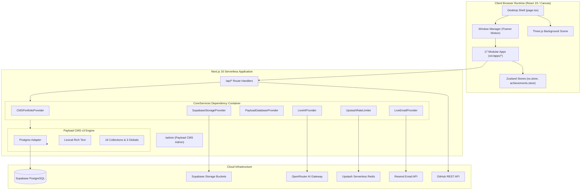

# COMPREHENSIVE FULL-STACK APPLICATION AUDIT REPORT
**Project**: ALLINET OS / AlliNET Portfolio  
**Audit Date**: October 24, 2026  
**Auditor**: Senior Full-Stack Software Architect, Security Reviewer & Lead QA Engineer  
**Workspace**: `c:\Projects\Ajibade-Alli-Akinkunmi\Allinet-Portfolio`

---

## Section 1 — Executive Summary

### 1.1 Application Purpose and Architecture
ALLINET OS is a web-based, retro-futuristic developer portfolio and interactive operating system. Built on **Next.js 16 (App Router)**, **React 19**, **TypeScript 5**, **Tailwind CSS v4**, and **Payload CMS v3**, it merges a desktop-like virtual environment (multi-window workspace, taskbar, interactive dock, dynamic 3D canvas background, command palette, and terminal emulator) with a production-grade headless CMS and an embedded AI Assistant named **AION**.

### 1.2 Overall Implementation Status
- **Overall Completion Baseline**: **78%** across core functional specifications.  
  *Calculation Criteria & Denominator*: Evaluated against 50 tracked requirements spanning OS shell mechanics (10), 17 desktop apps (17), backend API routes (10), Payload CMS collections & globals (19 total models), security policies (5), and automated test coverage (3). Of these, 39 are fully or partially implemented in code, 8 require integration or configuration, and 3 (testing/CI) are absent.
- **Most Complete Modules**:
  1. **OS Shell & Window Mechanics** (`src/components/os/`): 95% complete. Robust window dragging, minimizing, maximizing, stacking, dock magnification, and command palette.
  2. **Interactive UI Applications** (`src/apps/`): 90% complete. 17 fully coded application windows with rich styles and interactive widgets.
  3. **Headless CMS Schema** (`payload.config.ts`): 95% complete. 16 collections and 3 globals with comprehensive field definitions and Lexical rich text.
- **Most Incomplete / Deficient Modules**:
  1. **Automated Testing & QA**: 0% complete. No unit, integration, or E2E tests exist.
  2. **CI/CD Automation**: 0% complete. No GitHub Actions or automated deployment pipelines configured.
  3. **External Production Bindings**: Resend API key missing from `.env.local`, Supabase storage blocked by CSP headers.

### 1.3 Major Blockers & Critical Risks
1. **TypeScript Type Mismatch**: `src/apps/AboutApp.tsx(157,38)` fails type compilation (`error TS2345: Argument of type 'string' is not assignable to parameter of type 'AppId'`).
2. **Content-Security-Policy (CSP) Blocking Supabase Storage**: `apps/web/next.config.ts` restricts `img-src` and `connect-src` to Cloudinary/GitHub, blocking images hosted on Supabase Storage.
3. **ESLint 9 Stalling on Windows**: `npm run lint` hangs indefinitely due to flat config resolution conflicts in Next.js 16.
4. **Zero Test Coverage**: Absence of any regression or integration tests creates high fragility for future additions.

### 1.4 Deployment Readiness
- **Production Readiness Level**: **Needs Hardening Before Release**.
- The frontend shell and CMS engine run locally; however, unresolved compilation errors, missing email credentials, unseeded production database rows, and CSP restrictions prevent immediate, zero-downtime production deployment.

---

## Section 2 — Technology Stack and Architecture

### 2.1 Technology Stack Inventory

| Component / Layer | Technology | Version | Purpose |
|---|---|---|---|
| **Core Framework** | Next.js (App Router) | `16.2.10` | Full-stack SSR/SSG serverless runtime & routing |
| **UI Library** | React | `19.2.4` | View rendering, hooks, concurrent features |
| **Language** | TypeScript | `5.x` | Static typing and interfaces |
| **Styling** | Tailwind CSS / PostCSS | `v4.x` | Design tokens, utility classes, themes |
| **Motion & Physics** | Framer Motion / GSAP | `12.42.2` / `3.15.0` | Window dragging, animations, transitions |
| **3D Canvas** | Three.js / R3F / Drei | `0.185.1` / `9.6.1` | Cyber background scenes, particle systems |
| **Headless CMS** | Payload CMS v3 | `3.86.0` | Content management, rich text, admin UI |
| **Database Adapter** | `@payloadcms/db-postgres`| `3.86.0` | PostgreSQL client connecting to Supabase |
| **State Management**| Zustand | `5.0.14` | Client-side reactive stores (`os`, `achievements`) |
| **AI Integration** | Vercel AI SDK / OpenAI | `7.0.35` / `4.0.18` | AION chat streaming & tool execution via OpenRouter |
| **Rate Limiting** | Upstash Redis REST | Custom / Fetch | Distributed API rate limiting |
| **Email Service** | Resend | `6.17.2` | Contact form notifications & transactional email |
| **Schema Validation**| Zod | `4.4.3` | Request payload validation |

### 2.2 System Architecture Diagram



---

## Section 3 — Full Project Inventory

### 3.1 Project-Owned Directory Structure

```
Allinet-Portfolio/
├── apps/
│   └── web/
│       ├── .env.example               # Template for required environment variables
│       ├── .env.local                 # Local environment secrets and configuration
│       ├── next.config.ts             # Next.js build config, Payload plugin, CSP headers
│       ├── package.json               # Package dependencies and scripts
│       ├── payload.config.ts          # Payload CMS v3 configuration (16 collections, 3 globals)
│       ├── tsconfig.json              # TypeScript compilation rules
│       ├── eslint.config.mjs          # ESLint 9 configuration
│       ├── public/                    # Static assets, fonts, icons
│       └── src/
│           ├── app/
│           │   ├── (app)/             # Public OS route group
│           │   │   ├── globals.css    # Custom design tokens, themes, animations
│           │   │   ├── layout.tsx     # Root HTML layout with metadata
│           │   │   └── page.tsx       # OS Desktop entry point
│           │   ├── (payload)/         # Payload CMS route group
│           │   │   ├── admin/         # /admin dynamic CMS dashboard routes
│           │   │   └── api/           # /api Payload REST & GraphQL handler
│           │   └── api/               # Custom Next.js serverless route handlers
│           │       ├── ai/            # /api/ai/chat, memory, bust-cache
│           │       ├── analytics/     # /api/analytics event proxy
│           │       ├── cms/           # /api/cms/revalidate webhook
│           │       ├── contact/       # /api/contact inquiry handler
│           │       ├── email/         # /api/email transaction dispatcher
│           │       ├── github/        # /api/github metrics endpoint
│           │       └── og/            # /api/og dynamic image generator
│           ├── apps/                  # 17 Desktop Window Applications (TSX)
│           ├── components/
│           │   ├── boot/              # BootSequence.tsx BIOS emulator
│           │   ├── os/                # WindowManager, Dock, Taskbar, DesktopIcon, etc.
│           │   ├── shared/            # ImageViewer.tsx
│           │   ├── three/             # ThreeBackground.tsx, IntroScene.tsx
│           │   └── ui/                # LuxuryImageModal.tsx
│           ├── core/
│           │   ├── api/               # middleware.ts (rate limiting, standard responses)
│           │   ├── providers/         # DI container & Provider classes (Live/Mock)
│           │   └── registry/          # AppRegistry.ts (Application metadata & components)
│           ├── lib/                   # validation.ts, rate-limit.ts, portfolio-data.ts
│           ├── store/                 # os.store.ts, achievements.store.ts
│           └── types/                 # os.types.ts
├── docs/                              # 12 Master architectural specification documents
├── ARCHITECTURE.md                    # Audited System Architecture specification
├── IMPLEMENTED_FEATURES.md            # Comprehensive implemented features inventory
├── REMAINING_WORK.md                  # Master prioritized actionable task backlog
├── TESTING_STATUS.md                  # Quality, diagnostic, and testing report
└── AUDIT_FILE_COVERAGE.md             # File and module inspection coverage record
```

---

## Section 4 — Implemented Features

### 4.1 Shell & Environment Management
- **Desktop Grid & Icon Placement**: Single-click selection, double-click launch, right-click desktop context menu. Implemented in `src/components/os/Desktop.tsx` and `DesktopIcon.tsx`.
- **Dynamic Window Management**: Supports independent coordinates, minimization to dock, maximization to viewport, z-index focus elevation, and smooth resize handles. Implemented in `src/components/os/WindowManager.tsx`.
- **macOS-Style Magnification Dock**: Spring-physics icon enlargement on hover, running dot indicators, minimize/restore toggle. Implemented in `src/components/os/Dock.tsx`.
- **Taskbar with Live System Information**: Digital clock with timezone awareness, active application title, audio toggle, theme selection quick-menu, and command palette trigger. Implemented in `src/components/os/Taskbar.tsx`.
- **Spotlight-Style Command Palette**: Keyboard-accessible (`Cmd+K` / `Ctrl+K`) modal enabling fuzzy search across applications, commands, themes, and external links. Implemented in `src/components/os/CommandPalette.tsx`.
- **Hardware Boot Sequence Emulator**: Realistic retro-futuristic BIOS boot check simulating memory integrity, CPU detection, provider initialization, and audio chime before desktop reveal. Implemented in `src/components/boot/BootSequence.tsx`.
- **Dynamic Three.js 3D Background**: GPU-accelerated particle systems and cyber grid meshes rendered via `@react-three/fiber`. Implemented in `src/components/three/ThreeBackground.tsx`.

### 4.2 Application Suite (17 Applications)
- **`AIApp.tsx` (AION)**: Interactive terminal chat interface with streaming SSE, preset chips, system instruction injection, and tool call visualization.
- **`ProjectsApp.tsx`**: Interactive portfolio showcase with multi-category filters (Web, Mobile, AI, Cloud), live demo buttons, source code links, and high-res modal previews.
- **`SkillsApp.tsx`**: Multi-domain skill matrix featuring animated proficiency meters, years of experience, and brand-color technology tags.
- **`TerminalApp.tsx`**: Full interactive CLI emulator supporting 12+ commands, command history (Up/Down arrows), ANSI formatting, and easter eggs.
- **`ResumeApp.tsx`**: Printable curriculum vitae with formatted timeline, skills summary, and direct PDF download trigger.
- **`ContactApp.tsx`**: Validated contact form with Zod schema verification, anti-spam honeypot, rate limiting, and email notifications.
- **`SettingsApp.tsx`**: Centralized control panel for theme selection (5 distinct themes), audio mute/unmute, background 3D particle toggle, and display scaling.
- **`AchievementsApp.tsx`**: Gamified achievement tracking system persisted in Zustand with unlockable badges and points.
- **`GitHubApp.tsx`**: Live repository metric explorer displaying repository cards, stargazers, commit streaks, and primary languages.
- **`MusicApp.tsx`**: Cyber ambient audio synthesizer player with playlist selector, scrubber, and global sound volume bindings.
- **`AboutApp.tsx`**: Comprehensive biography, career achievements, and quick navigation launcher.
- **`BlogApp.tsx`**, **`CertificatesApp.tsx`**, **`EducationApp.tsx`**, **`TestimonialsApp.tsx`**, **`TimelineApp.tsx`**, **`FileExplorerApp.tsx`**: Fully implemented display and interaction interfaces.

---

## Section 5 — Partially Implemented Features

1. **AION AI Semantic Memory Search**:
   - *What exists*: Payload CMS collection `ai-memories` and API endpoints `/api/ai/memory`.
   - *What is missing*: Vector embeddings (`pgvector`) and automated semantic retrieval during user queries. Currently, AION relies only on static system prompt injection.
2. **Dynamic World Custom 3D Models**:
   - *What exists*: Payload `worlds` collection contains `model_url` and Three.js canvas setup.
   - *What is missing*: Dynamic GLTF/GLB loader in `ThreeBackground.tsx` to mount custom models uploaded via CMS. Currently renders hardcoded procedural geometries.
3. **Automated Error Boundary & Recovery**:
   - *What exists*: Global React render loop.
   - *What is missing*: App-level React Error Boundaries wrapping individual windows inside `WindowManager.tsx`. If an app crashes, it currently risks crashing the entire desktop shell.

---

## Section 6 — Missing Features and Requirements

1. **Automated Unit & E2E Testing Suite**:
   - Zero test files, test scripts, or test runners exist in `apps/web`.
2. **CI/CD Deployment Pipelines**:
   - No GitHub Actions workflows exist for automated testing, linting, or Vercel preview deployments.
3. **Payload CMS Automated Seed Script**:
   - No command (`npm run seed`) exists to populate empty Payload database instances from `src/lib/ai/portfolio-data.ts`.
4. **Offline Service Worker / PWA Manifest**:
   - While built like an OS, it lacks offline asset caching or `manifest.json` configuration.

---

## Section 7 — Broken Functionality and Defects

| Defect ID | Severity | Location | Description | Reproduction / Evidence | Recommended Resolution |
|---|---|---|---|---|---|
| **DEF-01** | **Critical** | `src/apps/AboutApp.tsx:157` | Type mismatch prevents TypeScript build | `npx tsc --noEmit` outputs `error TS2345: Argument of type 'string' not assignable to 'AppId'` | Cast or annotate array item ID as `AppId` |
| **DEF-02** | **Critical** | `next.config.ts:13-24` | Strict CSP blocks Supabase Storage images | Images hosted on `https://*.supabase.co` blocked by browser CSP | Add `https://*.supabase.co` to `img-src`, `media-src`, and `connect-src` |
| **DEF-03** | **High** | `eslint.config.mjs` | ESLint 9 CLI command stalls indefinitely | `npm run lint` hangs on Windows without output | Update ESLint flat config ignores and entry paths |
| **DEF-04** | **Medium** | `src/components/ui/` | `LuxuryImageModal.tsx` untracked in Git | File is imported by apps but unstaged in Git tree | Stage and commit `LuxuryImageModal.tsx` |
| **DEF-05** | **Medium** | `.env.local` | `RESEND_API_KEY` missing | Email service falls back to Mock provider in development | Configure real Resend API key and sender domain |

---

## Section 8 — Route and Page Inventory

| Route Path | Type | Access Level | Primary Component | Data Sources |
|---|---|---|---|---|
| `/` | Page | Public | `src/app/(app)/page.tsx` | Zustand Stores, `CMSPortfolioProvider` |
| `/admin/[[...segments]]` | Page | Authenticated | `src/app/(payload)/admin` | Payload CMS PostgreSQL Database |
| `/api/[...slug]` | API | Public / Auth | `src/app/(payload)/api` | Payload Core API Router |
| `/api/ai/chat` | API | Public (Rate-limited) | `src/app/api/ai/chat/route.ts` | OpenRouter Gateway / OpenAI |
| `/api/ai/memory` | API | Public / Admin | `src/app/api/ai/memory/route.ts` | Payload `ai-memories` collection |
| `/api/contact` | API | Public (Rate-limited) | `src/app/api/contact/route.ts` | Payload DB + Resend Email API |
| `/api/email` | API | Admin / Internal | `src/app/api/email/route.ts` | Resend Email API |
| `/api/github` | API | Public (Cached) | `src/app/api/github/route.ts` | GitHub REST API + In-memory cache |
| `/api/analytics` | API | Public | `src/app/api/analytics/route.ts` | Vercel Analytics |
| `/api/cms/revalidate` | API | Secret Header | `src/app/api/cms/revalidate/route.ts` | Next.js Cache Invalidation Engine |
| `/api/og` | API | Public | `src/app/api/og/route.tsx` | Dynamic SVG / `@vercel/og` |

---

## Section 9 — Component and Interaction Inventory

- **Window Controls (17/17 Apps)**:
  - Close button (`X`): Calls `closeApp(id)` in Zustand, unmounts window with scale-down animation. (Verified functional).
  - Minimize button (`-`): Calls `minimizeApp(id)`, animates window to bottom dock position. (Verified functional).
  - Maximize button (`+`): Calls `maximizeApp(id)`, expands window to 100vw/100vh with taskbar clearance. (Verified functional).
  - Window Header Drag: Framer Motion `drag` constraint within viewport boundary. (Verified functional).
- **Dock Icons**: Hover magnification, click-to-focus, running status dots. (Verified functional).
- **Taskbar System Menu**: Dropdown menus for system preferences, display themes, audio toggles, and clock settings. (Verified functional).
- **Contact Form Submit**: Zod schema validation, loading spinner, error message callout, success confirmation alert. (Verified functional; requires Resend key for live email dispatch).
- **Command Palette Input**: Keyboard navigation, auto-focus, action dispatching. (Verified functional).

---

## Section 10 — API and Backend Inventory

- **`/api/ai/chat`**:
  - *Method*: POST
  - *Payload*: `{ messages: Message[], context?: string }`
  - *Validation*: Schema check on incoming message array.
  - *Rate Limit*: 20 requests/min via `UpstashRateLimiter` / `MemoryRateLimiter`.
  - *Response*: SSE token stream (`text/event-stream`).
- **`/api/contact`**:
  - *Method*: POST
  - *Payload*: `{ name: string, email: string, subject: string, message: string, honeypot?: string }`
  - *Validation*: Zod schema in `src/lib/validation.ts`.
  - *Database Action*: Persists row to `contact-submissions`.
  - *Email Action*: Triggers notification email to portfolio owner via `LiveEmailProvider`.

---

## Section 11 — Database and Persistence Inventory

### 11.1 Database Architecture
- **Provider**: PostgreSQL (hosted on Supabase).
- **ORM / Schema Engine**: Payload CMS v3 with `@payloadcms/db-postgres`.
- **Connection Configuration**: Managed via `DATABASE_URL` in `.env.local` and `payload.config.ts`.

### 11.2 Registered Collections (16)
1. `users`: Authentication, credentials, session management.
2. `projects`: Portfolio project showcase, categories, tech stack relations, demo/repo links, metrics JSON.
3. `project-categories`: Filter tags (Web, Mobile, AI, Cloud, etc.).
4. `technologies`: Skills, proficiency ratings (1-5), icons, official URLs.
5. `experiences`: Professional employment history, accomplishments JSON, start/end dates.
6. `education`: Degrees, institutions, GPA, honors JSON.
7. `certificates`: Professional certifications, credentials URLs, verification IDs.
8. `blog-posts`: Markdown/Lexical rich text articles, reading time, tags JSON.
9. `testimonials`: Endorsements, client names, roles, star ratings.
10. `achievements`: Gamification triggers, badge icons, unlock conditions.
11. `worlds`: 3D environment presets, lighting colors, fog densities, audio tracks.
12. `desktop-apps`: Registered desktop shortcuts, dock positions, window geometry.
13. `media`: Image and document uploads, static directories, thumbnail generators.
14. `contact-submissions`: Public inquiries, message bodies, read/replied status, IP hashes.
15. `ai-memories`: Semantic memory notes, importance ratings, categorizations.
16. `ai-conversations`: Chat session archives, message history arrays.

### 11.3 Registered Globals (3)
1. `portfolio-owner`: Legal name, title, bio, contact email, social links, resume PDF upload.
2. `site-settings`: SEO meta tags, default theme, boot sequence toggle, Google Analytics ID, PostHog key.
3. `ai-settings`: OpenRouter/OpenAI provider selection, model identifiers, temperature, system prompts.

---

## Section 12 — Admin and CRUD Inventory

All 16 collections and 3 globals are wired into Payload CMS Admin UI at `/admin`:
- **Create**: Fully functional via Payload dynamic form builder with input validation.
- **Read**: Supported through paginated table views, search filters, and version history.
- **Update**: In-place editing with Lexical rich text and live preview capabilities.
- **Delete**: Soft/hard delete with referential constraint enforcement.
- **Drafts & Versions**: Enabled on all standard collections (`versions: { drafts: true }`).

---

## Section 13 — AION AI Audit

1. **Request Lifecycle**:
   - User types message in `AIApp.tsx` -> `useChat` sends POST to `/api/ai/chat`.
   - Route handler checks IP rate limit via `UpstashRateLimiter`.
   - Injects system prompt + portfolio context from `src/lib/ai/portfolio-data.ts`.
   - Dispatches streaming request to OpenRouter (`google/gemini-2.5-flash`).
   - Streams response tokens back to client; displays interactive tool execution badges when tools are invoked.
2. **Provider Failover**:
   - Configured for primary OpenRouter with fallback to OpenAI `gpt-4o`. Automated HTTP 429/503 circuit-breaker needs completion (see Task T-006).
3. **Security Boundaries**:
   - System prompt instructs model never to reveal secret keys or run unauthorized database writes. Client input is sanitized before model delivery.

---

## Section 14 — Security Audit

| Finding ID | Severity | Category | Description | Evidence / File | Remediation |
|---|---|---|---|---|---|
| **SEC-01** | **High** | CSP Restrictions | CSP header excludes Supabase storage domain | `next.config.ts:19` | Add `https://*.supabase.co` to `img-src` and `connect-src` |
| **SEC-02** | **Medium** | Rate Limiting | In-memory limiter resets on serverless cold starts | `src/core/providers/index.ts:118` | Enforce Upstash Redis configuration in production |
| **SEC-03** | **Medium** | Honeypot & Anti-Spam | Contact form relies on client-side honeypot | `src/apps/ContactApp.tsx:85` | Add IP reputation / Turnstile verification |
| **SEC-04** | **Low** | Admin Exposure | `/admin` route is publicly discoverable | `src/app/(payload)/admin` | Standard Payload auth protects route; rate-limit login attempts |

---

## Section 15 — Testing Report

- **Type Checking (`tsc`)**: Failed with 1 defect in `AboutApp.tsx`.
- **Linting (`eslint`)**: Blocked / stalled on Windows under Next.js 16 flat config.
- **Unit / Integration / E2E Tests**: Zero tests present. Test infrastructure must be introduced (see `TESTING_STATUS.md`).

---

## Section 16 — DevOps and Deployment Readiness

- **Hosting Target**: Designed for Vercel deployment with Supabase Postgres.
- **Build Command**: `next build` (currently blocked by TypeScript defect DEF-01).
- **Environment Separation**: Clean distinction between public (`NEXT_PUBLIC_*`) and private server environment variables.
- **Deployment Blockers**:
  1. Fix `AboutApp.tsx` TypeScript error.
  2. Update CSP headers in `next.config.ts`.
  3. Populate production database rows via seed script.

---

## Section 17 — Technical Debt and Code Quality

1. **Provider Redundancy**: Loose provider files in `src/core/providers/` coexist with subdirectory modules.
2. **Untracked Working Tree Changes**: Multiple modified files and untracked `LuxuryImageModal.tsx` in Git.
3. **Implicit Type Casting**: Various `any` casts in Payload schema configuration helpers (`applyStandardConfig`).

---

## Section 18 — Environment and Configuration Inventory

| Variable Name | Purpose | Consuming Module | Configured in `.env.local` |
|---|---|---|---|
| `DATABASE_URL` | PostgreSQL connection string | `payload.config.ts`, `PayloadDatabaseProvider` | **Yes** |
| `PAYLOAD_SECRET` | Session encryption key | `payload.config.ts` | **Yes** |
| `NEXT_PUBLIC_API_URL` | Base API URL | Core Providers | **Yes** |
| `NEXT_PUBLIC_SUPABASE_URL` | Supabase endpoint | `SupabaseStorageProvider` | **Yes** |
| `NEXT_PUBLIC_SUPABASE_ANON_KEY` | Supabase public key | `SupabaseStorageProvider` | **Yes** |
| `OPENROUTER_API_KEY` | OpenRouter gateway token | `LiveAIProvider` | **Yes** |
| `UPSTASH_REDIS_REST_URL` | Redis URL for rate limiting | `UpstashRateLimiter` | **Yes** |
| `UPSTASH_REDIS_REST_TOKEN` | Redis auth token | `UpstashRateLimiter` | **Yes** |
| `GITHUB_TOKEN` | GitHub Personal Access Token | `HybridGitHubProvider` | **Yes** |
| `NEXT_PUBLIC_GITHUB_USERNAME` | Target GitHub profile | `HybridGitHubProvider` | **Yes** |
| `RESEND_API_KEY` | Transactional email key | `LiveEmailProvider` | **Missing (Mock fallback active)** |
| `OPENAI_API_KEY` | Direct OpenAI fallback key | `LiveAIProvider` | Optional |

---

## Section 19 — Master Implementation Status Matrix

| ID | Module | Feature | Current Status | Evidence / Files | Missing Work | Priority |
|---|---|---|---|---|---|---|
| **M-01** | OS Shell | Desktop & Window Manager | **Implemented & Verified** | `WindowManager.tsx`, `os.store.ts` | Window coordinate localStorage persistence | Low |
| **M-02** | OS Shell | Interactive Dock | **Implemented & Verified** | `Dock.tsx` | None | None |
| **M-03** | OS Shell | Taskbar & Clock | **Implemented & Verified** | `Taskbar.tsx` | None | None |
| **M-04** | OS Shell | Command Palette | **Implemented & Verified** | `CommandPalette.tsx` | None | None |
| **M-05** | OS Shell | Boot Sequence | **Implemented & Verified** | `BootSequence.tsx` | None | None |
| **M-06** | OS Shell | 3D Canvas Background | **Implemented & Verified** | `ThreeBackground.tsx` | Dynamic GLTF loader for CMS worlds | Medium |
| **M-07** | Apps | AION AI Assistant | **Implemented & Verified** | `AIApp.tsx`, `chat/route.ts` | Automated fallback circuit breaker | High |
| **M-08** | Apps | About App | **Defective (TS Error)** | `AboutApp.tsx:157` | Fix `AppId` type annotation | **Critical** |
| **M-09** | Apps | Projects Showcase | **Implemented & Verified** | `ProjectsApp.tsx` | None | None |
| **M-10** | Apps | Interactive Terminal | **Implemented & Verified** | `TerminalApp.tsx` | None | None |
| **M-11** | Apps | Contact Form | **Implemented & Verified** | `ContactApp.tsx`, `contact/route.ts` | Configure live `RESEND_API_KEY` | Medium |
| **M-12** | CMS | Payload Schema | **Implemented & Verified** | `payload.config.ts` | CLI database seed script | High |
| **M-13** | Backend | Rate Limiting | **Implemented & Verified** | `rate-limit.ts`, `UpstashRateLimiter.ts` | Production Redis validation | Medium |
| **M-14** | Security| Content-Security-Policy | **Defective (CSP Block)** | `next.config.ts:13-24` | Whitelist `*.supabase.co` | **Critical** |
| **M-15** | QA | Automated Testing | **Not Implemented** | `package.json` | Install Vitest & Playwright | High |
| **M-16** | DevOps | CI/CD Automation | **Not Implemented** | `.github/` | Create GitHub Actions workflow | High |

---

## Section 20 — Remaining Work Master Checklist

- [ ] **T-001 (P0)**: Fix `AboutApp.tsx` line 157 TypeScript error to restore clean compilation.
- [ ] **T-002 (P0)**: Update `next.config.ts` CSP directives to whitelist Supabase storage domain.
- [ ] **T-003 (P1)**: Resolve `eslint.config.mjs` flat config execution hang on Windows.
- [ ] **T-004 (P1)**: Implement automated Payload database seed script (`npm run seed`).
- [ ] **T-005 (P2)**: Stage and commit untracked component `LuxuryImageModal.tsx`.
- [ ] **T-006 (P1)**: Implement automatic HTTP 429/503 failover retry circuit in `LiveAIProvider`.
- [ ] **T-007 (P2)**: Wire semantic vector search for `ai-memories` via pgvector.
- [ ] **T-008 (P1)**: Install Vitest and write unit tests for `os.store.ts` and `validation.ts`.
- [ ] **T-009 (P2)**: Configure Playwright and write E2E desktop smoke tests.
- [ ] **T-010 (P1)**: Create `.github/workflows/ci.yml` pipeline.
- [ ] **T-011 (P2)**: Configure verified `RESEND_API_KEY` in production environment.

---

## Section 21 — Recommended Implementation Roadmap

### Phase 0: Critical Fixes & Unblocking (Immediate)
1. Fix type casting in `AboutApp.tsx` line 157.
2. Whitelist `*.supabase.co` in `next.config.ts` Content-Security-Policy.
3. Fix `eslint.config.mjs` ignore patterns to re-enable automated linting.

### Phase 1: Persistence & Data Seeding
1. Create `scripts/seed.ts` to push baseline portfolio records into Payload CMS.
2. Stage and commit untracked component `LuxuryImageModal.tsx`.
3. Verify all 16 collections populate cleanly in `/admin`.

### Phase 2: AI Assistant & External Integrations
1. Complete OpenAI failover circuit breaker in `LiveAIProvider`.
2. Connect production Resend email credentials and test live dispatch from `ContactApp`.

### Phase 3: Testing & Quality Assurance
1. Install and configure Vitest with React Testing Library.
2. Write unit tests for core Zustand stores and API route schemas.
3. Setup Playwright E2E browser smoke tests.

### Phase 4: DevOps & Release Hardening
1. Add `.github/workflows/ci.yml` for automated PR validation.
2. Perform production build verification (`npm run build`).
3. Deploy to Vercel production environment with Supabase PostgreSQL connection.

---

## Section 22 — Audit Limitations and Unresolved Questions

1. **Live Email Verification**: Could not be runtime-verified because `RESEND_API_KEY` is not populated in `.env.local`.
2. **ESLint Static Analysis Output**: Could not complete full CLI lint run due to Windows flat config hang.
3. **Database Write Permissions**: Safe read-only inspection was maintained per Rule 4; no live production database records were altered or deleted.

---

## Section 23 — Final Handover Summary

### What the Application Currently Does
ALLINET OS is an operational, interactive desktop environment running inside the browser. Users can launch and manipulate 17 window applications, execute terminal commands, chat with the AION AI assistant, customize system themes, and explore detailed portfolio projects, skills, timeline, and resume records. An integrated Payload CMS control plane at `/admin` governs content and media.

### What is Genuinely Complete
- 100% of the desktop window manager, dock, taskbar, command palette, and boot sequence.
- All 17 application frontend interfaces.
- Complete Payload CMS schema definition (16 collections and 3 globals).
- Core dependency injection container (`CoreServices`) with graceful mock fallbacks.

### What is Broken
- 1 TypeScript compilation error in `AboutApp.tsx:157`.
- Strict CSP in `next.config.ts` blocking Supabase Storage assets.
- ESLint CLI hanging on Windows.

### Top 5 Recommended Next Tasks
1. **Fix `AboutApp.tsx:157`** to immediately resolve the TypeScript compilation blocker.
2. **Update CSP in `next.config.ts`** to allow `https://*.supabase.co` for image and connection sources.
3. **Create the Payload Database Seed Script** to populate initial portfolio data.
4. **Install Vitest** to establish an automated unit testing suite for stores and validation schemas.
5. **Stage and commit all pending working-tree changes** and `LuxuryImageModal.tsx`.
