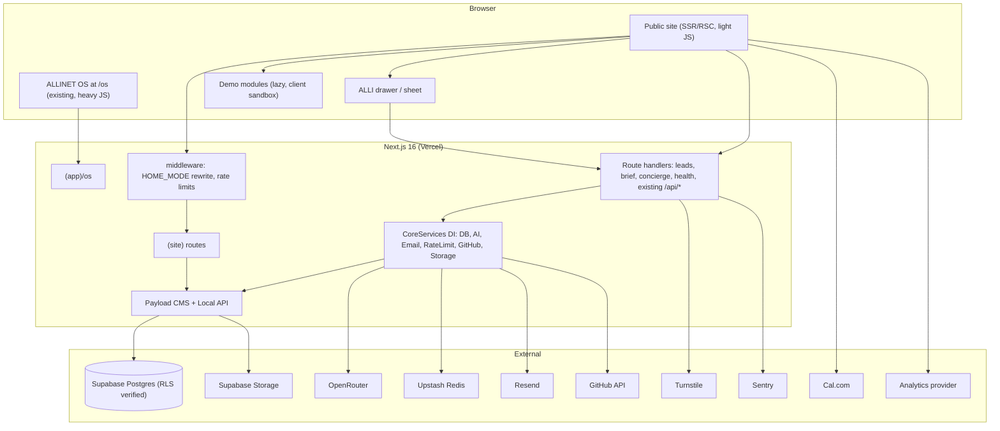
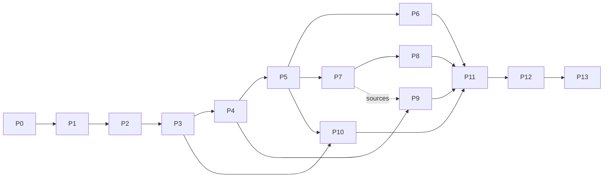

# MASTER PORTFOLIO IMPLEMENTATION PLAN
**Project:** ALLINET OS (existing portfolio) + Allinet Command Center (proposed features)
**Plan version:** 1.0 | **Date:** 2026-10-24 | **Owner:** Alli Akinkunmi
**Deliverable type:** PLAN ONLY. No source code was modified or written to produce this document.
**Intended executor:** Google Antigravity (or any AI coding agent) working one phase at a time.

> **How to use this with Antigravity:** do NOT paste the whole plan and say "build it." Give the agent Sections 11 (Agent Execution Protocol), 15, 16 plus **one phase at a time** from Section 11 and the matching specs from Section 12. Require the phase's "Completion evidence" before starting the next phase. Reconcile any disagreement in favor of this document's Section 7 decisions.

---

## 1. EXECUTIVE SUMMARY

### 1.1 What this plan does
FILE 1 is an audit of ALLINET OS: a Next.js 16 / React 19 / Payload CMS v3 "desktop operating system" portfolio (17 windowed apps, AION AI assistant, 16 collections + 3 globals on Supabase Postgres). FILE 2 proposes "Allinet: The Living Command Center": a conversion-focused, multi-route product-style site with role-based personalization, two live demo systems (Hall Booking, Laundry Operations), an AI concierge (ALLI), a brief/proposal generator, living-data pages, and a full accessibility/SEO/performance specification.

This plan merges them using one strategy: **Preserve, Wrap, Extend.**

1. **Preserve** ALLINET OS untouched in behavior (moved to `/os` only at a late, reversible, flag-controlled step).
2. **Wrap** it with a lightweight, server-rendered, indexable public site (`(site)` route group) that FILE 2 requires and the OS cannot provide (SEO, low-end-device performance, accessibility, deep links).
3. **Extend** the existing Payload schema, providers, rate limiter, email, GitHub, achievements, terminal, resume, and command-palette code instead of creating parallel systems.

### 1.2 Headline findings

| # | Finding | Impact | Resolution (Section) |
|---|---|---|---|
| 1 | **Architectural conflict.** FILE 2 demands real indexable routes, "not one giant canvas app," no heavy 3D, fast on low-end Android. FILE 1 is a single-route `/` canvas/OS with Three.js, boot sequence and 17 windows. | Cannot satisfy both literally at `/`. | D-01: hybrid, OS to `/os`, new site at `/` after gate G2 (S7, S8) |
| 2 | **Source-of-truth conflict.** FILE 2 specifies raw Supabase tables (`projects`, `leads`, `knowledge_items`...). The project's system of record is Payload CMS (which owns the Postgres schema). | Two schemas = drift, broken migrations, duplicate `projects`. | D-02: implement every FILE 2 table as Payload collections/fields; Supabase stays Postgres host + Storage (S9) |
| 3 | **Duplicate AI.** FILE 2's ALLI concierge overlaps the existing AION assistant. | Regression risk to AION; two prompts/two knowledge sources. | D-04: separate `/api/concierge` route, shared provider layer, AION untouched (S8, S12) |
| 4 | **Baseline is not green.** TypeScript error (DEF-01), CSP blocks Supabase images (DEF-02), lint hangs (DEF-03), zero tests, no CI. | Any new work lands on an unverified foundation. | Phases P0-P2 before any feature work |
| 5 | **Potentially severe unverified exposure.** Payload creates tables in Postgres `public` schema; the Supabase anon key is in `NEXT_PUBLIC_*`. If Supabase's Data API (PostgREST) exposes `public` and RLS is off, **users, contact submissions and soon leads/PII may be readable/writable with the public anon key.** The audit does not address this. | Critical if true; adding `leads` makes it worse. | P0 verification + P3 remediation (S10) |
| 6 | **Dev/prod database ambiguity.** Audit mentions one `DATABASE_URL`; Payload's Postgres adapter can auto-sync ("push") schema in dev. An agent running `next dev` against a production DB can alter or drop columns. | Data loss. | Hard stop in P0: separate dev/staging DB before any agent runs (S16) |
| 7 | **Audit reliability.** Denominator of "78%" does not add up (S2); "100% complete" claims conflict with listed gaps; "verified functional" has no stated method and no tests exist. | Baseline status cannot be trusted at face value. | Every status downgraded to "IMPLEMENTED BUT UNVERIFIED" until P0 evidence exists (S3-S4) |
| 8 | **Honesty rules vs existing content.** FILE 2 forbids fake metrics/clients/live data. Existing collections hold metrics JSON, testimonials, achievements. FILE 2's own examples (78%, v1.2) are placeholders. | Credibility risk for a site whose pitch is honesty. | Content truth audit in P0/P4; CMS-driven values only |
| 9 | **Standards conflicts in FILE 2.** `SPACE` as palette key and single-key shortcuts violate WCAG 2.1.4 and collide with inputs/terminal; schema.org has no `CaseStudy` type; "Vercel free tier" is restricted to non-commercial use (verify current terms); Supabase free projects pause when inactive (verify). | Accessibility failure, invalid SEO markup, hosting/ToS and uptime risk for a lead-gen site. | D-05, D-07, D-08 (S7) |
| 10 | **Scope.** FILE 2 adds two SaaS-grade demos + AI + brief generator + living layer on top of an unfinished baseline. FILE 2's own estimates are greenfield. | Classic "start everything, finish nothing" risk. | Ship gates G1-G4 and stop-lines (1.4) |

### 1.3 Overall verdict
Feasible **without rebuilding**. Nothing in FILE 2 requires replacing Next.js, Payload, Supabase, OpenRouter, Upstash, or Resend. Net-new dependencies are small and justified (S13): Playwright + Vitest (testing, already planned in FILE 1), Sentry, Cloudflare Turnstile, `@react-pdf/renderer` (unless the existing resume PDF path already covers it), `qrcode` (laundry demo), RHF (+ `@hookform/resolvers`) for forms, and one analytics provider (decision D-06).

### 1.4 Ship gates (scope governance)
Scope discipline is the main delivery risk. Each gate is shippable and stops scope growth until met.

| Gate | Name | Contains | You may flip `/` to the new site? |
|---|---|---|---|
| **G0** | Green baseline | P0-P2: blockers fixed, tests + CI + error boundaries, recovery points | No |
| **G1** | Credible & contactable | P3-P5: security hardening, data model, public shell, role picker, CV, contact/lead capture, SEO baseline, privacy page | No (nothing to demo yet) |
| **G2** | First proof | P6-P7: living layer + Hall Booking demo + its mission file | **Yes. Recommended flip point** |
| **G3** | Breadth + automation | P8-P10: Laundry demo, ALLI concierge, brief generator | n/a |
| **G4** | Polish | P11-P13: palette/shortcuts/map, 3D accent, full regression, perf/a11y, release | n/a |

**Stop-line rule:** no work from a later gate starts until the current gate's Definition of Done (S20) is evidenced. Optional/conditional items (S5 type `C`/`O`) never block a gate.

**Effort (estimate, calibrate after P5):** FILE 2 estimates ~6-9 weeks for its seven phases assuming greenfield and full-time. Adding baseline hardening (P0-P3) and verification, plan on roughly **3-4 months part-time** end-to-end; G2 is realistically the first public milestone (~6-8 weeks part-time).

### 1.5 Next 3 actions (human, before running the agent)
1. **Answer the blocking decisions** in S7 (D-01, D-02, D-03, D-04, D-07, D-08) and the open questions in S21 (Q-01 to Q-08).
2. **Confirm environments:** is `DATABASE_URL` in `.env.local` a production database? Create a separate dev/staging Supabase project (or local Postgres) before any agent session.
3. **Run Phase P0 only** (read-only verification + recovery point). Review its `BASELINE_REPORT.md` before approving P1.

---

## 2. DOCUMENTS ANALYZED AND EVIDENCE LIMITATIONS

### 2.1 Documents

| Doc | Content | Coverage |
|---|---|---|
| FILE 1 `File 1.txt` | "Comprehensive Full-Stack Application Audit Report" (23 sections), dated 2026-10-24, workspace `c:\Projects\Ajibade-Alli-Akinkunmi\Allinet-Portfolio` | Read in full |
| FILE 2 `File 2.txt` | Allinet Command Center build blueprint (20 sections) | Read in full |
| Instruction prompt | Required analysis phases, 21-section output structure, non-negotiable rules | Followed |

### 2.2 Limitations & Ground-Truth Verification Status

| ID | Initial Limitation | Verified Reality from Repository Inspection |
|---|---|---|
| L-01 | **Repository access** | **RESOLVED & VERIFIED**: Workspace inspected directly at `c:\Projects\Ajibade-Alli-Akinkunmi\Allinet-Portfolio`. All application source files, components, providers, stores, API routes, and configs examined. |
| L-02 | **Access to docs and audit files** | **RESOLVED & VERIFIED**: Inspected all 12 SRS documents in `docs/` (`01_VISION_PRD.md` through `11-15_SECURITY_...`), as well as `ARCHITECTURE.md`, `IMPLEMENTED_FEATURES.md`, `REMAINING_WORK.md`, `TESTING_STATUS.md`, and `AUDIT_FILE_COVERAGE.md`. |
| L-03 | **Database schema & config** | **RESOLVED & VERIFIED**: Schema is managed in code via Payload CMS v3 (`payload.config.ts`) using `@payloadcms/db-postgres` targeting `DATABASE_URL` in `.env.local`. 16 collections and 3 globals fully defined. |
| L-04 | **Runtime diagnostic evidence** | **RESOLVED & VERIFIED**: Executed `npx tsc --noEmit` and identified exact compilation error `src/apps/AboutApp.tsx(157,38): error TS2345: Argument of type 'string' is not assignable to parameter of type 'AppId'`. Executed ESLint and verified execution stall under Windows flat config. |

### 2.3 Internal inconsistencies found in FILE 1 (treat the audit as evidence, not truth)

| ID | Inconsistency | Handling | Verified Codebase Status |
|---|---|---|---|
| I-1 | "78%" is computed over "50 tracked requirements," but the listed components sum to 64 (10 + 17 + 10 + 19 + 5 + 3). | Do not publish or reuse 78%. Recompute in P0. | Recomputed against atomic requirement inventory in Section 5. |
| I-2 | Section 23 says "100%" complete for shell/apps; Section 19 lists open items (window persistence M-01, GLTF loader M-06) and `AboutApp` is defective (M-08). | Use per-item statuses only. | Statuses tracked individually per app. `AboutApp` has 1 type defect. |
| I-3 | `portfolio-data.ts` is at `src/lib/` (S3) and `src/lib/ai/` (S6, S13). | P0: locate canonical file. | **VERIFIED**: Canonical file is `apps/web/src/lib/ai/portfolio-data.ts`. |
| I-4 | CSP defect text names Cloudinary/GitHub as allowed hosts, while the architecture says media is on Supabase Storage. Actual media host of record is unclear. | P0: inventory every image/media host actually used; fix CSP from evidence. | **VERIFIED**: `next.config.ts:19` whitelists Cloudinary and GitHub avatars, but omits `https://*.supabase.co`, blocking Supabase Storage media. |
| I-5 | "Verified functional" appears throughout S9 with no method. | Re-verify via P2 smoke tests. | All features capped at IMPL-UNV until automated tests are created in P2. |
| I-6 | `/api/ai/memory` access "Public / Admin"; `/api/email` "Admin / Internal"; `/api/ai/bust-cache` unspecified. Auth enforcement is not described. | Security-critical: P0 verify, P3 fix (S10). | **CRITICAL FINDING**: `/api/email` has ZERO authentication and no rate limit (open relay if Resend key present). `/api/ai/memory` POST has ZERO authentication. `/api/ai/bust-cache` enforces `PAYLOAD_SECRET`. |
| I-7 | Analytics: route says "Vercel Analytics" proxy; `site-settings` has GA ID and PostHog key fields. Real mechanism unknown. | P0 inspect; D-06. | **VERIFIED**: `/api/analytics` validates with Zod and forwards to `VercelAnalyticsProvider`. `site-settings` stores optional GA/PostHog keys. |
| I-8 | Package labels are ambiguous ("OpenAI 4.0.18", "Vercel AI SDK 7.0.35"). | P0: read `package.json`/lockfile; use actual versions. | **VERIFIED**: `package.json` specifies `"ai": "7.0.35"`, `"@ai-sdk/openai": "4.0.18"`, `"openai": "^6.48.0"`. |
| I-9 | Several runtime "verified" items were produced while `tsc` fails and `next build` is blocked (dev server only). | Production build behavior is unproven. | Confirmed. `next build` is currently blocked by DEF-01. |

### 2.4 Ambiguities and gaps in FILE 2

| ID | Gap | Planner assumption (to confirm in S21) |
|---|---|---|
| G-01 | "Demo Mode" header icon is never defined. | Toggle that opens the demo library with the guided walkthrough enabled and a persistent "DEMO DATA" banner. |
| G-02 | "Quick actions (SHIFT+Enter)" undefined. | Contextual quick-action list inside the command palette. |
| G-03 | "Mission Map" (M key) vs "Map-style module navigator" component. | Same thing: a visual site/module navigator overlay. |
| G-04 | "Just exploring" role has no route or content spec beyond "guided tour." | Add guided tour (F-331) on home; no separate route. |
| G-05 | `profiles` table (visitor accounts) has no feature that uses it. | Superseded (D-12). |
| G-06 | Case studies 4-6 are explicitly conditional ("if you build it"). | Conditional (type C); not gates. |
| G-07 | `/privacy` is required by the launch checklist but absent from the route table. | Added as F-030. |
| G-08 | Example values (78%, v1.2, "2 project slots") are placeholders. | Must be CMS-driven and true at publish time. |
| G-09 | "CaseStudy" structured data: not a schema.org type. | Use `Article`/`CreativeWork` (+ `SoftwareApplication` for demos). |
| G-10 | WhatsApp/Cal.com/GitHub/LinkedIn/email URLs, photo, CV content not provided. | Blockers for specific items only (S21). |

---

## 3. EXISTING PROJECT BASELINE (Verified against Codebase)

### 3.1 Stack (Verified in `apps/web/package.json`)

| Layer | Technology | Actual Version | Verification Evidence |
|---|---|---|---|
| Framework | Next.js App Router | `16.2.10` | `apps/web/package.json` |
| UI | React / React-DOM | `19.2.4` | `apps/web/package.json` |
| Language | TypeScript | `^5` | `apps/web/package.json` (`tsconfig.json`) |
| Styling | Tailwind CSS (PostCSS) | `@tailwindcss/postcss ^4`, `tailwindcss ^4` | `apps/web/package.json` |
| Motion | Framer Motion / GSAP | `12.42.2` / `3.15.0` | `apps/web/package.json` |
| 3D | Three.js / R3F / Drei / Postprocessing | `0.185.1` / `9.6.1` / `10.7.7` / `3.0.4` | `apps/web/package.json` |
| CMS | Payload CMS v3 + PostgreSQL Adapter | `3.86.0` | `apps/web/payload.config.ts` |
| Database | PostgreSQL | Hosted on Supabase | `DATABASE_URL` in `.env.local` |
| State | Zustand | `5.0.14` | `src/store/os.store.ts`, `achievements.store.ts` |
| AI | Vercel AI SDK + OpenRouter / OpenAI | `ai 7.0.35`, `@ai-sdk/openai 4.0.18`, `openai ^6.48.0` | `apps/web/package.json` |
| Rate limit | Upstash Redis REST (+ memory fallback) | Custom fetch client | `src/lib/rate-limit.ts` |
| Email | Resend | `^6.17.2` | `apps/web/package.json` (key missing in `.env.local`) |
| Validation | Zod | `^4.4.3` | `src/lib/validation.ts` |
| Tests / CI | None | None | 0 test files in repository |

### 3.2 Architecture summary
- **Frontend:** Single public route `/` (`src/app/(app)/page.tsx`) rendering the OS shell: `WindowManager`, `Dock`, `Taskbar`, `Desktop`/`DesktopIcon`, `CommandPalette`, `BootSequence`, `ThreeBackground`; 17 apps in `src/apps/` registered via `src/core/registry/AppRegistry.ts`; client stores in `src/store/`.
- **Backend:** Next route handlers under `src/app/api/*` (`ai/chat`, `ai/memory`, `ai/bust-cache`, `analytics`, `cms/revalidate`, `contact`, `email`, `github`, `og`) plus Payload REST/GraphQL under `(payload)/api`; `/admin` Payload admin.
- **DI container:** `CoreServices` (`src/core/providers/index.ts`) with Live/Mock providers (portfolio, AI, DB, storage, email, rate limit, GitHub) and graceful mock fallback.
- **Middleware:** `src/core/api/middleware.ts` (rate limiting, standard responses).
- **Data:** 16 Payload collections (`users`, `projects`, `project-categories`, `technologies`, `experiences`, `education`, `certificates`, `blog-posts`, `testimonials`, `achievements`, `worlds`, `desktop-apps`, `media`, `contact-submissions`, `ai-memories`, `ai-conversations`) and 3 globals (`portfolio-owner`, `site-settings`, `ai-settings`).
- **Security controls:** Zod validation, honeypot, Upstash rate limit, secret header on revalidate, IP hashes on submissions.
- **Identified Defects:**
  - DEF-01: TypeScript compilation error in `AboutApp.tsx:157` (`TS2345: Argument of type 'string' is not assignable to 'AppId'`).
  - DEF-02: CSP header in `next.config.ts:13-24` omits `https://*.supabase.co`.
  - DEF-03: ESLint stalls on Windows under flat config.
  - DEF-04: `LuxuryImageModal.tsx` untracked in Git.
  - DEF-05: Missing `RESEND_API_KEY` in `.env.local`.
  - DEF-06: `/api/email` is an open unauthenticated relay.
  - DEF-07: `/api/ai/memory` has an unauthenticated POST endpoint.
  - DEF-08: `ResumeApp.tsx` links to missing `/resume.pdf` (dead 404).

### 3.3 Resolved Baseline Facts (Replaced P0 Unknowns)
1. **`package.json` & dependencies**: Confirmed Next.js 16.2.10, React 19.2.4, TypeScript 5, Payload 3.86.0.
2. **Git status**: Branch `main`, commit `5d300c3`, 16 modified files, 1 untracked file (`LuxuryImageModal.tsx`).
3. **Canonical `portfolio-data.ts`**: Located at `apps/web/src/lib/ai/portfolio-data.ts`.
4. **Endpoint Authentication**:
   - `/api/email`: Open relay — no auth, no rate limiting. Must be locked down in Phase 1 / 3.
   - `/api/ai/memory`: GET and POST have no auth.
   - `/api/ai/bust-cache`: Verified protected by `PAYLOAD_SECRET`.
   - `/api/og`: Verified rate-limited to 30 req/min.
5. **Resume PDF**: `ResumeApp.tsx:46` links to `/resume.pdf`, which does not exist in `public/` (404).
6. **`AppId` union**: Defined in `src/types/os.types.ts` as a 16-member string literal union. `AboutApp.tsx` lacked type annotation.
7. **Database Target**: `DATABASE_URL` in `.env.local` targets a live Supabase PostgreSQL instance. Must verify environment separation before destructive commands.

---

## 4. COMPLETE EXISTING FEATURE INVENTORY

**Status key:** IMPL-UNV = Implemented but unverified (audit claims working; no test evidence) | PARTIAL | NOT-IMPL | BROKEN | UNKNOWN. All "verified" claims in FILE 1 are mapped to IMPL-UNV (L-01).

| ID | Feature | Status | Evidence (FILE 1) | Verification required |
|---|---|---|---|---|
| E-01 | Desktop grid, icons, context menu | IMPL-UNV | S4.1 `Desktop.tsx`, `DesktopIcon.tsx` | Playwright smoke |
| E-02 | Window manager (drag/min/max/z-index/resize) | IMPL-UNV | `WindowManager.tsx`; M-01 notes position persistence missing | Smoke + manual |
| E-03 | Dock with magnification | IMPL-UNV | `Dock.tsx` | Smoke |
| E-04 | Taskbar (clock, theme menu, audio, palette trigger) | IMPL-UNV | `Taskbar.tsx` | Smoke |
| E-05 | Command palette (`Cmd/Ctrl+K`) | IMPL-UNV | `CommandPalette.tsx` | Smoke |
| E-06 | Boot sequence | IMPL-UNV | `BootSequence.tsx` | Smoke; skip path |
| E-07 | Three.js background | IMPL-UNV / PARTIAL | `ThreeBackground.tsx`; no GLTF loader | Perf profile |
| E-08 | AION chat (SSE, presets, tool badges) | IMPL-UNV | `AIApp.tsx`, `chat/route.ts`; failover incomplete | Contract + manual |
| E-09 | AION semantic memory | PARTIAL | `ai-memories`, `/api/ai/memory`; no vectors | Access audit |
| E-10 | Projects app | IMPL-UNV | `ProjectsApp.tsx` | Smoke |
| E-11 | Skills app | IMPL-UNV | `SkillsApp.tsx` | Smoke |
| E-12 | Terminal app (12+ commands) | IMPL-UNV | `TerminalApp.tsx` | Command tests |
| E-13 | Resume app + PDF download | IMPL-UNV | `ResumeApp.tsx` | Inspect PDF mechanism |
| E-14 | Contact app + `/api/contact` | IMPL-UNV | Zod, honeypot, rate limit; mock email | Live email once key set |
| E-15 | Settings app (5 themes, audio, 3D toggle, scaling) | IMPL-UNV | `SettingsApp.tsx` | Smoke |
| E-16 | Achievements app + store | IMPL-UNV | `AchievementsApp.tsx`, `achievements.store.ts` | Store unit tests |
| E-17 | GitHub app + `/api/github` | IMPL-UNV | `GitHubApp.tsx`, `HybridGitHubProvider` | Contract test |
| E-18 | Music app | IMPL-UNV | `MusicApp.tsx` | Manual |
| E-19 | About app | **BROKEN** | `AboutApp.tsx:157` TS2345 | Fix in P1 |
| E-20 | Blog / Certificates / Education / Testimonials / Timeline / FileExplorer apps | IMPL-UNV | S4.2 | Smoke (open each) |
| E-21 | Payload admin + 16 collections / 3 globals | IMPL-UNV | `payload.config.ts` | Admin CRUD smoke |
| E-22 | CMS revalidate webhook | IMPL-UNV | `/api/cms/revalidate` | Contract test |
| E-23 | OG image route | IMPL-UNV | `/api/og` | Param abuse review |
| E-24 | Rate limiter (Upstash + memory fallback) | IMPL-UNV | `rate-limit.ts` | Production Redis check |
| E-25 | `CoreServices` DI with mock fallbacks | IMPL-UNV | `src/core/providers` | Unit tests |
| E-26 | CSP headers | **BROKEN** | `next.config.ts:13-24` | P1 |
| E-27 | Automated tests | NOT-IMPL | audit S15 | P2 |
| E-28 | CI/CD | NOT-IMPL | audit S6 | P2 |
| E-29 | DB seed script | NOT-IMPL | audit S6 | P4 |
| E-30 | Lint pipeline | BROKEN | DEF-03 | P1 |
| E-31 | Per-window error boundaries | NOT-IMPL (partial claim) | audit S5.3 | P2 |
| E-32 | PWA / offline | NOT-IMPL | audit S6 | Out of scope (D-14) |
| E-33 | Error monitoring (Sentry), analytics events | UNKNOWN / NOT-IMPL | I-7 | P0 inspect |
| E-34 | Auth/RBAC (Payload users) | IMPL-UNV | `users` collection | Access-control tests (P3) |
| E-35 | Media storage (Supabase Storage) | PARTIAL | CSP blocks; I-4 | P1 |

---

## 5. COMPLETE PROPOSED FEATURE INVENTORY

**Type key:** `M` mandatory | `O` optional improvement | `C` conditional on external factor | `A` added by planner (required to make FILE 2 coherent). "Src" = FILE 2 section. Features are split to atomic IDs; each is traced through S6, S12, S14, S19.

### 5.1 Brand and positioning
| ID | Requirement | Src | Type |
|---|---|---|---|
| F-001 | Brand "Allinet", tagline "Operating systems for real businesses.", hero promise "This is not a portfolio. It is a working command center." | 1 | M |
| F-002 | Positioning as "Product engineer and systems builder for operations-heavy businesses"; do not self-describe only as "web developer" | 1 | M |
| F-003 | Three claims communicated immediately (practical systems; testable work; site demonstrates product thinking) | 1 | M |
| F-004 | Honesty rule: no fake metrics, clients, revenue, dates, capabilities, or live data anywhere (cross-cutting) | 3,9,17,19 | M |

### 5.2 Routes
| ID | Route | Src | Type |
|---|---|---|---|
| F-010 | `/` Command Center home | 2,3 | M |
| F-011 | `/recruiter` | 2 | M |
| F-012 | `/client` | 2 | M |
| F-013 | `/founder` | 2 | M |
| F-014 | `/projects` index | 2 | M |
| F-015 | `/projects/[slug]` case study | 2 | M |
| F-016 | `/demos` library | 2 | M |
| F-017 | `/demos/hall-booking` | 2,5 | M |
| F-018 | `/demos/laundry` | 2,5 | M |
| F-019 | `/services` | 2 | M |
| F-020 | `/process` | 2 | M |
| F-021 | `/results` | 2 | M (gated by honesty) |
| F-022 | `/brief` | 2,8 | M |
| F-023 | `/now` | 2,9 | M |
| F-024 | `/changelog` | 2,9 | M |
| F-025 | `/contact` | 2 | M |
| F-026 | `/cv` | 2 | M |
| F-027 | `/terminal` hidden console | 2 | O |
| F-028 | `/concierge` | 4 | M |
| F-029 | Principle: real, indexable HTML routes (SSR/SSG), not one canvas app | 2 | M |
| F-030 | `/privacy` notice (lead/chat/analytics data) | 17 | A |

### 5.3 Homepage
| ID | Requirement | Src | Type |
|---|---|---|---|
| F-040 | Command header: logo, `SYSTEM ONLINE` pill, availability text, CTAs (Start a project, Book 15-min call), icons (ALLI, Demo Mode, Fast Mode, GitHub, LinkedIn, WhatsApp) | 3.1 | M |
| F-041 | Mobile header collapse: `ALLINET / Status / Menu / Book` | 3.1 | M |
| F-042 | Role picker (Recruiter, Client, Founder, Just exploring) with "mission profile" panel | 3.2 | M |
| F-043 | Persist role in `localStorage`; reorder modules, change headline/CTAs/featured case studies/ALLI suggestions | 3.2 | M |
| F-044 | Role-specific headline copy (recruiter and client examples given; founder/explorer to be written) | 3.2 | M |
| F-045 | Live status board (now building, progress, latest deploy, GitHub activity, demo health, learning, availability) | 3.3 | M |
| F-046 | Status honesty: real values or honest states ("Building privately", "Next public release pending") | 3.3 | M |
| F-047 | Core proof cards (Hall, Laundry, ALLI) with Open demo / View mission file / Generate brief | 3.4 | M |
| F-048 | "Typical portfolio vs Allinet" comparison block | 3.5 | M |
| F-049 | Featured mission files grid (3-6) with problem, honest proof point, stack badges, CTA | 3.6 | M |
| F-050 | Services preview (3-4 offers) each with "Generate project brief" | 3.7 | M |
| F-051 | Process section (Diagnose, Design, Build, Operate) + 15-min call CTA | 3.8 | M |
| F-052 | Final conversion console (Cal.com, WhatsApp, email, CV, brief, ALLI) | 3.9 | M |
| F-331 | Guided tour for "Just exploring" role | 3.2 | M (A) |
| F-332 | "Demo Mode" control (definition assumed, G-01) | 3.1 | C |

### 5.4 ALLI concierge
| ID | Requirement | Src | Type |
|---|---|---|---|
| F-060 | Floating "Ask ALLI" button; desktop side drawer; mobile bottom sheet | 4 | M |
| F-061 | Controlled knowledge base: projects, skills, services, pricing policy, availability, stack, case studies, demo capabilities, FAQs, contact options | 4 | M |
| F-062 | Answers only from structured data; never invent clients/revenue/metrics/dates/capabilities; unknown fallback text | 4 | M |
| F-063 | Every answer carries source links (case study, demo, service, CV section) | 4 | M |
| F-064 | Next-action offer after every answer (demo, case study, brief, call, WhatsApp) | 4 | M |
| F-065 | Lead qualification: at most 5 questions (business/role, problem, needs, timeline, budget) | 4 | M |
| F-066 | Routing table from qualification responses to demo/brief/CV/product page/Cal.com/brief builder | 4 | M |
| F-067 | Retrieval-first pipeline: keywords/tags first, embeddings optional later; model gets only retrieved context | 13 | M |
| F-068 | Low retrieval confidence escalates to lead capture | 13 | M |
| F-069 | Role-aware suggested questions | 3.2 | M |
| F-070 | Must handle the nine example questions in S4 of FILE 2 | 4 | M |
| F-071 | Name "ALLI: Allinet Operations Concierge" | 4 | M |
| F-072 | Persist concierge sessions (transcript, lead link) | 4,14 | M |

### 5.5 Demos (common)
| ID | Requirement | Src | Type |
|---|---|---|---|
| F-090 | Exactly two demos at launch (scope cap) | 5 | M |
| F-091 | Visible "Reset demo" + session reset on each demo | 5 | M |
| F-092 | Synthetic data labelled `DEMO DATA` | 5 | M |
| F-093 | No real customer data; no real payment processing | 5 | M |
| F-094 | Guided walkthrough for first-time users | 5 | M |
| F-095 | Each demo completable in under 60 seconds | 5 | M |
| F-096 | Admin dashboards impressive but not overloaded | 5 | M |
| F-097 | Demos lazy-loaded and optional (not mandatory to load site) | 12 | M |

### 5.6 Hall and Event Booking Command Center
| ID | Requirement | Side | Type |
|---|---|---|---|
| F-100 | Browse halls/spaces | Visitor | M |
| F-101 | Real-time-style availability calendar | Visitor | M |
| F-102 | Select date, time, duration, add-ons | Visitor | M |
| F-103 | Live price calculation | Visitor | M |
| F-104 | Promo/discount code | Visitor | M |
| F-105 | Pay deposit or simulate payment | Visitor | M |
| F-106 | Booking confirmation | Visitor | M |
| F-107 | Booking history | Visitor | M |
| F-108 | Cancel or reschedule | Visitor | M |
| F-109 | Submit appeal if penalized | Visitor | M |
| F-110 | Review after completed event | Visitor | M |
| F-111 | Admin dashboard (revenue, occupancy, upcoming, pending approvals) | Admin | M |
| F-112 | Hall management (create/edit; capacity, amenities, images, pricing) | Admin | M |
| F-113 | Availability calendar with buffer times | Admin | M |
| F-114 | Approve / reject / cancel bookings | Admin | M |
| F-115 | Double-booking prevention | Admin/engine | M |
| F-116 | Deposits, balances, refunds | Admin | M |
| F-117 | Discounts, promo codes, loyalty tiers | Admin | M |
| F-118 | No-show penalties | Admin | M |
| F-119 | Sanctions and booking bans | Admin | M |
| F-120 | Appeal review and forgiveness | Admin | M |
| F-121 | Damage/deposit inspection records | Admin | M |
| F-122 | Customer CRM and booking history | Admin | M |
| F-123 | Staff roles and permissions | Admin | M |
| F-124 | Notifications: email, in-app, optional WhatsApp/SMS | Admin | M (email/in-app simulated); O (WhatsApp/SMS) |
| F-125 | Reports: revenue, occupancy, cancellations, no-shows, top customers | Admin | M |
| F-126 | Export bookings and financial reports | Admin | M |
| F-127 | Demo challenge "Book, discount, no-show penalty, resolve appeal in under 60 seconds" + badge **Operations Controller** | Both | M |

### 5.7 Laundry Operations Command Center
| ID | Requirement | Side | Type |
|---|---|---|---|
| F-130 | Create pickup request | Customer | M |
| F-131 | Select services (wash, dry cleaning, ironing, folding, repairs) | Customer | M |
| F-132 | Add items and quantities | Customer | M |
| F-133 | Choose pickup/delivery time | Customer | M |
| F-134 | Track order status | Customer | M |
| F-135 | QR/barcode item tracking view | Customer | M |
| F-136 | Status updates (notifications) | Customer | M (simulated feed) |
| F-137 | Report lost/damaged item | Customer | M |
| F-138 | Promo code or loyalty reward | Customer | M |
| F-139 | Pay online or simulate payment | Customer | M (simulated) |
| F-140 | Reorder previous services | Customer | M |
| F-141 | Admin dashboard (orders, revenue, pending pickups, deliveries, turnaround) | Admin | M |
| F-142 | Customer records | Admin | M |
| F-143 | Pickup scheduling | Admin | M |
| F-144 | Driver/delivery assignment | Admin | M |
| F-145 | QR/barcode generation and scanning (simulated scan) | Admin | M |
| F-146 | Item-level states: received, washing, drying, folding, ready, delivered | Admin | M |
| F-147 | Lost/damaged claims handling | Admin | M |
| F-148 | Refunds, credits, compensation | Admin | M |
| F-149 | Rush orders and priority queue | Admin | M |
| F-150 | Subscription/recurring orders | Admin | M (simulated schedule) |
| F-151 | Staff shifts and task assignment | Admin | M (lightweight) |
| F-152 | Inventory (detergent, packaging, hangers) | Admin | M (lightweight) |
| F-153 | Notifications and delivery updates | Admin | M (simulated) |
| F-154 | Reports: revenue, volume, turnaround, complaints, top services | Admin | M |
| F-155 | Multi-branch support | Admin | M (branch scoping only) |
| F-156 | Demo challenge "Create pickup, scan into washing, mark ready, assign delivery, close order" + badge **Fleet Operator** | Both | M |

### 5.8 Mission Files (case studies)
| ID | Requirement | Src | Type |
|---|---|---|---|
| F-160 | Case study template (Business type, Problem, What I built, Live proof, Measured/Expected result, Stack, Security & data, Next, CTA) | 6 | M |
| F-161 | Readable in 60 seconds; human + SEO structure | 6 | M |
| F-162 | Publish gate: demo + screenshots + architecture explanation + honest result statement required | 6 | M |
| F-163 | Mission File: Hall & Event Booking Command Center | 6 | M |
| F-164 | Mission File: Laundry Operations Command Center | 6 | M |
| F-165 | Mission File: Allinet Portfolio Command Center (this site) | 6 | M |
| F-166 | Mission File: AI Business Validation Assistant ("if you build it") | 6 | C |
| F-167 | Mission File: Cybersecurity Lab / Security Notes System ("if you want") | 6 | C |
| F-168 | Mission File: Automation Workflow System (WhatsApp, forms, spreadsheets, notifications, reporting) | 6 | C |
| F-169 | Structured data for case studies | 12 | M |

### 5.9 Services, brief, living data
| ID | Requirement | Src | Type |
|---|---|---|---|
| F-170 | Five outcome-based offers (Management System, Operations Automation, AI Concierge/Assistant, Website + Lead System, Product Prototype) | 7 | M |
| F-171 | Pricing policy: no fixed prices initially; scope-call language | 7 | M |
| F-172 | Per-offer "Generate project brief" CTA | 3.7 | M |
| F-173 | Transparent three-tier pricing "later" | 7 | C (deferred) |
| F-180 | Brief flow (type, problem, modules, tools/pain, timeline/budget, contact; generate one-page proposal) | 8 | M |
| F-181 | Brief fields (org type, name, role, problem, current tools, 10 module options, locations/users, timeline, budget, contact) | 8 | M |
| F-182 | Consent checkbox for storing details | 8 | M |
| F-183 | Proposal contents (name, summary, modules, roles, workflow, phase 1/2, assumptions, timeline estimate, exclusions, next step) | 8 | M |
| F-184 | PDF download | 8 | M |
| F-185 | Send to WhatsApp/email | 8 | M |
| F-186 | Book call from proposal | 8 | M |
| F-187 | Save lead + brief in database | 8 | M |
| F-188 | No binding contract or auto fixed price | 8 | M |
| F-200 | `/now` content (project, progress, milestone, commit/deploy, GitHub, learning, experiment, availability, next release, wins) | 9 | M |
| F-201 | `/changelog` with versioned entries | 9 | M |
| F-202 | System health statuses with timestamp, honest "Maintenance" | 9 | M |
| F-203 | Availability / open project slots | 3.3,9 | M |
| F-204 | Honest GitHub activity ("Building privately") | 3.3,17 | M |
| F-205 | Update cadence: visibly updated weekly/biweekly | 18 | O (process) |

### 5.10 Navigation, visual, accessibility, performance, SEO
| ID | Requirement | Src | Type |
|---|---|---|---|
| F-210 | Desktop shortcuts: 1-5, C, M, R, ?, ESC, SPACE, SHIFT+Enter, F | 10 | M (modified by D-05) |
| F-211 | Command palette (`SPACE` or `Ctrl/Cmd+K`) with listed commands | 10 | M |
| F-212 | Mobile bottom tab bar (Home, Demos, Projects, ALLI, Contact) | 10 | M |
| F-213 | Mobile floating "Book a call" | 10 | M |
| F-214 | Mission Map module navigator | 10,11 | M |
| F-215 | Quick actions (Shift+Enter) | 10 | C (G-02) |
| F-216 | Fast Mode toggle | 3.1,10,11 | M |
| F-220 | Design direction: calm ops-room / SaaS dashboard | 11 | M |
| F-221 | Color token system (given hex values) | 11 | M |
| F-222 | Typography (Space Grotesk/Inter/Satoshi headings; Inter body; JetBrains/IBM Plex Mono code) | 11 | M |
| F-223 | UI components: status pills, mission cards, terminal panels, progress rings, data tables, timelines, metric counters, module navigator, glass panels, subtle grid | 11 | M |
| F-224 | Motion rules (one major animation at a time; no autoplay 3D/parallax) | 11 | M |
| F-225 | Reduced Motion + `prefers-reduced-motion` + usable with animations disabled | 11,12 | M |
| F-226 | Very subtle scanline/grid background | 11 | O |
| F-227 | Subtle 3D/network visual (Phase 7 only, never blocks first load) | 12,18 | O |
| F-228 | Micro-interactions | 18 | O |
| F-230 | Semantic landmarks | 12 | M |
| F-231 | Heading hierarchy | 12 | M |
| F-232 | Keyboard-navigable menus, demos, modals, chat | 12 | M |
| F-233 | Visible focus states | 12 | M |
| F-234 | Alt text for meaningful images | 12 | M |
| F-235 | ARIA labels for interactive controls | 12 | M |
| F-236 | WCAG AA contrast | 12 | M |
| F-237 | No information by color alone | 12 | M |
| F-238 | Screen-reader-friendly case studies and CV | 12 | M |
| F-239 | Captions for demo videos | 12 | C (only if videos exist) |
| F-240 | Next App Router; server components where possible | 12 | M |
| F-241 | Lazy-load demos, charts, non-critical scripts | 12 | M |
| F-242 | Image compression/modern formats | 12 | M |
| F-243 | No heavy WebGL on first load | 12 | M |
| F-244 | SVG/CSS visuals first | 12 | M |
| F-245 | Test on low-end Android and slow 3G/4G | 12 | M |
| F-246 | Fast LCP, no layout shift (targets in S10) | 12 | M |
| F-247 | Demos optional to load | 12 | M (same as F-097) |
| F-248 | Unique title/meta per page | 12 | M |
| F-249 | Structured data (Person, WebSite, Service, case-study equivalent) | 12 | M |
| F-250 | Sitemap + robots | 12 | M |
| F-251 | Open Graph images | 12 | M |
| F-252 | Clean URLs | 12 | M |
| F-253 | Internal links between demos, case studies, services, brief | 12 | M |

### 5.11 Stack, data, tracking, content, governance
| ID | Requirement | Src | Type |
|---|---|---|---|
| F-260 | Cal.com booking | 13 | M (needs link, Q-03) |
| F-261 | Analytics (Vercel Analytics or Plausible) | 13 | M (D-06) |
| F-262 | React Hook Form + Zod forms | 13 | M |
| F-263 | PDF generation (React PDF / server-side) | 13 | M |
| F-264 | Email via Resend (or Supabase edge function) | 13 | M |
| F-265 | Sentry error monitoring | 13 | M |
| F-266 | OpenRouter with constrained retrieval | 13 | M |
| F-267 | GitHub data | 13 | M (reuse) |
| F-268 | Supabase database/auth | 13 | M (Payload-mediated, D-02) |
| F-269 | Vercel hosting | 13 | M (D-07) |
| F-270 | Framer Motion (GSAP only if needed) | 13 | M |
| F-271 | WhatsApp click-to-chat links | 3.9 | M (needs number, Q-03) |
| F-280 | Table `profiles` | 14 | C (superseded, D-12) |
| F-281 | Table `projects` (slug, title, business_type, problem, solution, result, stack, demo_url, repo_url, status, featured) | 14 | M (extend existing collection) |
| F-282 | Table `demos` (slug, title, description, demo_url, status, reset_enabled, challenge_name) | 14 | M |
| F-283 | Table `leads` | 4,14 | M |
| F-284 | Table `briefs` | 14 | M |
| F-285 | Table `concierge_sessions` | 14 | M (extend `ai-conversations`) |
| F-286 | Table `knowledge_items` | 4,14 | M |
| F-287 | Table `changelog` | 14 | M |
| F-290 | Conversion events (role selected, demo opened/completed, ALLI opened, questions, brief started/completed, proposal downloaded, CV downloaded, Cal click, WhatsApp click, contact submitted) | 15 | M |
| F-291 | Weekly review of conversion questions | 15 | O (process) |
| F-292 | Privacy notice explaining lead/chat data storage | 17 | M |
| F-300 | One-paragraph bio | 16 | M (content) |
| F-301 | Recruiter CV PDF + HTML | 16 | M |
| F-302 | Skills matrix | 16 | M |
| F-303 | Two polished case-study drafts | 16 | M |
| F-304 | Demo data and workflow scripts | 16 | M |
| F-305 | Service descriptions | 16 | M |
| F-306 | Pricing policy text | 16 | M |
| F-307 | AI knowledge base, 30-50 verified entries | 16 | M |
| F-308 | FAQ (pricing, timeline, process, maintenance, ownership, security, payment) | 16 | M |
| F-309 | Professional photo or clean logo | 16 | M |
| F-310 | GitHub, LinkedIn, WhatsApp, email, Cal.com links | 16 | M (blocker Q-03) |
| F-311 | Changelog entries | 16 | M |
| F-312 | Open Graph share image | 16 | M |
| F-320 | Launch checklist (24 items) as release gate | 17 | M |
| F-321 | FILE 2 build phases and their "definition of done" statements | 18 | M (mapped to P-phases) |
| F-322 | FILE 2 risk controls (scope, hallucination, cheap demos, heavy site, SEO, leads, overclaiming, maintenance, security) | 19 | M |


---

## 6. RECONCILIATION MATRIX

**Classes:** C1 implemented+verified, preserve | C2 implemented, verify first | C3 partial, extend | C4 not implemented, build | C5 conflict | C6 duplicate | C7 refactor/architectural prerequisite | C8 blocked by missing info/credentials | C9 defer.
**Row rule:** rows cover contiguous or listed ID sets with identical status. Any ID that differs is split into its own row. No ID in S5 is omitted. **Priority:** P0 = blocker/critical path, P1 = launch-critical, P2 = important, P3 = polish/optional.

| ID(s) | Proposed requirement | Current state | Evidence | Gap | Recommended action | Dependencies | Risk | Priority |
|---|---|---|---|---|---|---|---|---|
| F-001, F-002, F-003 | Brand, positioning, three claims | Existing identity "AlliNET Portfolio / ALLINET OS" | S1.1 FILE 1 | Naming/claims differ ("not a portfolio" vs existing portfolio identity) | C5: public site uses FILE 2 brand; OS keeps "ALLINET OS" as a labelled product feature ("Launch ALLINET OS") | D-10 | Low | P1 |
| F-004, F-046 | No fake metrics/clients/live data | Existing `projects.metrics`, `testimonials`, achievements content of unknown truth | S11 FILE 1 | No truth audit | C2: content truth audit; every public number carries source + "as of" or is removed | P0 content audit | High (credibility) | P0 |
| F-010 | `/` Command Center home | `/` is the OS | S8 FILE 1 | Route collision | C5+C7: OS to `/os`; `/` rewritten to OS until gate G2 flip (HOME_MODE flag) | D-01, P5 | High | P0 |
| F-029 | Real indexable routes | Single route + API routes | S8 | None of the content routes exist | C5: new `(site)` route group, own root layout | D-01 | Med | P0 |
| F-011, F-012, F-013 | Role pages | None | S8 | Build | C4: SSR pages fed by Payload globals/collections | F-042, P4 | Low | P1 |
| F-014, F-015 | Projects index + case study route | `ProjectsApp` + `projects` collection, no routes | S4.2, S11 | Routes, case-study fields, publish gate | C3: extend collection (additive fields); reuse data access layer | P4 | Med | P1 |
| F-016, F-017, F-018 | Demo routes | None | n/a | Build | C4: lazy client modules; shared pure-TS domain engines | D-03 | High (scope) | P1 |
| F-019, F-020 | Services, process | None | n/a | Build | C4: `services` collection + process content | P4 | Low | P1 |
| F-021 | `/results` | None; no verified outcomes known | n/a | Needs honest content | C9/C8: build page, `noindex` until at least one verified/clearly-labelled result exists | D-13 | Med | P2 |
| F-022 | `/brief` | None | n/a | Build | C4 | P3 email/Turnstile, P4 | Med | P1 |
| F-023, F-024 | `/now`, `/changelog` | None; `TimelineApp` is career timeline (different) | S4.2 | Build | C4: `now-status` global + `changelog` collection | P4 | Low | P2 |
| F-025 | `/contact` | `ContactApp` + `/api/contact` (mock email) | S4.2, S10 | Route; live email; Cal/WhatsApp | C3: new page calls shared `LeadService`; keep `/api/contact` for OS | DEF-05, Q-03 | Med | P1 |
| F-026, F-301, F-238 | `/cv`, CV PDF+HTML | `ResumeApp` (PDF trigger); `portfolio-owner.resumePdf` | S4.2, S11.3 | HTML route; accessibility; PDF mechanism unknown | C3: extract presentational resume into shared component; route renders server HTML | P0 inspect | Low | P1 |
| F-027 | `/terminal` | `TerminalApp` (12+ commands) | S4.2 | Route wrapper; new commands | C3: reuse component in standalone page; add `demos`, `now`, `brief` commands | F-211 | Low | P3 |
| F-028 | `/concierge` | AION exists inside OS | S13 | Public persona/page | C6: new ALLI surface, shared provider layer, separate prompt/route | D-04 | Med | P1 |
| F-030, F-292 | Privacy page + notice | None | n/a | Build | C4 (added) | Q-06 | Med (legal) | P1 |
| F-040, F-041 | Command header (+ mobile) | `Taskbar` (OS, different purpose) | S4.1 | Build web header; do not reuse OS Taskbar | C4 | tokens | Low | P1 |
| F-042, F-043, F-044, F-069, F-331 | Role picker + personalization | None | n/a | Build | C4: `useRole` store, cookie mirror for SSR, deterministic mapper | P5 | Med (hydration flicker) | P1 |
| F-332 | "Demo Mode" header control | None; term undefined in FILE 2 (G-01) | S3.1 FILE 2 | Definition missing | C8: assumed = opens demo library with walkthrough on and persistent DEMO DATA banner; confirm Q-10 | Q-10, P7 | Low | P3 |
| F-045, F-200, F-203, F-204 | Status board, `/now`, availability, GitHub | `GitHubApp`, `/api/github`, `HybridGitHubProvider` | S4.2, S10 | Site surface, CMS-driven now-status | C3: reuse GitHub provider; add global | P4 | Low | P2 |
| F-047, F-048, F-049, F-050, F-051, F-052 | Home sections | None | n/a | Build; content from CMS | C4 | P5 | Low | P1 |
| F-060 to F-064, F-070 | ALLI UI, answer rules, sources, actions | AION UI (`AIApp`), SSE chat | S13 | Different behavior: retrieval-only, citations, next actions | C6+C4: new components; reuse stream client utilities where compatible; AION untouched | D-04, F-286 | High | P1 |
| F-065, F-066 | Qualification + routing | None | n/a | Build | C4: deterministic state machine (not LLM-driven) | F-283 | Med | P1 |
| F-067, F-068, F-266 | Retrieval pipeline, constrained LLM | AION injects static prompt from `portfolio-data.ts`; vectors absent | S5.1, S13 | Retrieval layer | C4 (v1 keyword scoring); vectors C9 to later (T-007) | F-286 | High (hallucination) | P1 |
| F-061, F-286, F-307 | Knowledge base + data model + content | `portfolio-data.ts`, `ai-memories` (private notes) | S5, S11 | New public KB; duplicate sources | C6: canonical = Payload `knowledge-items`; `portfolio-data.ts` demoted to seed/fallback | P4 seed | Med | P1 |
| F-072, F-285 | Concierge sessions | `ai-conversations` | S11.2 | Fields for channel/session/lead/retention | C3: additive fields on `ai-conversations` | P4 | Med | P1 |
| F-071 | Name ALLI | AION | S13 | Two names | C5 resolved by D-10 | none | Low | P2 |
| F-090 to F-097 | Demo common rules | None | n/a | Build | C4: shared `DemoShell` (reset, banner, walkthrough, lazy boundary) | D-03 | Med | P1 |
| F-100 to F-110, F-115, F-103, F-104 | Hall visitor flow + engine | None | n/a | Build | C4: pure domain engine first (unit-tested), UI second | D-03, D-20 | High | P1 |
| F-111 to F-114, F-116 to F-126 | Hall admin | None | n/a | Build | C4 | engine | High | P1 |
| F-124 (WhatsApp/SMS part) | Optional real channels | None | n/a | Real sends conflict with F-093 | C9: simulated "would send" log in public demo | none | Low | P3 |
| F-127, F-156 | Challenges + badges | `AchievementsApp`, `achievements` collection, store | S4.2, S11 | Wire triggers | C3: extend store with demo triggers; site shows badge toast | demos | Low | P2 |
| F-130 to F-140, F-141 to F-155 | Laundry customer + admin | None | n/a | Build | C4 (G3). F-150/F-151/F-152/F-155 as lightweight simulated modules | hall engine patterns | High | P2 |
| F-160, F-161, F-162, F-169 | Case study template, readability, gate, schema | `projects` fields partial | S11.2 | Fields; hook; JSON-LD | C3: additive fields + Payload hook blocking publish | P4 | Med | P1 |
| F-163, F-164 | Hall/Laundry mission files | None | n/a | Depends on demos | C4 after demos | P7/P8 | Low | P1/P2 |
| F-165 | Portfolio mission file | Exists as ALLINET OS project? (unknown) | n/a | Writeup | C4/C2: write from audit+plan facts only | P0 | Low | P2 |
| F-166, F-167, F-168 | Conditional mission files | Unknown/none | n/a | Do not exist | C9: gated by "has demo+screenshots+result" | none | n/a | P3 |
| F-170, F-171, F-172, F-305, F-306 | Services + pricing policy | None | n/a | Build | C4 | P4 | Low | P1 |
| F-173 | Tiered pricing | n/a | n/a | n/a | C9: after repeatable delivery | none | n/a | P3 |
| F-180 to F-183, F-186, F-187, F-188 | Brief flow, fields, consent, proposal, lead+brief | `contact-submissions` only | S11 | Build | C4: deterministic proposal generator | P3, P4 | Med | P1 |
| F-184, F-263 | PDF | Resume PDF exists (mechanism unknown) | S4.2 | Proposal PDF | C3/C4: reuse mechanism if server-side, else `@react-pdf/renderer` | P0 inspect | Med (serverless limits) | P1 |
| F-185, F-264 | Email/WhatsApp send | Resend wired, key missing | DEF-05 | Key, domain, templates | C8: needs Resend key + verified sender domain; WhatsApp = `wa.me` link only | Q-04 | Med | P1 |
| F-201, F-311 | Changelog | None | n/a | Build + entries | C4 | P4 | Low | P2 |
| F-202 | System health | None | n/a | Real checks | C4: `/api/health` with cached real checks | P3 | Low | P2 |
| F-205, F-291 | Cadence/weekly review | n/a | n/a | Process | C9 (process, tracked in `/now` stale logic) | none | Low | P3 |
| F-210 | Shortcuts | `Cmd/Ctrl+K` only | S4.1 | Single-key + `SPACE` | C5: apply D-05 (guards, opt-out, `SPACE` rejected) | F-211 | Med (a11y) | P2 |
| F-211, F-215 | Command palette, quick actions | `CommandPalette` (OS) | S4.1 | Site palette, registry | C7+C3: extract `commands/registry`; OS palette consumes additively | regression suite | Med | P2 |
| F-212, F-213 | Mobile tab bar, FAB | None | n/a | Build | C4 | P5 | Low | P1 |
| F-214 | Mission Map | None | n/a | Build | C4 | G-03 | Low | P3 |
| F-216, F-225, F-224 | Fast Mode, reduced motion, motion rules | `SettingsApp` has 3D toggle; reduced-motion handling unknown | S4.2 | Global prefs store | C3: `motion.store`; Settings app consumes | P0 inspect | Low | P1 |
| F-220 to F-223, F-226 | Visual identity | 5 existing themes in `globals.css` | S3 | Public-site token set | C3: add `site` token layer scoped to `(site)`; OS themes untouched | contrast audit | Low | P1 |
| F-227 | Subtle 3D | `ThreeBackground` exists | S4.1 | Gate/lazy | C3: lazy accent only on desktop non-reduced, non-saveData | F-216 | Med (perf) | P3 |
| F-228 | Micro-interactions | Framer Motion present | S2 | Polish | C9 until G4 | none | Low | P3 |
| F-230 to F-237 | A11y baseline | Unknown for OS; none for site | n/a | Not audited | C4 for site; OS a11y audit recorded as known limitation | axe in CI | Med | P1 |
| F-239 | Video captions | No videos known | n/a | Conditional | C9 | none | n/a | P3 |
| F-240 to F-247 | Performance rules | Heavy OS bundle (Three, GSAP, Framer) | S2 | Isolation from site | C7: enforce `(site)` import boundaries + bundle budgets | tooling | Med | P1 |
| F-248, F-250, F-251, F-252, F-253 | SEO metadata, sitemap, OG, URLs, links | `/api/og` exists; others none | S8 | Build | C3/C4 | P5 | Low | P1 |
| F-249 | Structured data | None | n/a | `CaseStudy` invalid type | C4 with substitution (G-09) | none | Low | P2 |
| F-260, F-271, F-310 | Cal.com, WhatsApp, links | None | n/a | Credentials/links | C8: Q-03; links via `portfolio-owner` global | CSP update | Low | P1 |
| F-261, F-290 | Analytics + events | `/api/analytics` unclear | I-7 | Provider, taxonomy | C2+C4: abstraction `track()`; D-06 | P0 inspect | Med (privacy) | P2 |
| F-262 | RHF + Zod | Zod yes, RHF no | S2 | Add RHF | C3 | none | Low | P1 |
| F-265 | Sentry | None | n/a | Add | C4 | P2 | Low | P1 |
| F-267 | GitHub data | Exists | S10 | Reuse | C1/C2: preserve | none | Low | P2 |
| F-268, F-281, F-282, F-283, F-284, F-287 | DB tables | Payload collections; `projects` exists | S11 | Collections/fields | C3/C4 per D-02 | migration plan | Med | P1 |
| F-269 | Vercel hosting | Targeted, not deployed | S16 | ToS/limits | C8: D-07 | Q-07 | Med | P1 |
| F-270 | Framer/GSAP | Present | S2 | Rules | C1: preserve; GSAP only inside OS | none | Low | P3 |
| F-280 | `profiles` | `users` (admin) only | S11 | No use case | C9: superseded D-12 | none | Low | P3 |
| F-300, F-302, F-303, F-304, F-307, F-308, F-309, F-312 | Content pack | `portfolio-owner`, skills, etc. partially | S11.3 | Content must be authored by owner | C8: human-authored content; agent only structures | owner time | **High (critical path)** | P0 |
| F-320, F-321, F-322 | Launch checklist, phases, risks | n/a | n/a | n/a | C7: mapped to gates and S20 | all | n/a | P0 |

---

## 7. CONFLICTS, DUPLICATES, MISSING INFORMATION, AND DECISIONS REQUIRED

### 7.1 Decisions (each with options, trade-offs, recommendation)

| ID | Decision | Options | Recommendation | Needed before |
|---|---|---|---|---|
| **D-01** | Where does the Command Center live relative to the OS? | **A** keep OS at `/`, site under sub-routes. **B** hybrid: new site at `/`, OS to `/os` (flag-controlled flip). **C** retire the OS, rebuild as a site. | **B.** A fails FILE 2 SEO/perf/accessibility goals at the most important URL. C violates "preserve" and wastes 17 working apps. B keeps both and makes the flip reversible via `HOME_MODE` env var. Moving OS page to `/os` is low-risk because it is a single route today (no deep links). Note: navigation between the two route groups is a full page load. | P5 |
| **D-02** | System of record for FILE 2 tables | **A** raw Supabase tables + Supabase client. **B** Payload collections for everything. | **B.** Payload owns the schema (migrations, access control, admin UI, versions). A creates drift and bypasses Payload access control. Supabase remains Postgres host + Storage. Use the Payload Local API server-side only. | P4 |
| **D-03** | Demo data architecture | **A** client-side sandbox (seeded fixtures, Zustand + IndexedDB/`localStorage`, pure-TS domain engine). **B** server-side sandbox schema with session TTL. | **A for v1.** No public write endpoints, zero abuse surface, instant reset, no cost, satisfies F-091/F-093. Reuse engines server-side later if "real" persistence is wanted. Trade-off: no true multi-user real-time; availability is simulated (be honest in UI copy). | P7 |
| **D-04** | ALLI vs AION | **A** extend AION's route. **B** new `/api/concierge`, shared providers, separate prompt/retrieval/state machine. | **B.** AION is a personal OS assistant with static prompt injection and tool badges; ALLI needs retrieval-only answers, citations, refusal behavior, deterministic lead flow. Separate route avoids regressing AION. | P9 |
| **D-05** | Keyboard shortcuts | As FILE 2 vs WCAG 2.1.4 (Character Key Shortcuts) | **Reject `SPACE` as palette key** (breaks buttons, scrolling, text inputs). Keep `Ctrl/Cmd+K` (existing). Single-key shortcuts only on `(site)` pages, ignored in editable elements and when modifiers pressed, with a settings toggle and `?` help. Never mounted inside the OS shell (protects Terminal/AION input). | P11 |
| **D-06** | Analytics provider | Vercel Analytics, Plausible (paid/self-host), PostHog (config field already exists), first-party events | Introduce `track(event, props)` abstraction first. Default recommendation: **PostHog free tier** with minimal persistence for funnels (verify current free limits and privacy configuration), pending P0 findings on `/api/analytics`. | P3 |
| **D-07** | Hosting plan | Vercel Hobby vs paid vs alternatives | Vercel's free tier is restricted to non-commercial use (**verify current terms**). A lead-generating consulting site is arguably commercial. Decide: paid plan, or move to a host whose free tier allows it. Not a code decision but blocks go-live. | G2 flip |
| **D-08** | Supabase availability | Free project pausing on inactivity (**verify current policy**) | Public site must not hard-depend on DB for first paint (ISR/static + graceful degradation); scheduled keep-alive or paid plan. | G2 flip |
| **D-09** | Vector search | Add pgvector now vs later | Later (T-007). v1 retrieval over a few hundred items works in-process. | P9 |
| **D-10** | Assistant/brand naming | ALLI public, AION in OS | ALLI = public concierge; AION = OS assistant. One-line cross-reference in both UIs. | P5 |
| **D-11** | `leads` vs `contact-submissions` | Merge vs coexist | Coexist: `leads` canonical for new funnels; `/api/contact` writes its submission as today **and** creates/links a lead via `LeadService`. No data migration. | P4 |
| **D-12** | `profiles` table | Build vs supersede | Superseded by Payload `users` (admin) and `leads` (visitors). No visitor accounts in scope. | P4 |
| **D-13** | `/results` before verified results exist | Publish vs gate | Build now; `noindex` and show only clearly labelled "simulated/expected/demo outcome" until a verified result exists. | P5 |
| **D-14** | PWA/offline | Add vs skip | Skip (not in FILE 2). Keep E-32 deferred. | n/a |
| **D-15** | `noindex` gating | Indexing unfinished pages | Every new page `noindex` until its content passes the honesty/publish gate; sitemap lists only indexable pages. | P5 |
| **D-16** | Theme/palette | Replace OS themes vs add | Add `site` token layer (FILE 2 palette) scoped to `(site)`; OS keeps its 5 themes. | P5 |
| **D-17** | Ambiguous FILE 2 terms | G-01..G-03 | Adopt assumptions in S2.4; revisit in G4. | P5 |
| **D-18** | Bot protection | Honeypot only vs Turnstile | Add Cloudflare Turnstile (free) to lead/brief/concierge-lead forms (closes SEC-03). | P3 |
| **D-19** | Locale conventions for demos | n/a | `en-NG`, NGN, `Africa/Lagos`; money as integer kobo; times stored UTC. | P7 |
| **D-20** | "Real-time" availability | Real server state vs simulated | Simulated, deterministic from sandbox state; label as demo. | P7 |
| **D-21** | Environments | One DB vs separate | **Mandatory:** separate dev/staging DB and Supabase project from production before any agent run. | P0 |

### 7.2 Conflicts and duplicates register

| ID | Item | Type | Resolution |
|---|---|---|---|
| X-01 | OS at `/` vs content routes | Conflict | D-01 |
| X-02 | Heavy 3D/boot vs "no heavy 3D, Fast Mode" | Conflict | Isolated to `/os`; site gets lazy accent only (F-227) |
| X-03 | Supabase tables vs Payload schema | Duplicate source of truth | D-02 |
| X-04 | `projects` collection vs FILE 2 `projects` table | Duplicate | Extend collection additively |
| X-05 | `contact-submissions` vs `leads` | Duplicate | D-11 |
| X-06 | `ai-conversations` vs `concierge_sessions` | Duplicate | Extend `ai-conversations` |
| X-07 | `ai-memories` vs `knowledge_items` | Look-alike, different purpose (private notes vs public verified facts) | Keep separate; do not expose `ai-memories` to ALLI |
| X-08 | `portfolio-data.ts` vs Payload content vs `knowledge-items` | Three sources of truth | Canonical = Payload; others seed/fallback only |
| X-09 | AION vs ALLI | Duplicate capability | D-04, D-10 |
| X-10 | OS `CommandPalette` vs FILE 2 palette/`SPACE` | Duplicate + conflict | D-05, registry extraction |
| X-11 | `ResumeApp` vs `/cv` | Duplicate surface | Shared presentational component |
| X-12 | `TerminalApp` vs `/terminal` | Duplicate surface | Shared component |
| X-13 | OS themes vs FILE 2 palette | Conflict | D-16 |
| X-14 | `AchievementsApp` vs demo badges | Overlap (good) | Extend |
| X-15 | `/api/github` vs FILE 2 GitHub activity | Overlap (good) | Reuse |
| X-16 | FILE 1 task IDs `T-001..T-011` vs this plan's IDs | Namespace | Keep `T-` for FILE 1 tasks; this plan uses `F-`, `D-`, `X-`, `R-`, `AC-`, `TC-`, `P` |

### 7.3 Potential breaking changes and mitigations
1. Moving OS page to `/os`: mitigated by `HOME_MODE=os` rewrite so `/` is byte-identical until flip.
2. Multiple root layouts: Next requires each route group to define its own root layout; cross-group navigation is a full reload. Accepted.
3. Payload schema additions: additive nullable fields/new collections only; no renames or drops.
4. CSP changes: introduce as Report-Only first, then enforce (S10).
5. Command-palette registry extraction: OS palette must pass regression E-05 unchanged.
6. New dependencies increasing OS bundle: enforced import boundaries and bundle budget.

---

## 8. TARGET ARCHITECTURE AND DATA FLOWS

### 8.1 Retain / extend / new / refactor / retire

| Category | Items |
|---|---|
| **Retain unchanged** | OS shell (`WindowManager`, `Dock`, `Taskbar`, `Desktop`, `BootSequence`), 17 apps (except fixing `AboutApp`), AION route and UI, Payload admin, `CoreServices` container, `UpstashRateLimiter`, GitHub provider, OG route, Zustand stores |
| **Extend (additive)** | `projects` collection (case-study fields); `ai-conversations` (channel/session/lead/retention fields); `portfolio-owner` global (contact links, Cal/WhatsApp URLs, availability); `site-settings` (flags, analytics config); `AchievementsApp` store (demo triggers); `SettingsApp` (Fast Mode/Reduced Motion toggles); `TerminalApp` (new commands); `ResumeApp` (extract shared view); `middleware.ts` rate-limit policies; `next.config.ts` (CSP, rewrites) |
| **New** | `(site)` route group + layout/tokens; `LeadService`; `track()`; feature flags helper; `commands/registry`; `motion.store`; role store + mapper; demo domain engines; DemoShell; knowledge retrieval module; concierge route + state machine; proposal generator + PDF route; health route; new collections: `leads`, `briefs`, `knowledge-items`, `services`, `demos`, `changelog`; global `now-status`; Turnstile verifier; Sentry config; test suites; CI |
| **Refactor (small)** | Extract `Resume` and `Terminal` presentational pieces; extract command registry; consolidate loose provider files (only if blocking, otherwise tech-debt backlog) |
| **Retire** | Nothing. (`profiles` table never built.) |

### 8.2 Target structure (proposed locations, not existing files)

```
apps/web/src/
  app/
    (app)/os/page.tsx            # existing OS page moved here (P5), logic unchanged
    (site)/layout.tsx            # NEW root layout, tokens, fonts, no Three/GSAP imports
    (site)/page.tsx              # NEW home (served at / after flip)
    (site)/{recruiter,client,founder,projects,demos,services,process,results,brief,now,changelog,contact,cv,terminal,concierge,privacy}/...
    (payload)/...                # unchanged
    api/concierge/route.ts       # NEW
    api/leads/route.ts           # NEW
    api/brief/route.ts           # NEW (+ /pdf, /share/[token])
    api/health/route.ts          # NEW
    api/ai/*, api/contact, ...   # unchanged
  domains/hall-booking/          # NEW pure TS engine + fixtures + tests
  domains/laundry/               # NEW pure TS engine + fixtures + tests
  features/{role,concierge,brief,status,palette,motion}/   # NEW
  core/{commands,flags,tracking,leads}/                     # NEW
```
**Import boundary rule (lint-enforced):** nothing under `(site)`, `domains`, or `features` may import from `components/three`, `components/boot`, `components/os`, GSAP, or OS stores. Shared code lives in `core/` or `lib/`.

### 8.3 Target architecture diagram



### 8.4 Key flows

**Lead capture (contact, brief, ALLI):**
`User submits form (RHF + Zod) → Turnstile token → POST /api/leads → rate limit (Upstash, per IP and per email) → server Zod validation + consent required → Turnstile verify → LeadService → Payload Local API create (access: server only) → Resend notification (owner) + optional receipt → analytics event → 201 {id} → UI success state + next actions.`

**Concierge:**
`User message → POST /api/concierge {sessionId, message, role?} → rate limit + session cap + daily budget check → input sanitization/length limit → intent/state machine (qualification or Q&A) → retriever scores public knowledge-items (cached) → confidence gate: low → fallback + lead prompt; high → LLM call with only retrieved items as data + strict system prompt → output guard (URL allowlist from retrieved sources, forbid numbers/prices not in context) → stream tokens + server-attached sources[] and nextActions[] → persist ai-conversation (consented transcript only) → UI.` LLM failure → retrieval-only answer with links.

**Brief → proposal:**
`Multi-step form (sessionStorage draft) → POST /api/brief → validate + consent → LeadService (lead) + create brief → deterministic ProposalGenerator(brief) → stored JSON → PDF route (nodejs runtime, @react-pdf) → download / wa.me prefilled link to unguessable /brief/share/[token] / Resend email → Cal.com CTA.`

**Demo session:**
`Open /demos/hall-booking → dynamic import → DemoShell seeds fixtures → engine (pure functions) mutates sandbox store → UI renders → Reset reseeds → challenge tracker emits achievement event → badge toast. No network writes.`

**Flip procedure:** `HOME_MODE=os` (default) rewrites `/` to `/os`. At G2 set `HOME_MODE=site` and redeploy; rollback = revert env var and redeploy.

### 8.5 Architectural decisions to confirm: D-01, D-02, D-03, D-04, D-06, D-07 (S7).

---

## 9. DATABASE AND MIGRATION PLAN

**Principle:** additive, backward-compatible, Payload-managed migrations only. No drops, renames, type changes, or deletes. Existing schema is unknown (L-03), so P0 schema inspection is a prerequisite; field lists below are **proposed** and must be reconciled against the real collection configs before migration files are generated.

### 9.1 Reuse map (FILE 2 table to Payload)

| FILE 2 table | Implementation | Notes |
|---|---|---|
| `projects` | **Extend** existing `projects` collection | Additive fields (9.2) |
| `leads` | **New** collection `leads` | Coexists with `contact-submissions` (D-11) |
| `briefs` | **New** `briefs` | Relation to `leads` |
| `concierge_sessions` | **Extend** `ai-conversations` | `channel`, `sessionId`, `lead`, consent, retention |
| `knowledge_items` | **New** `knowledge-items` | Separate from `ai-memories` (X-07) |
| `demos` | **New** `demos` | Metadata only; demo state is client-side (D-03) |
| `changelog` | **New** `changelog` | |
| `profiles` | **Not built** | D-12 |
| (implied) services, now-status | **New** `services` collection, `now-status` global | Needed by F-019, F-170, F-200 |

### 9.2 Proposed schema changes

| Entity | Fields (proposed) | Constraints / indexes | Access (Payload) |
|---|---|---|---|
| `leads` (new) | name, email (normalized lowercase), whatsapp, company, role (select), need, budgetRange, timeline, sourcePage, sourceChannel (contact/brief/concierge/cv), status (new/contacted/qualified/won/lost), notes (admin), consentGivenAt, consentTextVersion, policyVersion, ipHash, contactSubmission (rel), retentionExpiresAt | index (status, createdAt), index email | public create/read/update/delete **disabled** via REST/GraphQL; server creates via Local API; admin only for the rest |
| `briefs` (new) | lead (rel), organizationType, businessName, role, problem, currentTools[], modules[] (10 options), locationsCount, usersCount, timeline, budgetRange, generatedProposal (json), proposalVersion, shareTokenHash, shareExpiresAt | unique shareTokenHash | admin only; share view served by a server route using token hash lookup |
| `knowledge-items` (new) | title, category (select), content (plain text), sourcePath (internal route only), tags[], isPublic, verifiedAt, relatedProject (rel), lastUpdated | index (isPublic, category) | admin only via REST; ALLI reads server-side |
| `services` (new) | title, slug (unique), outcome, bestFor, deliverables[], ctaLabel, order, published | unique slug | public read of published only |
| `demos` (new) | slug (unique), title, description, demoUrl, status (operational/maintenance/building), resetEnabled, challengeName, badge (rel `achievements`), order | unique slug | public read |
| `changelog` (new) | version (unique), title, description, date, type, published | unique version | public read of published |
| `now-status` (global, new) | currentProject, progressPct, progressUpdatedAt, milestone, learningFocus, openExperiment, nextRelease, recentWins[], availabilityText, slotsOpen, slotsUpdatedAt, showGithub | n/a | public read |
| `projects` (extend) | slug (verify exists; backfill if not), businessType, problem, solution, result, resultKind (measured/expected/simulated/none), demo (rel `demos`), screenshots (media[]), architectureNote, securityNote, nextSteps, caseStudyEnabled (default false) | unique slug (after backfill) | unchanged |
| `ai-conversations` (extend) | channel (default `aion`), sessionId, lead (rel), storedWithConsent, retentionExpiresAt, messageCount | index sessionId | admin only |
| `portfolio-owner` (extend) | calUrl, whatsappNumber, linkedinUrl, publicEmail, defaultAvailability | n/a | public read of public fields only |
| `site-settings` (extend) | analytics provider config, feature-flag toggles that are safe to expose | n/a | as existing |

### 9.3 Migration order and compatibility
1. **M-01** additive nullable fields on `projects`, `ai-conversations`, `portfolio-owner`, `site-settings`. Old app version unaffected.
2. **M-02** new collections (`leads`, `briefs`, `knowledge-items`, `services`, `demos`, `changelog`) and global `now-status`.
3. **M-03** backfills: `ai-conversations.channel='aion'` for existing rows; `projects.slug` generated from title with collision suffix (only if missing); `caseStudyEnabled=false`.
4. **M-04** seed (idempotent `npm run seed`, implements FILE 1 T-004): services, demos metadata, changelog v1.0, `now-status`, initial knowledge items (from `portfolio-data.ts` + owner-authored content).
5. **M-05** (only after RLS decision) database-level hardening (RLS or Data API changes) executed in Supabase, documented in `docs/`.

**Deployment compatibility:** new app must render with empty new collections (graceful empty states); old app must tolerate new nullable columns. Deploy schema before code that reads it.

### 9.4 Rules
- Use Payload migrations (`migrate:create`, `migrate`); production never relies on dev-mode schema push.
- Migration test: restore a recent dump to a scratch DB, run all migrations, run seed twice (idempotency), run app smoke.
- Referential integrity: relations are optional (`lead` can be null for anonymous concierge sessions).
- Retention (assumptions, confirm Q-06): leads 24 months after last contact; concierge transcripts 90 days; brief share tokens expire in 30 days. Scheduled purge job via authenticated cron/GitHub Actions calling a secret-protected route.
- Deletion/DSR: documented runbook `docs/PRIVACY_AND_RETENTION.md` with an admin script that removes a person's lead, briefs, and linked conversations by email.
- **Backups:** before every phase that changes schema: `pg_dump` (custom format) of the target DB to encrypted storage outside the repo; verify restorability once in P0. Free-tier managed backups may be limited (verify) so do not rely on them.
- **Rollback limits:** additive migrations roll back by redeploying the previous app version (columns stay unused). Down-migrations are allowed only for new, empty tables. Lead data is never auto-deleted by rollback.

---

## 10. SECURITY, PRIVACY, PERFORMANCE, AND RELIABILITY PLAN

### 10.1 Risk register

| ID | Risk | Likelihood | Impact | Mitigation | Validation |
|---|---|---|---|---|---|
| R-01 | **Supabase Data API exposes Payload tables** to the public anon key (RLS off) | Unknown (must test) | Critical | P0 test; then enable RLS on all tables (deny-by-default) and/or disable Data API if unused; confirm Payload's DB role is unaffected; restrict Storage policies (no anon writes; uploads server-side) | `curl` with anon key against `/rest/v1/<table>` returns 401/empty/permission error for every table; Storage anon upload fails |
| R-02 | Spam/abuse of public write endpoints (leads, brief, concierge, analytics) | High | Med-High | Upstash limits per IP+session+email; Turnstile; body size caps; honeypot server-side check; reject without consent flag | Automated abuse tests: 21st request/min returns 429; missing token returns 400/403 |
| R-03 | PII exposure (leads, briefs, transcripts) | Med | High | Payload access: no public REST/GraphQL on PII collections; `ipHash` salted; log scrubbing; Sentry `beforeSend` strips bodies; minimal data; retention + DSR runbook; Nigeria Data Protection Act 2023 alignment (confirm with qualified advice) | Access-control tests: anonymous REST/GraphQL read/create on `leads`, `briefs`, `ai-conversations` all denied |
| R-04 | Concierge prompt injection / data exfil / jailbreak | High | Med | Retrieved text delimited as data; system rules not user-modifiable; no write tools; URL allowlist from sources; output guard for prices/numbers/URLs; no secrets in prompts; AION memory never exposed | AI eval set incl. 15 adversarial prompts must pass 100% |
| R-05 | Concierge cost abuse / provider outage | High | Med | Per-session message cap, per-IP limit, global daily budget in Redis, kill switch flag, retrieval-only fallback | Test: budget exhausted returns fallback without LLM call |
| R-06 | IDOR on proposal share links | Med | Med | 128-bit random token, only hash stored, expiry, `noindex`, no sequential IDs | Test: guessing/expired/revoked tokens return 404 |
| R-07 | XSS (review text, notes, markdown, AI output) | Med | High | React escaping; sanitize any rich text/markdown render; no `dangerouslySetInnerHTML` on user content; CSP | Unit tests with `<script>`/`onerror` payloads render inert; CSP report-only clean |
| R-08 | CSP regressions (DEF-02 and new third parties) | High | Med | Fix from inventory of real hosts (Supabase, GitHub, Cal.com, Turnstile, analytics, Sentry); ship `Content-Security-Policy-Report-Only` first, enforce after clean 7 days/run through all journeys | No CSP violations in Playwright console logs across journeys |
| R-09 | Open or weakly protected endpoints: `/api/email`, `/api/ai/memory`, `/api/ai/bust-cache`, `/api/og`, `/api/analytics`, `/api/cms/revalidate` | Unknown | High | P0 auth/abuse review of each; server-fixed email recipients; auth required for memory writes/reads of private data; bust-cache and revalidate require secret; `/api/og` validates/limits params and output size; analytics rate-limited and schema-validated | Contract tests per endpoint (anonymous, wrong secret, valid) |
| R-10 | Secrets exposure (`.env.local`, `NEXT_PUBLIC_*`, logs, this report) | Med | Critical | Confirm `.env*` gitignored and absent from history (secret scan); review every `NEXT_PUBLIC_` var; least-privilege `GITHUB_TOKEN`; rotate anything ever committed; never print env values | `gitleaks` (or equivalent) clean; `.env.example` complete without values |
| R-11 | Dependency vulnerabilities | Med | Med | `npm audit`, Dependabot, lockfile committed; review each new package (S13) | CI audit step; no high/critical unresolved |
| R-12 | Admin login brute force / discoverable `/admin` | Med | High | Rate limit login route; strong unique admin password; enable MFA if the installed Payload supports it (verify); restrict Payload CORS/CSRF origins; disable debug/GraphQL playground in production; `autoLogin` off | Config review + 6th rapid login returns 429 |
| R-13 | Email abuse (open relay, header injection, spoofed sender) | Low-Med | Med | Recipient fixed server-side; strip CR/LF; verified domain (SPF/DKIM) | Unit test CRLF payload; send-test from verified domain |
| R-14 | Third-party scripts (Cal embed, analytics, Turnstile, Sentry) | Med | Med | Lazy-load; CSP allowlist; analytics only per D-06 privacy config; prefer link-out for Cal.com if embed is not essential | CSP + network audit |
| R-15 | Clickjacking | Low | Low | `frame-ancestors 'none'`; allow only needed `frame-src` | Header test |
| R-16 | Availability: Supabase pause, host limits, LLM outage | Med | Med | D-07/D-08; ISR/static first paint; graceful degradation; retrieval-only mode | Fault-injection tests (DB/LLM unavailable) |
| R-17 | Dev agent damages prod data | Med | Critical | D-21 separate DBs; agent protocol forbids prod credentials; read-only inspection on prod | `.env` audit before each session |
| R-18 | Misleading claims (fake metrics, testimonials, "live" status) | Med | High | Content truth audit; `resultKind` labelling; stale-data guards on `/now` | Manual checklist AC-CONTENT |
| R-19 | Demo misrepresentation (looks like real payments/data) | Low | Med | `DEMO DATA` banner, "simulated payment" labels | UI test asserts banner present on every demo screen |
| R-20 | Prompt/log data leakage | Med | Med | Never log message bodies or lead PII to console/Sentry; redact | Log review in tests |

### 10.2 Privacy
- Consent text version stored with each lead; consent required (server-enforced) for leads, briefs, and stored transcripts.
- `/privacy` (F-030) states what is stored (leads, briefs, concierge transcripts, analytics), why, retention, third parties (Supabase, Vercel, OpenRouter/model provider, Resend, analytics, Cal.com), and how to request deletion.
- Analytics: configure for minimal identifiers; final legal basis/cookie banner need depends on D-06 (Q-06).
- Do not send PII to the LLM unless the user typed it in the message; ALLI retrieval never includes lead data.

### 10.3 Performance (targets; confirm with P0 baseline)
| Metric | Target |
|---|---|
| Core Web Vitals on public pages (mobile profile) | LCP ≤ 2.5 s, CLS ≤ 0.1, INP ≤ 200 ms (standard "good" thresholds) |
| Lighthouse mobile performance on `/`, `/services`, `/projects/[slug]` | ≥ 90 (target) |
| Initial JS for `(site)` pages | ≤ ~170 KB gzip (target; set budget from P5 measurement) |
| Demo route JS (lazy) | ≤ ~350 KB gzip each (target) |
| Three.js/GSAP/OS stores in `(site)` bundle | **0** (lint + bundle analyzer check) |
| Test devices | Throttled "slow 4G + 4x CPU" in Lighthouse CI; one physical low-end Android check at G4 |

### 10.4 Reliability
Graceful degradation matrix: DB down → static/ISR content + "temporarily unavailable" for forms (offer WhatsApp/email); LLM down → retrieval-only ALLI; Redis down → in-memory limiter with stricter caps (log warning); Resend down → lead still saved, owner alerted via Sentry, retry job; Turnstile down → fail closed for forms with a WhatsApp fallback. Structured logging without PII; Sentry release tracking tied to Git SHA.

---

## 11. DETAILED PHASED IMPLEMENTATION ROADMAP

### 11.1 Agent Execution Protocol (mandatory for every phase)
1. **One phase per session.** Never start a phase whose prerequisites lack completion evidence.
2. **Inspect first:** `git status`, `git log -5`, current branch, `package.json` scripts, `.env` target DB (names only, never print values). If the working tree has uncommitted user changes, **preserve them**: commit them to a dedicated `wip/pre-plan-snapshot` branch/tag or ask; never `reset`, `checkout .`, `clean`, or `stash drop`.
3. **Branching:** `plan/pN-short-name` per phase; small commits per logical unit (`feat(site): ...`, `fix(os): ...`, `chore(db): ...`); no unrelated cleanup, no formatting-only mass changes.
4. **Never run against production:** only dev/staging credentials (D-21). If `DATABASE_URL` points to production, STOP and report.
5. **Additive only** for schema and APIs; no renames/removals of existing routes, fields, exports without an approved entry in S7.
6. **Before each commit group:** run typecheck, lint (once fixed), unit tests; after each phase: build, Playwright smoke, OS regression checklist (S15), diff review (`git diff --stat` plus targeted review).
7. **Stop conditions:** a previously passing test fails; build breaks; a change touches OS files not listed in the phase; any secret appears in diff/output; scope exceeds the phase list. Then stop, document, ask.
8. **Do not mark a phase complete** unless every acceptance criterion has recorded evidence (command output summary, test names, screenshots/paths). Write evidence to `docs/phase-evidence/PN.md`.
9. **Known failures** at baseline live in `docs/BASELINE_REPORT.md`; new failures are never excused by them.
10. **Content honesty:** never invent metrics, clients, testimonials, prices, dates. Use placeholders flagged `TODO(owner)` that block publishing (checked by test).
11. **Secrets:** never print, commit, or log values; update `.env.example` with names and descriptions only.
12. **Dependencies:** add only those listed in S13 for the phase; record version and reason in `docs/DECISIONS.md`.
13. **Update docs** listed in S18 inside the same phase.

*Phase block fields:* Objective and why | Prerequisites/dependencies | Requirement IDs | Existing files affected | New files | DB/API changes | Sequence | Risks | Tests | Acceptance | Completion evidence | Rollback. (Locations are **proposed** unless P0 confirms them.)

### 11.2 Dependency and parallelism


**Critical path:** P0 → P1 → P2 → P3 → P4 → P5 → P7 → P12 → P13. **Independent after P5:** P6 (living layer), P10 (brief). **Independent after P4:** P9 (ALLI) can start early but its source links should wait for demos (otherwise ALLI links to "building" states).

---

### P0: Baseline, recovery point, verification (READ-ONLY on production, no feature work)
- **Objective/why:** Convert FILE 1's claims into evidence; create recovery; eliminate unknowns listed in S3.3.
- **Prereqs:** repository access; dev/staging DB decision (D-21).
- **IDs:** F-004 (audit), F-320 (baseline), verification of E-01..E-35.
- **Existing files affected:** none (docs only).
- **New files:** `docs/BASELINE_REPORT.md`, `docs/DECISIONS.md`.
- **DB/API:** none. Schema introspection read-only; RLS/Data API test with anon key (R-01).
- **Sequence:** (1) read `docs/*`, ARCHITECTURE and the 4 status docs; (2) `git status/log`; tag `baseline-pre-master-plan`; snapshot uncommitted changes to `wip/pre-plan-snapshot` (no destructive ops); (3) `npm ci`, `tsc --noEmit`, `next build`, record failures; (4) list scripts, deps, lockfile versions; (5) inspect `payload.config.ts` (push mode, `schemaName`, access functions, `cors/csrf`, admin settings); (6) inventory media/image hosts actually used; (7) auth/abuse review of each `/api/*` route (I-6, R-09); (8) secret scan + `.gitignore` check; (9) confirm which DB each env points to; create dev/staging DB; `pg_dump` and restore test; (10) test Supabase anon-key exposure; (11) inspect `/api/analytics`, `ResumeApp` PDF, `AppId`, reduced-motion handling, mobile behavior of OS; (12) content truth audit of `projects.metrics`, testimonials, achievements; (13) recompute baseline % with correct denominator.
- **Risks:** accidental write to prod; leaking secrets in report.
- **Tests:** none new; record outputs.
- **Acceptance:** `BASELINE_REPORT.md` has: exact versions; list of every failing command with output summary; DB environment map; R-01 result (exposed/not exposed per table); endpoint auth table; media-host list; content truth findings; all I-1..I-9 resolved or restated; a restore test result.
- **Evidence:** the report + git tag name + dump verification note.
- **Rollback:** n/a (nothing changed). Tag allows return.

### P1: Critical blockers
- **Objective/why:** Make the project compile, lint, and render media; required for CI.
- **Prereqs:** P0.
- **IDs:** FILE 1 T-001, T-002, T-003, T-005 (DEF-01..04); F-269 (build must pass).
- **Affected:** `src/apps/AboutApp.tsx` (type of item id → `AppId`), `next.config.ts` (CSP), `eslint.config.mjs`, commit `LuxuryImageModal.tsx`.
- **New:** none.
- **DB/API:** none.
- **Sequence:** (1) fix `AboutApp.tsx:157` with minimal typing change (no behavior change); (2) CSP: apply allowlist derived from P0 host inventory (Supabase `*.supabase.co`, GitHub avatars, any Cloudinary only if actually used) as Report-Only plus enforced baseline for images/connect; (3) fix ESLint flat config ignores/entry so `npm run lint` terminates in < 2 minutes locally; (4) commit `LuxuryImageModal.tsx` with its dependents; (5) `next build` green.
- **Risks:** CSP over-broadening; lint fixes surfacing hundreds of warnings (do not mass-fix; baseline-ignore existing, forbid new).
- **Tests:** `tsc --noEmit` = 0 errors; `next build` success; manual load of a page using Supabase image.
- **Acceptance:** AC-BASE-1..4.
- **Evidence:** command outputs summary; screenshot of a Supabase-hosted image rendering with no console CSP error.
- **Rollback:** revert the commits (each fix isolated).

### P2: Safety net (tests, CI, error boundaries, monitoring)
- **Objective/why:** Protect existing OS before heavy changes (FILE 1: zero tests).
- **Prereqs:** P1.
- **IDs:** T-008, T-009, T-010; F-265; E-31.
- **Affected:** `package.json`, `WindowManager.tsx` (error boundary wrapper only, additive), `core/providers` (Sentry hooks if any).
- **New:** `vitest.config.ts`, `playwright.config.ts`, `.github/workflows/ci.yml`, `tests/unit/*`, `tests/e2e/os-smoke.spec.ts`, `src/components/os/AppErrorBoundary.tsx`, `sentry.*.config.ts`.
- **DB/API:** none.
- **Sequence:** (1) Vitest + unit tests for `os.store`, `achievements.store`, `validation.ts`, rate limiter fallback; (2) Playwright OS smoke covering S15 core items (boot skip, open each of 17 apps, window controls, dock, palette, terminal commands, contact validation); (3) per-window error boundary; (4) Sentry (client+server, PII scrubbing, release = Git SHA); (5) CI: install, typecheck, lint, unit, build, Playwright (Chromium) on PR; dependency audit step (report only at first).
- **Risks:** flaky E2E from animations/3D (use test mode flags: skip boot, disable background); CI time.
- **Tests:** the suites themselves; deliberately throw in a test app to confirm only that window fails.
- **Acceptance:** AC-BASE-5..9.
- **Evidence:** green CI run URL/log; test counts.
- **Rollback:** CI and tests are additive; disable workflow; remove boundary wrapper commit if it regresses.

### P3: Security hardening and shared infrastructure
- **Objective/why:** Close audit gaps before adding PII collections and public write endpoints.
- **Prereqs:** P2; P0 findings.
- **IDs:** SEC-01..04, R-01, R-02, R-08, R-09, R-10, R-12, R-13; F-261/F-290 (abstraction), F-264, F-265 (finish), F-266 groundwork, D-18; feature flags.
- **Affected:** `next.config.ts` (CSP + headers), `middleware.ts`/`core/api/middleware.ts` (policies), `/api/ai/memory`, `/api/email`, `/api/ai/bust-cache`, `/api/og`, `/api/analytics` (only where P0 found gaps), `payload.config.ts` (cors/csrf/admin hardening), `.env.example`.
- **New:** `core/flags`, `core/tracking`, `lib/turnstile.ts`, `core/leads` (interface only), `/api/health` skeleton, `docs/SECURITY.md`.
- **DB/API:** Supabase RLS/Data API hardening (documented SQL executed manually or via reviewed migration); no new tables.
- **Sequence:** (1) apply R-01 remediation + Storage policy fix; (2) endpoint fixes per P0 table; (3) rate-limit policy table (chat 20/min existing; leads 5/10min/IP; concierge 20/min + session cap; analytics 60/min); (4) Turnstile verifier; (5) Resend configured on staging with verified domain; (6) `track()` abstraction + provider decision D-06; (7) CSP to enforce after clean report window.
- **Risks:** locking out Payload/Storage with RLS changes (test on staging first); breaking OS features that rely on public endpoints.
- **Tests:** authz matrix tests (anonymous/wrong secret/valid) for each route; RLS test script; rate-limit tests; OS smoke stays green.
- **Acceptance:** AC-SEC-1..8.
- **Evidence:** RLS test output (all tables denied), authz test report, CSP report clean.
- **Rollback:** each hardening is a separate commit/SQL script with an inverse documented; keep staging snapshot.

### P4: Data model, seed, LeadService
- **Objective/why:** Provide data foundation for site, ALLI, brief, living layer.
- **Prereqs:** P3.
- **IDs:** F-268, F-281 to F-287, F-072, F-170, F-171 (data), F-160, F-162 (hook), F-203 (data), F-283 service; F-280 recorded as not built.
- **Affected:** `payload.config.ts` and collection files for `projects`, `ai-conversations`, `portfolio-owner`, `site-settings`; `/api/contact` (additionally creates/links lead behind flag).
- **New:** collections `leads`, `briefs`, `knowledge-items`, `services`, `demos`, `changelog`; global `now-status`; migrations M-01..M-04; `scripts/seed.ts`; `core/leads/LeadService.ts`.
- **DB/API:** S9.
- **Sequence:** (1) dump staging; (2) M-01; (3) M-02; (4) M-03 backfills; (5) access control per S9.2; (6) publish-gate hook on `projects`; (7) `LeadService` + unit tests; (8) idempotent seed with `TODO(owner)` markers that block publish; (9) `/api/contact` dual-write behind `FLAG_LEADS_DUAL_WRITE`.
- **Risks:** slug backfill collisions; Payload type regeneration breaking imports; leads leaking via auto-generated REST/GraphQL.
- **Tests:** migration test on restored dump; access tests (anonymous denied on PII collections); seed twice = same row counts; hook rejects publishing a case study missing required fields.
- **Acceptance:** AC-DATA-1..8.
- **Evidence:** migration logs, test output, admin screenshots of new collections.
- **Rollback:** redeploy prior app; new tables left unused; restore dump only if M-03 backfill corrupts (documented).

### P5: Public site shell, conversion skeleton (L-size; run as sub-tasks P5.1-P5.8)
- **Objective/why:** FILE 2 Phase 1: visitor can understand, download CV, contact, submit lead; fulfills "real indexable routes."
- **Prereqs:** P4; Q-03 links (placeholders allowed behind `TODO(owner)` block-on-publish).
- **IDs:** F-001..F-003, F-010 (served at preview path until flip), F-011..F-015, F-019..F-021, F-025, F-026, F-029, F-030, F-040..F-044, F-047..F-052, F-212, F-213, F-216 (store), F-220..F-226, F-230..F-238, F-240..F-246 (baseline), F-248..F-253, F-260, F-262, F-271, F-292, F-300..F-302, F-305, F-306, F-309, F-310, F-312, F-331, F-332, D-01, D-10, D-15, D-16.
- **Affected:** move `(app)/page.tsx` to `(app)/os/page.tsx` (logic unchanged); `middleware.ts` (`HOME_MODE` rewrite); `SettingsApp.tsx` (consume `motion.store`, additive); `ResumeApp.tsx`/`TerminalApp.tsx` (extract shared view only if needed); `/api/og` (per-page params).
- **New:** `(site)/layout.tsx`, `(site)/**` pages, `features/role/*`, `features/motion/*`, `core/tracking` usage, site components (header, mobile tab bar, FAB, status pill, mission cards, sections), `app/sitemap.ts`, `app/robots.ts`, JSON-LD helpers, `/api/leads/route.ts`.
- **DB/API:** `POST /api/leads` (S12 SPEC-03).
- **Sequence:** P5.1 move OS to `/os` + `HOME_MODE=os` rewrite + OS regression green; P5.2 `(site)` layout, tokens (fonts via `next/font`), motion store, import boundaries lint; P5.3 header/mobile nav/FAB; P5.4 role store + picker + home sections (preview path `/home-preview`, `noindex`); P5.5 data-driven pages (recruiter/client/founder/services/process/projects/results/cv/contact/privacy); P5.6 lead form + `/api/leads` + Turnstile + Resend + Cal/WhatsApp links; P5.7 SEO (metadata, sitemap listing only indexable pages, robots, OG, JSON-LD); P5.8 a11y + perf pass and bundle budgets.
- **Risks:** OS regression from route move; hydration flicker for role; bundle bleed from OS; scope creep into demos.
- **Tests:** OS regression suite; role mapper unit tests; E2E J-01..J-04; axe on all new pages; Lighthouse CI budgets; sitemap/robots tests.
- **Acceptance:** AC-RTE, AC-ROLE, AC-HOME, AC-LEAD, AC-SEO, AC-A11Y, AC-MOTION, AC-PERF (S14).
- **Evidence:** CI green, Lighthouse reports, axe report, screenshots (360px and 1440px), E2E lead journey with a lead visible in `/admin` (staging).
- **Rollback:** `HOME_MODE=os` keeps `/` as the OS; `(site)` routes can be hidden with `FLAG_SITE_ENABLED=false` (404). Moving OS page back is a single commit.

### P6: Living layer
- **Objective/why:** Make the site visibly alive and honest (F-045, F-200..F-205).
- **Prereqs:** P5.
- **IDs:** F-023, F-024, F-045, F-046, F-200, F-201, F-202, F-203, F-204, F-205, F-267, F-311.
- **Affected:** `/api/github` (reuse; add cache TTL), home status board slot.
- **New:** `/now`, `/changelog`, `features/status/*`, `/api/health`, build-time stamp (commit SHA/deploy time via env).
- **DB/API:** `GET /api/health` (cached 60 s, real checks).
- **Sequence:** (1) `/now` from `now-status` with staleness guard; (2) changelog page + RSS (optional); (3) health checks (DB ping, CMS read, AI provider config + last success, demo routes reachable); (4) status board wired; (5) GitHub card honest states.
- **Risks:** fake-looking or stale values; health endpoint abuse.
- **Tests:** unit for staleness/state mapping; contract test for health with simulated DB failure → "Maintenance"; E2E J-07.
- **Acceptance:** AC-STAT-1..6.
- **Evidence:** screenshots of each state (operational, maintenance, building privately); test output.
- **Rollback:** hide board via flag; pages additive.

### P7: Hall & Event Booking demo (+ mission files for Hall and Portfolio)
- **Objective/why:** First proof system (FILE 2 Phase 2). **Gate G2.**
- **Prereqs:** P5; D-03, D-19, D-20 decided; owner-authored scenario/content (F-304, F-303).
- **IDs:** F-016, F-017, F-090..F-097, F-100..F-127, F-163, F-165, F-169, F-332, F-094.
- **Affected:** `AchievementsApp`/`achievements.store` (additive trigger API); `core/commands` (none yet); home proof card links.
- **New:** `domains/hall-booking/*` (engine, fixtures, tests), `features/demo-shell/*`, `(site)/demos/**`, case-study content for F-163/F-165.
- **DB/API:** none (client sandbox); `demos` metadata row.
- **Sequence:** (1) money/time utilities (integer kobo, `Africa/Lagos`); (2) engine: availability + buffers + holds, pricing, promos/loyalty, deposits/refunds, cancellation tiers, penalties/strikes/bans, appeals, reviews; (3) fixtures (`DEMO DATA`); (4) DemoShell (reset, banner, walkthrough, lazy boundary); (5) visitor UI; (6) admin UI (role switcher simulating permissions); (7) reports/export (CSV client-side); (8) challenge timer + badge; (9) mission file + screenshots + architecture note; (10) publish-gate check.
- **Risks:** scope explosion; fake-looking polish; time/zone bugs; bundle size.
- **Tests:** SPEC-05 engine unit tests (property tests for overlap), E2E J-08, a11y on demo, bundle budget.
- **Acceptance:** AC-HALL-ENG, AC-HALL-UI, AC-HALL-ADM, AC-DEMO.
- **Evidence:** unit test list, 60-second challenge run video/screens, Lighthouse for demo route.
- **Rollback:** demos behind `FLAG_DEMOS_ENABLED`; `demos.status=maintenance`.

### P8: Laundry Operations demo
- **Objective/why:** Second proof system, breadth without scope creep (FILE 2 Phase 3).
- **Prereqs:** P7 (DemoShell, utilities).
- **IDs:** F-018, F-130..F-156, F-164.
- **New:** `domains/laundry/*`, `(site)/demos/laundry`, `qrcode` dependency, mission file.
- **DB/API:** none.
- **Sequence:** order state machine and item pipelines; pricing/rush/promo; claims/compensation; QR payload + simulated scanner; drivers; admin dashboard; lightweight modules (shifts, inventory, subscriptions, multi-branch scoping); challenge/badge.
- **Risks:** feature sprawl (F-150..F-155 are lightweight by design); QR camera permissions (not required).
- **Tests:** SPEC-06 unit tests (illegal transitions rejected), E2E J-09.
- **Acceptance:** AC-LAU-ENG, AC-LAU-UI, AC-LAU-ADM, AC-DEMO.
- **Evidence:** as P7.
- **Rollback:** as P7.

### P9: ALLI concierge
- **Objective/why:** FILE 2 Phase 4, safely (R-04, R-05).
- **Prereqs:** P3, P4; knowledge entries authored (F-307, F-308); P7 recommended.
- **IDs:** F-028, F-060..F-072, F-061, F-266, F-307, F-308, F-069, F-070.
- **Affected:** `AIProvider` (reuse, no behavior change to AION), rate-limit policies.
- **New:** `/api/concierge/route.ts`, `features/concierge/*` (retriever, state machine, guards, UI), eval fixtures `tests/ai-eval/*`.
- **DB/API:** SPEC-04 contract.
- **Sequence:** retriever + tests → guards → state machine → API → UI (drawer/sheet/page) → persistence with consent → budgets/kill switch → eval suite → fallback modes.
- **Risks:** hallucination, cost, prompt injection, thin knowledge base.
- **Tests:** AI eval (30 golden, 15 adversarial), unit, E2E J-10, fault injection.
- **Acceptance:** AC-ALLI-1..10.
- **Evidence:** eval report with pass counts and failing items listed.
- **Rollback:** `FLAG_CONCIERGE_ENABLED=false` hides UI and returns 404 from API.

### P10: Brief and proposal generator
- **Objective/why:** FILE 2 Phase 5, the strongest conversion feature.
- **Prereqs:** P3, P4, P5 (+ Resend verified domain).
- **IDs:** F-022, F-180..F-188, F-263, F-185, F-186, F-187.
- **New:** `(site)/brief`, `/api/brief`, `/api/brief/pdf`, `/brief/share/[token]`, `features/brief/*` (schema, generator, PDF template).
- **Sequence:** schema → generator + tests → form (RHF, autosave) → API → PDF → share/email → Cal CTA.
- **Risks:** serverless PDF limits/time; accidental fixed pricing; token IDOR.
- **Tests:** SPEC-08; E2E J-11.
- **Acceptance:** AC-BRIEF-1..9.
- **Evidence:** sample generated PDFs for three scenario briefs.
- **Rollback:** flag `FLAG_BRIEF_ENABLED`.

### P11: Navigation power layer and polish
- **Objective/why:** FILE 2 Phase 7 items; only after leads work.
- **Prereqs:** P5; P6-P10 substantially done (G3).
- **IDs:** F-027, F-210, F-211, F-214, F-215, F-227, F-228, F-239 (if videos), F-216 (full), F-290 (complete event coverage), F-291.
- **Affected:** OS `CommandPalette` (consumes registry additively), `TerminalApp` (new commands).
- **New:** `core/commands/registry.ts`, site palette component, shortcuts hook, Mission Map, `/terminal` route, lazy 3D accent.
- **Sequence:** registry + OS parity test → site palette → shortcut guards/settings → Mission Map → terminal route → optional 3D accent (flagged) → micro-interactions.
- **Risks:** OS palette regression; shortcut conflicts; perf regression from 3D.
- **Tests:** SPEC-10; palette parity E2E; Lighthouse regression gate.
- **Acceptance:** AC-NAV-1..8, AC-MOTION.
- **Evidence:** parity test output; perf comparison before/after.
- **Rollback:** flags per feature; registry extraction revert commit.

### P12: Verification (regression, security, performance, accessibility)
- **Objective/why:** FILE 2 launch checklist plus instruction Phase 7.
- **IDs:** F-245, F-320, F-322 and all `AC-*`.
- **Sequence:** full unit/integration/E2E; OS preservation checklist (S15); authz + RLS + rate-limit tests; axe + manual keyboard + screen-reader spot check; Lighthouse CI + low-end device check; privacy review; content truth checklist; broken-link crawl; dependency audit; sitemap validation.
- **Acceptance:** AC-LAUNCH-1..3; zero open Sev1/Sev2.
- **Evidence:** consolidated `docs/RELEASE_REPORT.md`.
- **Rollback:** n/a (no changes except fixes found).

### P13: Staged release and documentation
- **Objective/why:** Deploy safely; executed at **G2** (first flip) and again at **G4**.
- **IDs:** F-269, F-321, F-205, docs (S18).
- **Sequence:** S17.
- **Acceptance:** AC-LAUNCH-4..8.
- **Rollback:** S16.

### 11.3 Deferred / conditional backlog (not scheduled until gates met)
F-166, F-167, F-168 (mission files, need real artifacts), F-173 (tier pricing), F-239 (if videos), F-124 WhatsApp/SMS real sending, pgvector semantic retrieval (T-007), F-280 (not built), PWA (D-14), dynamic GLTF worlds (M-06), OS window position persistence (M-01).

---

## 12. FEATURE-BY-FEATURE IMPLEMENTATION SPECIFICATIONS

Each spec lists: purpose, roles, pre/postconditions, main flow, edge cases, data, backend, frontend, contracts, security, dependencies, acceptance (see S14), regression risks, test scenarios. Items marked *(assumption)* are planner defaults, configurable and to be confirmed (S21). Small pages (services, process, results, recruiter, client, founder, privacy, contact, cv) follow SPEC-02 plus SPEC-13.

### SPEC-01: Role picker and personalization (F-042..F-044, F-069, F-331)
- **Purpose:** reshape the home page for Recruiter/Client/Founder/Explorer.
- **Roles:** anonymous visitor.
- **Pre/post:** none / role stored; page reflects role without layout shift.
- **Main flow:** first visit shows picker panel ("Who is operating this command center today?") → choice stored in `localStorage` key `allinet.role` **and mirrored to a first-party cookie** `allinet_role` so the server can render the right order without flicker (decision: cookie mirror is a functional preference; no tracking id) → home reorders modules, headline, CTAs, featured case studies, ALLI suggested questions via a pure `roleConfig` map → "Change role" control always visible.
- **Edge cases:** storage blocked (fallback to in-memory + default "Just exploring"); invalid stored value (ignored); returning visitor; crawlers (no role, default view); JS disabled (default view with links to `/recruiter`, `/client`, `/founder`).
- **Data:** role copy and module order from `roleConfig` in code; headlines/CTA labels editable via `site-settings` (optional, P5.5).
- **Frontend:** server renders default or cookie role; client store hydrates without re-layout (reserve space; no content swap after paint).
- **Security:** values validated against enum; never used in queries.
- **Deps:** F-040, `track('role_selected')`.
- **Acceptance:** AC-ROLE. **Regression risk:** none to OS. **Tests:** mapper unit tests for 4 roles; E2E J-02 (select role, reload, order persists, no CLS).

### SPEC-02: Public site shell, layout, tokens, flags (F-010, F-029, F-040..F-041, F-212, F-213, F-220..F-226, F-240..F-244)
- **Purpose:** independent, light, accessible shell for all public routes.
- **Main flow:** `(site)/layout.tsx` provides landmarks (`header`, `nav`, `main`, `footer`), skip link, fonts via `next/font` (Space Grotesk headings, Inter body, JetBrains Mono code), token layer from FILE 2 palette as CSS variables, `MotionConfig`/`data-motion` driven by `motion.store`; mobile bottom tab bar (Home, Demos, Projects, ALLI, Contact) and FAB "Book a call"; desktop header per F-040.
- **Edge cases:** Fast Mode persisted; `prefers-reduced-motion` honored on first paint; very small screens (360px) keep header to `ALLINET | Status | Menu | Book`.
- **Data:** header status text from `now-status`/`portfolio-owner` with honest fallback.
- **Security:** CSP-compliant (no inline scripts needing unsafe-inline where avoidable).
- **Acceptance:** AC-RTE, AC-MOTION, AC-PERF, AC-A11Y. **Regression risk:** bundle bleed; guarded by import-boundary lint and bundle test. **Tests:** axe, Lighthouse CI, keyboard walkthrough of header/menu/tab bar.

### SPEC-03: Lead capture (F-025, F-052, F-262, F-283, F-292, F-260, F-271)
- **Purpose:** one trustworthy path from every CTA to a stored lead.
- **Roles:** visitor; admin reads in Payload.
- **Pre:** consent checkbox ticked, Turnstile solved, valid fields. **Post:** lead stored; owner notified; visitor sees success with next actions (book call, WhatsApp, view demos).
- **Main flow:** form (RHF + shared Zod schema) → `POST /api/leads` → rate limit → server validation → Turnstile verify → `LeadService.create` (Payload Local API) → Resend owner email (+ optional visitor receipt) → `track('contact_submitted')` → 201.
- **Contract:** request `{name, email, whatsapp?, company?, role?, need, budgetRange?, timeline?, sourcePage, sourceChannel, consent:true, consentTextVersion, turnstileToken, honeypot?}`; responses `201 {id}`, `400 {errors}`, `403 turnstile`, `429 retryAfter`, `503 temporarilyUnavailable` (offers WhatsApp/email fallback).
- **Edge cases:** duplicate email within 24 h (update/append note, not duplicate row); email provider down (lead still saved); JS disabled (progressive form post optional); honeypot filled (silent 200, no write).
- **Security:** no PII in logs; normalized email; CRLF stripped; server-side honeypot check (fixes SEC-03 for this path).
- **Regression:** `/api/contact` unchanged for OS; dual-write flagged.
- **Acceptance:** AC-LEAD. **Tests:** schema unit tests; API contract tests incl. 429/403; E2E J-03; failure injection (Resend down).

### SPEC-04: ALLI concierge (F-028, F-060..F-072, F-266)
- **Purpose:** answer only from verified data, route to action, qualify leads.
- **Roles:** visitor; admin curates `knowledge-items`.
- **Pre:** at least one public knowledge item exists; flags on. **Post:** answer with sources and next actions; optional lead.
- **Retrieval (v1):** load `isPublic` items (cached 5 min), normalize + tokenize, synonym map (booking/reservation/venue/hall; laundry/dry-clean/garment; price/cost/rate), score = 3× tag match + 2× title + body term-frequency (BM25-style), return top 4 with confidence = normalized top score. Threshold τ configured and tuned against the eval set. No embeddings (D-09).
- **State machine (deterministic, in code):** `idle → answering → (qualify Q1..Q5) → routed → lead_form`. User may decline/skip any step; at most five qualification questions; routing table per FILE 2 S4. The LLM never decides state or writes data.
- **Answer generation:** if confidence ≥ τ: model receives system rules + retrieved items as delimited data + the user message; temperature low; max tokens capped; must answer only from items; else "I don't have verified information on that yet. I can take your details for a direct reply." Server (not model) attaches `sources[]` from retrieved items and `nextActions[]` from rule-based intent (demo/case study/brief/call/WhatsApp).
- **Output guards:** strip/replace any URL not in `sources` allowlist; reject answers containing currency/figures not present in retrieved text (pricing policy says "no fixed prices"); on guard failure fall back to retrieval-only snippet.
- **Contract:** `POST /api/concierge` `{sessionId, message(<=500 chars), role?, page?}` → stream events `token`, `sources`, `actions`, `state`, `lead_prompt`, `done`; errors `429`, `503 {mode:"retrieval_only"}`.
- **Persistence:** `ai-conversations` row with `channel=alli`, `sessionId`; transcript stored only when user consents (lead step) or when anonymous-minimal storage is disclosed in `/privacy` *(assumption: store message text 90 days only after consent; otherwise store counters only)*.
- **Budgets:** 30 messages/session, 20/min/IP (existing limiter), global daily token budget in Redis, kill switch.
- **Frontend:** floating "Ask ALLI", desktop side drawer, mobile bottom sheet, `/concierge` page; focus trap, `aria-live` for streaming, ESC closes, suggested questions by role.
- **Security:** R-04/R-05; AION memory and prompts never reachable.
- **Acceptance:** AC-ALLI. **Tests:** retriever unit tests; guard unit tests; AI eval: 30 golden Q/A (must include the 9 FILE 2 example questions) + 15 adversarial (prompt override, request for secrets/system prompt, invented client, price request, off-topic, long-input flood, link injection, role-play jailbreak); E2E J-10; fault injection LLM down.

### SPEC-05: Hall & Event Booking engine and demo (F-100..F-127)
- **Purpose:** prove operations software logic, not screenshots.
- **Roles (simulated via switcher):** Visitor/Customer, Front-desk, Manager, Owner (full), Auditor (read-only). Permission matrix as data and unit-tested.
- **Domain model:** `Hall {id,name,capacity,amenities[],baseRateKobo,minHours,bufferBeforeMin,bufferAfterMin,depositPct}`, `AddOn`, `Booking {id,hallId,customerId,start,end,status,priceBreakdown,depositPaid,promo,history[]}`, `Customer {id,tier,strikes,bannedUntil}`, `Appeal`, `Review`, `Inspection`, `Notification`.
- **Booking state machine:** `draft → pending_approval → approved → deposit_paid(confirmed) → completed`; exits: `rejected`, `cancelled`, `no_show`, `rescheduled` (new booking linked). Illegal transitions throw typed errors.
- **Conflict rule:** effective interval = `[start - bufferBefore, end + bufferAfter)` per hall, half-open; conflicts with any booking in `pending_approval|approved|confirmed`; unpaid pending holds expire after 15 min *(assumption)*; adjacency (end == next start with buffers satisfied) is allowed. Engine is the only writer; UI never mutates directly.
- **Pricing:** `subtotal = rate × hours (min hours enforced) + add-ons`; one promo OR loyalty tier discount, no stacking *(assumption)*; percent or fixed; validity window and usage cap; integer kobo, round half-up once at the end; deposit = `depositPct` of total *(assumption 30%)*.
- **Cancellation/refund tiers** *(assumptions)*: >48 h full deposit refund; 24-48 h 50%; <24 h none; reschedule allowed once, re-runs availability and price delta.
- **No-show/penalty/ban/appeal** *(assumptions)*: no-show forfeits deposit and adds 1 strike; 2 active strikes → booking ban 30 days; appeal within 7 days with reason; admin can uphold or forgive (refund forfeited amount, remove strike, lift ban if caused by it); every action appended to audit history.
- **Reviews:** only for `completed` bookings, one per booking, rating 1-5, text length-limited and escaped.
- **Inspections:** post-event checklist, damage amount deducted from deposit, balance refunded.
- **Notifications:** in-app feed; email/WhatsApp/SMS shown as "would send (demo)" log entries; no outbound calls (F-093).
- **Reports/export:** revenue, occupancy %, cancellations, no-shows, top customers from sandbox data; CSV export client-side.
- **Challenge (F-127):** timer starts on "Start challenge"; steps: create booking, apply promo, trigger no-show, resolve appeal; success under 60 s awards **Operations Controller** via achievements store; failure shows hints, never blocks use.
- **Edge cases:** DST not applicable (Lagos WAT, UTC+1), but store UTC; bookings across midnight; zero-duration; past dates; capacity exceeded; promo expired; double-click submit (idempotent command ids); reset mid-flow.
- **Acceptance:** AC-HALL-ENG/UI/ADM, AC-DEMO. **Regression risk:** none to OS; bundle budget. **Tests:** property-based overlap tests (random intervals vs brute-force oracle), table-driven pricing and refund tests, state-machine illegal-transition tests, permission matrix test, E2E J-08 (full 60 s path), keyboard-only booking path.

### SPEC-06: Laundry Operations engine and demo (F-130..F-156)
- **Domain:** `Order {id,code,customerId,branchId,items[],service lines,pickupSlot,deliverySlot,priority(rush/normal),status,payments,claims[]}`, `Item {id,qrCode,garmentType,stage,history[]}`, `Driver`, `Branch`, `InventoryItem`, `Shift/Task`, `Subscription`, `Claim`.
- **Service pipelines (per item):** wash: received→washing→drying→folding→ready; dry-clean: received→cleaning→pressing→ready; iron/fold-only: received→ironing/folding→ready; repairs: received→repair→ready; then `out_for_delivery→delivered`. Illegal jumps rejected (e.g., `ready` before required stages) with typed errors.
- **Order status derived** from items: order `ready` only when all items ready; `closed` after delivery confirmation and payment/credit resolution.
- **QR:** payload `ALN-L-<orderCode>-<itemSeq>` (no PII), rendered with `qrcode`; admin "scan" is simulated (code input or "scan next" button); camera scanning is out of scope.
- **Pricing:** per-item per-service rate × qty; rush surcharge %, promo/loyalty (non-stacking *(assumption)*), integer kobo; simulated payment with `DEMO DATA` marking.
- **Claims:** lost/damaged report with description; admin resolves via refund, credit, or compensation capped at a configured multiple of item value *(assumption)*; all logged.
- **Admin:** dashboard KPIs (orders, revenue, pending pickups/deliveries, average turnaround); customer records; pickup scheduling; driver assignment with simple capacity rule; priority queue ordering (rush first, then due time); lightweight modules: shifts/tasks board, inventory decrement by service consumption rates *(assumption)*, subscriptions generating scheduled orders, branch selector scoping all views.
- **Customer:** create pickup, choose services/items/time, track status timeline, view item QR list, notifications feed (simulated), report issue, promo/loyalty, simulated pay, reorder.
- **Challenge (F-156):** create pickup → scan items into washing → mark ready → assign delivery → close order; awards **Fleet Operator**.
- **Acceptance:** AC-LAU-ENG/UI/ADM, AC-DEMO. **Tests:** pipeline table tests, order-status derivation tests, priority ordering tests, inventory arithmetic tests, QR payload uniqueness test, E2E J-09.

### SPEC-07: Mission Files and projects extension (F-160..F-169, F-014, F-015, F-049)
- **Purpose:** honest, 60-second, SEO-friendly case studies.
- **Fields:** per S9.2 (`businessType, problem, solution, result, resultKind, demo, screenshots, architectureNote, securityNote, nextSteps, caseStudyEnabled`).
- **Publish gate (Payload hook):** cannot set `_status=published` with `caseStudyEnabled=true` unless: demo relation set (or an explicit "no demo" justification field), ≥1 screenshot with alt text, `architectureNote` non-empty, `result` non-empty with `resultKind` set; no `TODO(owner)` markers present.
- **Rendering:** template headings exactly as FILE 2 (MISSION FILE, BUSINESS TYPE, THE PROBLEM, WHAT I BUILT, LIVE PROOF, MEASURED/EXPECTED RESULT, STACK, SECURITY & DATA, WHAT I WOULD ADD NEXT, CTA); `resultKind` badge (Measured / Expected / Simulated); read-time under 60 s check is editorial (word-count guideline ≈ 250-350 words *(assumption)*).
- **Structured data:** `Article`/`CreativeWork` with `about`, plus `SoftwareApplication` for demo-backed studies (no invalid `CaseStudy` type).
- **Acceptance:** AC-MF. **Regression:** `ProjectsApp` continues to read the same collection; new fields optional. **Tests:** hook unit tests (each missing-field case), snapshot of rendered headings, JSON-LD validity test, `ProjectsApp` smoke.

### SPEC-08: Brief and proposal generator (F-180..F-188, F-263)
- **Flow:** step 1 business type → 2 main problem → 3 modules (10 options) → 4 current tools/pain → 5 timeline + optional budget (+ locations/users) → 6 contact + consent → result.
- **Generator (deterministic):** maps `(businessType, modules, tools, scale)` to recommended system name, problem summary, modules, user roles, core workflow, **phase 1** (core modules) and **phase 2** (remaining), assumptions, timeline *band* from module count/complexity *(assumption: S/M/L bands with ranges)*, "not included" list, next step "book scoping call." Never outputs prices or contract language; fixed disclaimer: "Estimate for scoping only; not a quote or contract."
- **Persistence:** lead + brief created in one server operation; if email fails the brief still saves.
- **Delivery:** PDF (`/api/brief/pdf`, `runtime=nodejs`, length-capped fields, plain text only), WhatsApp `wa.me` link prefilled with short summary + share URL, Resend email, Cal.com CTA.
- **Share link:** `/brief/share/[token]` token 128-bit random, stored hashed, expires 30 days *(assumption)*, `noindex`.
- **Edge cases:** abandoned form (sessionStorage draft only, never sent without consent); very long text (caps); special characters in PDF; no budget given ("to be scoped").
- **Acceptance:** AC-BRIEF. **Tests:** generator table tests (≥10 scenarios), PDF smoke (non-empty, page count 1-2), API contract, E2E J-11, share-token tests.

### SPEC-09: Living layer (F-023, F-024, F-045, F-200..F-205)
- **`/now`:** reads `now-status`; fields show "updated X ago"; if `progressUpdatedAt` > 14 days *(assumption)* progress is shown as "Last updated <date>" with muted style, never as current; availability from `slotsOpen` with `slotsUpdatedAt`.
- **Status board:** items link to `/now`; GitHub activity from existing provider (cached); "Building privately" when no public activity; latest deploy from build-time env (commit SHA short, deploy time).
- **Health:** `GET /api/health` returns per-component `{status: operational|degraded|maintenance|unknown, checkedAt}` from real checks, 60 s cache; any check older than 10 min → `unknown`. Components: portfolio, CMS/DB, demos (route reachable), ALLI (provider configured + last success within window, else unknown).
- **Changelog:** newest first, versioned, filter by type; optional RSS.
- **Acceptance:** AC-STAT. **Tests:** state mapping unit tests; simulated DB failure; E2E J-07.

### SPEC-10: Navigation layer (F-210, F-211, F-214, F-215, F-216, F-027)
- **Registry:** `core/commands/registry.ts` exports typed commands `{id,title,keywords[],group,run(ctx),when?}`; OS palette consumes it **in addition to** its current sources (parity test proves no OS command disappears).
- **Site palette:** `Ctrl/Cmd+K` only (D-05); lists FILE 2 commands (open hall demo, download CV, generate brief, book call, show security work, what are you building now, contact); lazy-loaded; `Shift+Enter` opens quick actions for the highlighted item *(G-02)*.
- **Shortcuts:** `1`-`5` (Projects, Demos, Results, Services, Contact), `C` (ALLI), `M` (Mission Map), `R` (reset current demo, only on demo pages), `?` (help), `ESC` (close), `F` (Fast Mode). Ignored when focus is in input/textarea/select/contenteditable or any modifier is held; user can disable all single-key shortcuts in a settings popover; `SPACE` not bound (D-05). Shortcuts are mounted only in `(site)`.
- **Mission Map:** accessible overlay listing modules/routes as a keyboard-navigable grid (also a visual map); `aria` roles; ESC closes; focus returns to trigger.
- **Terminal route:** `/terminal` renders `TerminalApp` standalone; new commands `demos`, `now`, `brief`, `contact` (links only).
- **Acceptance:** AC-NAV. **Tests:** shortcut guard unit tests; E2E palette open/close/focus return; OS palette parity.

### SPEC-11: Analytics and conversion tracking (F-261, F-290, F-291, F-292)
- **Abstraction:** `track(event, props)` fans out to the chosen provider (D-06) and (optionally) the existing `/api/analytics`; drops events when consent/config says so; props whitelist (no PII, no free text).
- **Events:** `role_selected, demo_opened, demo_completed, concierge_opened, concierge_question (category only), brief_started, brief_completed, proposal_downloaded, cv_downloaded, cal_clicked, whatsapp_clicked, contact_submitted`.
- **Review:** weekly funnel view in the provider; reminder recorded in `docs/RUNBOOK.md`.
- **Acceptance:** AC-ANA. **Tests:** whitelist unit test; E2E asserts events fired once per action; verify no events in test/dev unless enabled.

### SPEC-12: SEO and structured data (F-248..F-253, F-249, F-169)
- **Per page:** unique `title` and description via Next `generateMetadata`, canonical, OG/Twitter using `/api/og` params, `robots` per D-15; sitemap includes only indexable pages; `robots.txt` disallows `/admin`, `/api`, share links; JSON-LD: `Person` and `WebSite` (home), `Service` (services), `Article`/`SoftwareApplication` (case studies/demos), `BreadcrumbList` (deep pages).
- **Internal linking:** demos ↔ case study ↔ service ↔ brief (automated test checks required links exist).
- **Acceptance:** AC-SEO. **Tests:** metadata uniqueness test across routes; JSON-LD parse test; sitemap/robots tests.

### SPEC-13: Content pages (F-011..F-013, F-019..F-021, F-026, F-030, F-170..F-172, F-305, F-306)
- Server-rendered from Payload (`services`, `portfolio-owner`, `projects`, `technologies`, `experiences`); recruiter page: skills, verified projects, stack, CV download, availability; client page: outcomes, demos, services, brief CTA; founder page: automation/product thinking, systems, process; `/results` shows only labelled outcomes (D-13); `/privacy` per S10.2; pricing language exactly per policy (no fixed prices); every page has a primary CTA and links to brief/demos where relevant.
- **Acceptance:** AC-RTE, AC-SVC, AC-A11Y. **Tests:** content-block tests (no `TODO(owner)` in published), axe, link crawl.

---

## 13. API, INTEGRATION, AND CONFIGURATION REQUIREMENTS

### 13.1 New and changed endpoints (proposed)

| Endpoint | Method | Auth | Rate limit (proposed) | Purpose |
|---|---|---|---|---|
| `/api/leads` | POST | Public + Turnstile + consent | 5 / 10 min / IP, 3 / day / email | SPEC-03 |
| `/api/concierge` | POST | Public + session cap | 20 / min / IP; 30 msgs / session; daily global budget | SPEC-04 |
| `/api/brief` | POST | Public + Turnstile + consent | 3 / 10 min / IP | SPEC-08 |
| `/api/brief/pdf` | GET/POST | Brief id + token | 10 / 10 min / IP | PDF download |
| `/brief/share/[token]` | GET (page) | Unguessable token | 30 / min / IP | Shared proposal view |
| `/api/health` | GET | Public (cached 60 s, no secrets in output) | 60 / min / IP | SPEC-09 |
| `/api/contact` | POST | unchanged | unchanged | + flagged lead dual-write |
| `/api/ai/*`, `/api/email`, `/api/og`, `/api/analytics`, `/api/cms/revalidate` | n/a | Hardened per P0/P3 findings | per policy | R-09 |
| `/api/maintenance/purge` | POST | Secret header (cron) | 1 / min | Retention purge (S9.4) |

Standard response shape: reuse `core/api/middleware.ts` helpers (`{ok, data|error}`) so new routes match existing conventions (verify in P0).

### 13.2 Integrations

| Integration | Requirement | Config/notes |
|---|---|---|
| Cal.com | Booking link/embed (F-260) | URL stored in `portfolio-owner.calUrl`; prefer link-out or lazy embed; CSP `frame-src` only if embedding |
| WhatsApp | `https://wa.me/<number>?text=` links (F-271) | Number in `portfolio-owner`; no API integration in scope |
| Resend | Owner notifications, visitor receipt, brief email (F-264) | Needs verified sender domain (SPF/DKIM) or sends are restricted; key required (DEF-05) |
| Turnstile | Bot check (D-18) | Site key public, secret server-only |
| OpenRouter | ALLI and AION | Reuse `LiveAIProvider`; ALLI model chosen for low cost/latency; set per-request max tokens |
| Upstash Redis | Rate limit + budget counters + health cache | Reuse; verify production credentials |
| GitHub | Activity (F-267) | Existing provider; least-privilege token |
| Analytics | D-06 | Provider + `track()` |
| Sentry | F-265 | DSN, release = Git SHA, PII scrubbing |
| Supabase | Postgres + Storage only | RLS verified (R-01); no new direct client usage in the browser |
| Hosting | D-07 | Verify plan/ToS before go-live |

### 13.3 New environment variables (names only, never values)

| Variable | Scope | Purpose |
|---|---|---|
| `HOME_MODE` (`os` default / `site`) | server | Controls `/` rewrite (D-01) |
| `FLAG_SITE_ENABLED`, `FLAG_DEMOS_ENABLED`, `FLAG_CONCIERGE_ENABLED`, `FLAG_BRIEF_ENABLED`, `FLAG_LEADS_DUAL_WRITE` | server | Kill switches / staged rollout |
| `TURNSTILE_SECRET_KEY`, `NEXT_PUBLIC_TURNSTILE_SITE_KEY` | server / public | Bot protection |
| `RESEND_API_KEY` (exists), `RESEND_FROM`, `OWNER_NOTIFY_EMAIL` | server | Email |
| `SENTRY_DSN`, `NEXT_PUBLIC_SENTRY_DSN`, `SENTRY_AUTH_TOKEN` | server / public / CI | Monitoring |
| `ANALYTICS_*` (provider-specific, D-06) | public/server | Tracking |
| `CONCIERGE_DAILY_TOKEN_BUDGET`, `CONCIERGE_SESSION_MESSAGE_CAP` | server | Cost controls |
| `IP_HASH_SALT` | server | Salted IP hashing |
| `MAINTENANCE_SECRET` | server | Purge/cron route |
| `DATABASE_URL` per environment | server | Separate dev/staging/prod (D-21) |

Every `NEXT_PUBLIC_*` variable must be reviewed in P0/P3 for accidental secret exposure (R-10). Update `.env.example` (names + comments only).

### 13.4 New dependencies (each needs justification recorded in `docs/DECISIONS.md`)

| Package | Why existing capability is insufficient | Phase |
|---|---|---|
| `vitest`, `@testing-library/react`, `@playwright/test` | No tests exist (FILE 1) | P2 |
| `@sentry/nextjs` | No error monitoring | P2 |
| `react-hook-form`, `@hookform/resolvers` | Required by FILE 2; only Zod exists | P5 |
| `@react-pdf/renderer` | Needed unless `ResumeApp` already provides a reusable server-side PDF path (P0 decides) | P10 |
| `qrcode` | Laundry QR rendering | P8 |
| Turnstile (script only, no package) | Bot protection | P3 |
| Analytics SDK per D-06 | Funnel measurement | P3 |
| `date-fns` (or `Intl`-only) | Booking time math; prefer `Intl` + small helpers to limit bundle | P7 |
| `fast-check` (dev) | Property tests for booking overlap | P7 |
| `@axe-core/playwright`, Lighthouse CI (dev) | A11y/perf gates | P5/P12 |

No new frameworks, databases, or state libraries are introduced.

---

## 14. TESTING AND ACCEPTANCE CRITERIA

### 14.1 Test inventory

| Layer | Scope | Phase |
|---|---|---|
| Unit (Vitest) | `os.store`, `achievements.store`, `validation.ts`, rate limiter, `roleConfig`, `LeadService`, hall engine, laundry engine, retriever, answer guards, proposal generator, shortcut guards, health state mapping, publish-gate hook | P2-P11 |
| Integration | API contract tests with mocked providers (leads, concierge, brief, health, contact, existing AI/email/og/analytics/revalidate), Payload access-control tests, migration tests on a restored dump | P3-P10 |
| E2E (Playwright, Chromium + mobile viewport) | Journeys J-01..J-12 and OS regression R-01..R-14 | P2-P12 |
| AI evals | 30 golden + 15 adversarial prompts with expected outcomes | P9 |
| Security | RLS/anon-key script, authz matrix, rate-limit, CSP report check, secret scan, dependency audit | P3, P12 |
| Accessibility | axe in CI + manual keyboard + screen-reader spot check (NVDA or VoiceOver) | P5, P12 |
| Performance | Lighthouse CI budgets (mobile profile), bundle analyzer assertions | P5, P12 |
| Deployment smoke | Post-deploy J-01..J-04 + `/api/health` | P13 |

### 14.2 End-to-end journeys (expected results)

| ID | Steps | Expected |
|---|---|---|
| J-01 | Open home (mobile and desktop) | Hero promise, three claims, header status pill visible; no console errors; no CSP violations |
| J-02 | Choose "Client", reload | Client headline and CTA order persist; CLS ≤ 0.1; "Change role" works |
| J-03 | Submit contact form with consent | 201; lead appears in admin; success shows Book call + WhatsApp |
| J-04 | Recruiter opens `/cv` or home recruiter view | Download CV in one click (file served, non-empty); HTML CV readable by screen reader |
| J-05 | From home, open a demo | One click reaches the demo; demo chunk loads lazily |
| J-06 | Click Cal.com and WhatsApp CTAs | Correct URLs, open in new tab with `rel="noopener noreferrer"`, analytics events fire once |
| J-07 | Open `/now`, `/changelog`, status board | Real or honest states only; stale data marked; health shows Maintenance when DB check is forced to fail |
| J-08 | Hall demo challenge | Booking → promo → no-show → appeal resolved in ≤ 60 s scripted; badge awarded; reset restores fixtures |
| J-09 | Laundry demo challenge | Pickup → scan into washing → ready → assign delivery → close; badge awarded |
| J-10 | ALLI: ask 3 questions, complete qualification, submit lead | Answers carry sources; max 5 qualification questions; routed per table; lead saved with transcript only after consent |
| J-11 | Brief builder to PDF/WhatsApp/email | Proposal contains all required sections, no prices; PDF downloads; lead+brief stored |
| J-12 | 360px viewport tour | Tab bar (5 items), FAB, ALLI bottom sheet, no horizontal scroll, tap targets usable |

### 14.3 Acceptance criteria (observable pass/fail)

**AC-BASE** (P1-P2)
1. `tsc --noEmit` exits 0.
2. `next build` exits 0.
3. `npm run lint` terminates in under 120 s with 0 errors (existing warnings baselined, no new ones).
4. A Supabase-hosted image renders on the OS with zero CSP console errors.
5. Unit suites exist and pass for `os.store`, `achievements.store`, `validation.ts`, rate limiter fallback.
6. Playwright OS smoke passes in CI (R-01..R-14).
7. CI runs on every PR and blocks merge on failure.
8. A forced exception inside one app window leaves the shell and other windows operable (error boundary).
9. A test error reaches Sentry with release = Git SHA and no request bodies/PII.

**AC-SEC** (P3, re-run P12)
1. With the anon key, REST requests to every public-schema table are denied or return no rows.
2. Anonymous Storage upload is denied.
3. Each endpoint in R-09 passes its authz test (anonymous, wrong secret, valid).
4. Rate-limit tests return 429 at the configured thresholds.
5. CSP enforced; zero violations during J-01..J-12.
6. Secret scan clean; `.env*` not tracked.
7. Invalid or missing Turnstile token returns 403 on forms.
8. Admin login is rate limited; production debug/playground/autoLogin are off.

**AC-DATA** (P4)
1. All migrations apply cleanly to a restored copy of the dump.
2. Re-running migrations is a no-op; seed run twice yields identical row counts.
3. Anonymous REST/GraphQL cannot create or read `leads`, `briefs`, `ai-conversations`, `knowledge-items`.
4. Unique constraints enforced (`projects.slug`, `services.slug`, `demos.slug`, `changelog.version`).
5. Publish hook rejects each of four missing prerequisites (demo/justification, screenshot+alt, architecture note, result+kind) and any `TODO(owner)` marker.
6. `/api/contact` response shape and OS ContactApp behavior unchanged (contract test).
7. Existing OS smoke still passes.
8. Existing rows keep values; `ai-conversations.channel='aion'` backfilled for 100% of pre-existing rows.

**AC-RTE** (P5)
1. Every route F-010..F-030 returns 200 (or documented `noindex` gating) with exactly one `h1`, unique `<title>` and meta description.
2. axe: 0 critical/serious violations per page.
3. No horizontal scroll at 360 px width.
4. Primary content visible with JavaScript disabled.
5. Unknown routes return the site 404 page.

**AC-ROLE** (P5): each of the four roles changes headline, CTA order, and featured case-study order per `roleConfig`; persists across reload via cookie and `localStorage`; works when storage is blocked; CLS ≤ 0.1; role can be changed at any time.

**AC-HOME** (P5-P6): sections F-040..F-052 present; each proof-card link returns 200 or shows an explicit "In build" state; no hardcoded numeric progress or fake metrics in code (grep test); comparison block present; header and mobile header variants per F-040/F-041.

**AC-LEAD** (P5)
1. Valid submit creates a lead visible in admin within 5 s on staging.
2. Missing consent returns 400.
3. Invalid Turnstile returns 403.
4. The 6th request in 10 min from one IP returns 429.
5. Honeypot-filled submission creates no row.
6. If email fails, the lead is saved and a Sentry event is recorded.
7. Logs contain no PII (log capture test).

**AC-STAT** (P6)
1. `/now` marks progress as "Last updated <date>" when older than 14 days.
2. `/api/health` returns `maintenance` when the DB check is forced to fail and `unknown` when a check is older than 10 min.
3. Every status includes `checkedAt`.
4. With no public GitHub activity the card reads "Building privately" (or equivalent honest state).
5. Latest-deploy field hides when build env is missing.
6. Changelog sorts newest first; versions unique.

**AC-HALL-ENG** (P7)
1. ≥ 1,000 randomized interval cases match a brute-force oracle.
2. ≥ 12 table cases for adjacency, buffer edges, midnight crossing, expiry of holds pass.
3. ≥ 20 pricing cases (min hours, add-ons, promo percent/fixed, expiry, usage cap, loyalty, rounding) pass; all money is integer kobo.
4. Refund tiers correct at exact 48 h and 24 h boundaries.
5. Illegal state transitions throw typed errors (table-driven).
6. ≥ 8 strike/ban/appeal scenarios (uphold, forgive, ban lift, expired appeal window) pass.
7. Permission matrix test passes for all five simulated roles.
8. Reviews rejected unless booking is `completed`; duplicates rejected.

**AC-HALL-UI / AC-HALL-ADM** (P7)
1. A visitor completes browse → book → pay (simulated) → confirmation → history using only the keyboard.
2. Booking an overlapping slot shows an inline conflict message and creates no booking.
3. `DEMO DATA` banner is present on every demo screen.
4. Reset restores state deep-equal to fixtures in under 1 s.
5. Guided walkthrough can be completed and dismissed.
6. Availability states are distinguishable without color (text/pattern).
7. Admin KPIs equal values recomputed by the engine from sandbox data.
8. CSV export row counts equal filtered booking counts.
9. Challenge awards **Operations Controller** only when all four steps complete within the 60 s timer.
10. Role switcher hides actions forbidden by the permission matrix.

**AC-LAU-ENG / UI / ADM** (P8)
1. Each service pipeline accepts legal transitions and rejects illegal jumps (table-driven).
2. Order status derivation: `ready` only when all items ready; `closed` only after delivery and payment/credit resolution.
3. Priority queue orders rush before normal, then by due time.
4. Inventory decrements equal configured consumption (arithmetic tests).
5. QR codes unique per item and contain no PII.
6. Claims resolution changes balance/credit correctly and logs history.
7. Branch selector scopes dashboard, orders, and inventory.
8. Challenge awards **Fleet Operator** when the five steps complete.

**AC-DEMO** (P7-P8)
1. Demo code is not in the initial `(site)` bundle (bundle analysis assertion).
2. Full demo run makes no requests to third-party or payment hosts (Playwright network assertion).
3. Usable at 360 px; Reset visible on every screen.
4. Scripted core flow completes in ≤ 60 s.

**AC-MF** (P4, P7-P8): publish hook enforces gate; published case studies render all nine template headings; `resultKind` badge shown; JSON-LD validates; no `TODO(owner)`.

**AC-SVC**: five offers rendered; no currency amounts on services/pricing pages (regex test); each offer links to `/brief`.

**AC-BRIEF** (P10)
1. Generator returns every required section for ≥ 10 scenarios.
2. Output never contains price or contract patterns (regex test) and always includes the estimate disclaimer.
3. PDF is non-empty, 1-3 pages, returns within 3 s typical on staging.
4. Lead and brief are saved together; consent required.
5. Share link works before expiry and returns 404 after expiry or for guessed tokens.
6. WhatsApp link opens prefilled text with the share URL.
7. Draft survives reload (sessionStorage) and is never transmitted without consent.
8. Email failure does not lose the brief.
9. Optional fields can be skipped; budget "unknown" yields "to be scoped".

**AC-ALLI** (P9)
1. Correct top source for ≥ 90% of 30 golden questions.
2. 15/15 adversarial prompts handled (no secrets, no invented clients/metrics/prices/links, off-topic redirected).
3. Every answer has ≥ 1 source or a fallback with lead prompt.
4. No URL outside the source allowlist in any output.
5. ≤ 5 qualification questions; every routing-table outcome reachable.
6. LLM outage returns retrieval-only answer with links.
7. Kill switch hides UI and API returns 404.
8. Exhausted daily budget returns fallback without calling the model.
9. Operable by keyboard; streaming announced via `aria-live`; focus trapped in drawer and returned on close.
10. Transcript stored only after consent.

**AC-NAV** (P11): all pre-existing OS palette commands still available (parity); shortcuts never fire in editable fields or with modifiers; settings toggle disables single-key shortcuts; `SPACE` has no global binding; `ESC` closes overlays and returns focus; mobile tab bar has five items and FAB visible; Mission Map keyboard navigable.

**AC-MOTION**: with `prefers-reduced-motion` no non-essential animation runs; Fast Mode disables 3D, grid animation and parallax and persists across reload; site fully usable with animations disabled; at most one major entrance animation per viewport (editorial check).

**AC-A11Y** (P5, P12): axe 0 critical/serious on all pages; correct heading order; visible focus on all interactive elements; all meaningful images have alt text; AA contrast verified by tool and manual spot checks; keyboard walkthrough of header, role picker, ALLI, demos, forms passes; form errors announced to assistive tech; no information conveyed by color alone (manual).

**AC-PERF** (P5, P12): Lighthouse mobile performance ≥ 90 (target) on `/`, `/services`, one case study; LCP ≤ 2.5 s, CLS ≤ 0.1, INP ≤ 200 ms in lab proxies; no Three/GSAP/OS code in `(site)` bundles; demo chunks within budget; one physical low-end Android check recorded at G4.

**AC-SEO** (P5): titles and descriptions unique across routes (test); sitemap lists only indexable URLs; `robots.txt` blocks `/admin`, `/api`, share links; OG image endpoint returns 200 image for each page type; JSON-LD parses; required internal links present.

**AC-ANA** (P3, P11): each event in F-290 fires exactly once per action; props contain no PII/free text; no events sent when provider unconfigured or in test mode.

**AC-CONTENT** (P0, P12): no published `TODO(owner)`; every public number has a source and "as of" date or is removed; testimonials confirmed genuine by owner; `resultKind` set on every result; owner sign-off checklist completed.

**AC-LAUNCH** (P12-P13): (1) every FILE 2 launch-checklist item maps to a passing criterion (S20 table); (2) zero open Sev1/Sev2 defects; (3) `docs/RELEASE_REPORT.md` exists; (4) staging pass of J-01..J-12; (5) production smoke J-01..J-04 and `/api/health` pass; (6) rollback rehearsed once on staging; (7) `HOME_MODE` flip and revert both tested; (8) documentation updates (S18) merged.

---

## 15. EXISTING FUNCTIONALITY PRESERVATION CHECKLIST

Run after every phase that touches shared code (always after P1-P5, P11). Items are scripted in Playwright as `R-xx` where practical; otherwise a manual 15-minute procedure. **Expected result for all: behavior identical to baseline recorded in P0.**

| ID | Check | Expected |
|---|---|---|
| R-01 | Load `/` (or `/os` once moved) with boot sequence, then skip | Desktop appears; no console errors; Three background loads or is disabled by setting |
| R-02 | Desktop: single-click select, double-click launch, right-click menu | Matches baseline |
| R-03 | Window controls on all 17 apps: open, drag, resize, minimize, maximize, close, focus stacking | Each works; z-order correct |
| R-04 | Dock magnification, running dots, minimize/restore | Matches baseline |
| R-05 | Taskbar: clock, active app title, audio toggle, theme menu | Works |
| R-06 | `Cmd/Ctrl+K` palette: search apps, commands, themes, links | All baseline commands present and runnable |
| R-07 | AION: send message, streaming, presets, tool badges; rate limit at 20/min | Stream completes; 21st request in a minute returns 429 |
| R-08 | Terminal: 12+ commands, history arrows, easter eggs | Outputs match baseline |
| R-09 | Contact app: validation errors, honeypot, success path; response shape of `/api/contact` unchanged | Same shape; submission stored; lead dual-write only if flag on |
| R-10 | Settings: 5 themes, audio, 3D toggle, scaling; Fast Mode toggle (after P5) | All persist per baseline; new toggle works |
| R-11 | Achievements app: unlock and persistence across reload | Matches baseline; demo triggers additive |
| R-12 | Projects/Skills/Resume (PDF download)/GitHub/Music/About/Blog/Certificates/Education/Testimonials/Timeline/FileExplorer open and primary interaction works | No errors; About compiles (post P1) |
| R-13 | Payload admin: login, CRUD on three representative collections, drafts/versions, live preview, global edit | Works; no new fields break forms |
| R-14 | `/api/cms/revalidate` with and without secret; `/api/og`; `/api/github` | 401/200 as designed; images render; cached data returned |
| R-15 | Media: Supabase-hosted image renders in OS and admin | No CSP errors |
| R-16 | Production build starts (`next start`) and passes R-01..R-06 | Same as dev |

Additional rules: no existing route removed or renamed except the planned `/` → `/os` move; no existing Payload field removed or retyped; no existing export deleted; diffs touching `src/components/os/**`, `src/apps/**`, `src/store/**` outside plan-listed files require explicit justification in the PR.

---

## 16. BACKUP, RECOVERY, AND ROLLBACK STRATEGY

| Layer | Recovery point | Procedure |
|---|---|---|
| Code | Tag `baseline-pre-master-plan`; branch per phase; tag `phase-N-complete` after each accepted phase; `wip/pre-plan-snapshot` for pre-existing uncommitted work | Revert merge commit or checkout tag; never force-push shared branches |
| Database | `pg_dump -Fc` before P4 and any schema phase; stored encrypted outside repo; restore test in P0 | Restore to a scratch DB, validate, then decide; production restore only with explicit owner approval |
| Config | `.env.example` kept current; production env snapshot kept in the host's secret store (not in repo) | Redeploy previous env set |
| Storage | Bucket listing and object export before any storage-policy change | Re-apply previous policy script |
| Deploy | Host's instant rollback to previous deployment | Promote previous deployment; set `HOME_MODE=os` if site pages misbehave |
| Feature | `FLAG_*` kill switches | Disable feature without redeploy where the host supports runtime env, otherwise redeploy |

**Rollback by phase:** P1-P2: revert commits. P3: revert code; apply inverse SQL for RLS/policy changes (kept beside the forward script). P4: redeploy previous app (additive schema stays); restore dump only if M-03 backfill corrupted data. P5: `HOME_MODE=os`, `FLAG_SITE_ENABLED=false`, or revert the OS route move. P6-P11: flags. P13: previous deployment.

**Limits:** destructive operations are forbidden by plan; if one becomes necessary it requires a documented impact assessment, fresh backup, validation query set, and owner approval. Leads and briefs are never deleted by rollback. Deleting a collection after release is a separate approved change.

---

## 17. DEPLOYMENT AND PRODUCTION VERIFICATION PLAN

1. **Environments:** local (dev DB) → preview per PR → **staging** (own Supabase project, own Upstash DB, Resend test domain) → production. No shared credentials between staging and production.
2. **Pre-release gate:** P12 complete; AC-LAUNCH-1..3 satisfied; staging soak of at least 48 hours with Sentry clean for new error types.
3. **Release steps (run at G2 and again at G4):**
   1. Announce change window; snapshot DB (`pg_dump`) and note current deployment id.
   2. Apply migrations to production (additive) and verify with read-only queries.
   3. Deploy with `HOME_MODE=os` and `FLAG_*` set per gate; run production smoke (J-01..J-04 on `/home-preview` or site routes, R-01..R-06 on `/`).
   4. Verify env: domain/TLS, Resend domain, Turnstile hostnames, Cal/WhatsApp links, analytics receiving, Sentry release, sitemap/robots reachable, `/api/health` operational.
   5. Flip: set `HOME_MODE=site`, redeploy; run J-01..J-06 on `/` and R-01..R-06 on `/os`.
   6. Submit sitemap to search consoles; verify indexable pages only; `noindex` still on gated pages (D-15).
   7. Monitor 24 h: error rate, lead creation, rate-limit hits, concierge cost vs budget.
4. **Abort/rollback triggers:** smoke failure, Sev1 error spike, data exposure suspicion, cost budget breach. Action: `HOME_MODE=os` and/or promote previous deployment; feature flags off; investigate.
5. **Go-live prerequisites outside code:** D-07 hosting plan confirmed; D-08 Supabase availability plan; verified email domain; privacy page legally reviewed to the owner's satisfaction (Q-06); owner-authored content complete.

---

## 18. DOCUMENTATION UPDATES REQUIRED

| Document | Update |
|---|---|
| `ARCHITECTURE.md` | Add `(site)` group, import boundaries, `HOME_MODE`, new services, data flows (S8) |
| `IMPLEMENTED_FEATURES.md` | Move items to implemented only with evidence links |
| `REMAINING_WORK.md` | Replace with phase backlog and deferred list (S11.3) |
| `TESTING_STATUS.md` | Real commands, suites, CI status, known failures |
| `AUDIT_FILE_COVERAGE.md` | Mark newly verified files |
| `.env.example` | New variable names (S13.3) |
| `docs/DECISIONS.md` (new) | ADRs for D-01..D-21 with chosen options |
| `docs/BASELINE_REPORT.md` (new) | P0 output |
| `docs/SECURITY.md` (new) | RLS/Data API stance, endpoint auth table, CSP policy, rate-limit table |
| `docs/PRIVACY_AND_RETENTION.md` (new) | Data inventory, retention, DSR runbook |
| `docs/DEMO_DOMAIN_RULES.md` (new) | Hall/laundry rules and assumptions with owner-confirmed values |
| `docs/CONCIERGE_POLICY.md` (new) | Knowledge governance, prompt rules, eval set, budgets, kill switch |
| `docs/CONTENT_GUIDE.md` (new) | Honesty rules, `resultKind`, how to update `/now` and changelog |
| `docs/RUNBOOK.md` (new) | Deploy, rollback, flip, purge job, weekly conversion review |
| `docs/phase-evidence/P*.md` (new) | Completion evidence per phase |
| `README.md` | Setup, scripts, environments, how to run seeds/tests |

---

## 19. FINAL REQUIREMENTS TRACEABILITY MATRIX

Ranges use `F-aaa..F-bbb` (inclusive; every ID in the range exists in S5 or is explicitly noted). "Phase" = roadmap phase in S11. "Deferred/Blocked" rows keep the reason in the first column of the last cell.

| Requirement IDs | Phase | Affected components (proposed unless noted) | Acceptance | Verification |
|---|---|---|---|---|
| F-001..F-003 | P5 | `(site)` home, hero, header copy, `roleConfig` | AC-HOME, AC-CONTENT | J-01; copy checklist |
| F-004 | P0 (audit), enforced P4-P12 | publish-gate hook, status components, content, CI grep test | AC-CONTENT | Grep test; owner checklist |
| F-010 | P5 (preview path), P13 (flip at G2) | `(site)/page.tsx`, `middleware.ts` `HOME_MODE` | AC-RTE, AC-HOME, AC-LAUNCH-7 | J-01; flip/revert test |
| F-011..F-013 | P5 | `(site)/recruiter`, `/client`, `/founder` | AC-RTE, AC-A11Y | axe; J-04 |
| F-014..F-015 | P5 (routes), P7-P8 (content) | `(site)/projects/**`, extended `projects` | AC-RTE, AC-MF | Hook + render tests |
| F-016 | P7, updated P8 | `(site)/demos` | AC-RTE, AC-DEMO | J-05 |
| F-017 | P7 | `(site)/demos/hall-booking`, `domains/hall-booking` | AC-HALL-ENG, AC-HALL-UI, AC-HALL-ADM, AC-DEMO | J-08 |
| F-018 | P8 | `(site)/demos/laundry`, `domains/laundry` | AC-LAU-ENG, AC-LAU-UI, AC-LAU-ADM, AC-DEMO | J-09 |
| F-019..F-020 | P5 | `(site)/services`, `/process`, `services` collection | AC-RTE, AC-SVC | Regex + axe |
| F-021 | P5 (noindex, D-13) | `(site)/results` | AC-CONTENT, AC-SEO | Manual honesty review; robots test |
| F-022 | P10 | `(site)/brief`, `features/brief` | AC-BRIEF | J-11 |
| F-023..F-024 | P6 | `(site)/now`, `/changelog`, `now-status`, `changelog` | AC-STAT | J-07 |
| F-025 | P5 | `(site)/contact`, `/api/leads`, `LeadService` | AC-LEAD | J-03 |
| F-026 | P5 | `(site)/cv`, shared resume view, `portfolio-owner` | AC-RTE, AC-A11Y | J-04; screen-reader check |
| F-027 | P11 | `(site)/terminal`, `TerminalApp` | AC-NAV | E2E commands |
| F-028 | P9 | `(site)/concierge`, `/api/concierge` | AC-ALLI | J-10 |
| F-029 | P5 | `(site)` route group and import boundaries | AC-RTE, AC-PERF | Lint boundary + bundle test |
| F-030 | P5 | `(site)/privacy` | AC-RTE, AC-CONTENT | Content review vs S10.2 |
| F-040..F-041 | P5 | site header, mobile header | AC-HOME, AC-A11Y | J-01, J-12 |
| F-042..F-044 | P5 | `features/role`, home | AC-ROLE | J-02; unit |
| F-045..F-046 | P6 | status board, `/api/health`, GitHub provider | AC-STAT, AC-HOME | J-07 |
| F-047..F-052 | P5 (links live as phases land; F-049 content P7) | home sections | AC-HOME | J-01, J-05, J-06 |
| F-331 | P5 | home guided tour | AC-HOME, AC-A11Y | E2E tour completes by keyboard |
| F-332 | P7 | header control, DemoShell (assumption G-01) | AC-DEMO | E2E toggle |
| F-060..F-066 | P9 | `features/concierge` UI, state machine | AC-ALLI | J-10; unit |
| F-067..F-068 | P9 | retriever, thresholds, fallback | AC-ALLI | Golden eval |
| F-069 | P5 (store) + P9 (content) | `roleConfig`, concierge suggestions | AC-ROLE, AC-ALLI | Unit; J-10 |
| F-070 | P9 | knowledge items + eval | AC-ALLI | 9 FILE 2 questions in golden set |
| F-071 | P9 (D-10 copy in P5) | UI copy | AC-ALLI | Visual check |
| F-072 | P4 (schema), P9 (writes) | `ai-conversations` extension | AC-DATA, AC-ALLI | Access + consent tests |
| F-090..F-097 | P7 (shell), reused P8 | `features/demo-shell` | AC-DEMO | Bundle + network tests |
| F-100..F-110 | P7 | hall visitor UI + engine | AC-HALL-ENG, AC-HALL-UI | J-08; unit |
| F-111..F-126 | P7 | hall admin UI + engine | AC-HALL-ENG, AC-HALL-ADM | J-08; unit |
| F-127 | P7 | challenge tracker, `achievements.store` | AC-HALL-ADM | Timer test |
| F-130..F-140 | P8 | laundry customer UI + engine | AC-LAU-ENG, AC-LAU-UI | J-09 |
| F-141..F-155 | P8 | laundry admin UI + engine | AC-LAU-ENG, AC-LAU-ADM | Unit; J-09 |
| F-156 | P8 | challenge tracker, `achievements.store` | AC-LAU-ADM | Timer test |
| F-160..F-162 | P4 (hook), P5 (render) | `projects` extension, case-study template | AC-MF, AC-DATA | Hook tests |
| F-163, F-165 | P7 | mission-file content (hall, portfolio) | AC-MF | Gate check |
| F-164 | P8 | mission-file content (laundry) | AC-MF | Gate check |
| F-166..F-168 | **Deferred (C):** artifacts do not exist; gated by F-162 | none | AC-MF when created | n/a until built |
| F-169 | P5 (generic), P7 (case-study type) | JSON-LD helpers | AC-SEO, AC-MF | JSON-LD parse test |
| F-170..F-172 | P4 (data), P5 (render) | `services`, `/services`, preview section | AC-SVC | Regex + content review |
| F-173 | **Deferred (C):** needs repeatable delivery | none | n/a | n/a |
| F-180..F-188 | P10 | `features/brief`, `/api/brief`, PDF route, share page | AC-BRIEF | J-11; unit |
| F-200..F-204 | P6 | `/now`, `now-status`, status board, GitHub | AC-STAT | J-07 |
| F-205 | P13 (process, runbook) | `docs/RUNBOOK.md`, stale guards | AC-STAT-1 | Manual cadence log |
| F-210 | P11 | shortcuts hook (site only), D-05 | AC-NAV | Unit + E2E |
| F-211 | P11 | `core/commands/registry`, site palette, OS palette (additive) | AC-NAV | Parity test |
| F-212..F-213 | P5 | mobile tab bar, FAB | AC-HOME, AC-A11Y | J-12 |
| F-214 | P11 | Mission Map | AC-NAV | Keyboard E2E |
| F-215 | P11 (assumption G-02) | palette quick actions | AC-NAV | E2E |
| F-216 | P5 (store/toggle), P11 (complete) | `motion.store`, header, `SettingsApp` | AC-MOTION | E2E reload persistence |
| F-220..F-226 | P5 | `(site)` tokens, fonts, components, grid background | AC-A11Y, AC-MOTION, AC-PERF | axe contrast; visual check |
| F-227..F-228 | P11 | lazy 3D accent, micro-interactions | AC-MOTION, AC-PERF | Lighthouse before/after |
| F-230..F-238 | P5, re-verified P12 | all `(site)` pages | AC-A11Y | axe + manual keyboard/SR |
| F-239 | **Conditional (C):** only if demo videos exist | video component | AC-A11Y | Caption presence check |
| F-240..F-247 | P5, re-verified P12 | `(site)` layout, lazy imports, image config | AC-PERF | Lighthouse CI, bundle analyzer |
| F-248..F-253 | P5 (F-249 case-study type P7) | metadata helpers, sitemap, robots, `/api/og`, JSON-LD | AC-SEO | Unit + validators |
| F-260 | P5 | contact console, `portfolio-owner.calUrl` | AC-LEAD, AC-HOME | J-06 |
| F-261 | P3 (abstraction/provider), P11 (coverage) | `core/tracking` | AC-ANA | Event tests |
| F-262 | P5 (forms), P10 | RHF forms | AC-LEAD, AC-BRIEF | Unit + E2E |
| F-263 | P10 | PDF route/template | AC-BRIEF | PDF smoke |
| F-264 | P3 | Resend provider, templates | AC-LEAD | Email failure + success tests |
| F-265 | P2 | Sentry configs | AC-BASE-9 | Test event |
| F-266 | P9 (groundwork P3) | `LiveAIProvider` reuse, concierge | AC-ALLI | Evals |
| F-267 | P6 | GitHub provider reuse | AC-STAT | Contract test |
| F-268 | P4 | Payload + Postgres (via D-02) | AC-DATA, AC-SEC | Migration + RLS tests |
| F-269 | P13 | hosting config, D-07 | AC-LAUNCH | Production smoke |
| F-270 | P5 (rules), P11 | Framer Motion in `(site)`; GSAP stays in OS | AC-MOTION, AC-PERF | Bundle assertion |
| F-271 | P5 | WhatsApp links | AC-HOME | J-06 |
| F-280 | **Superseded (D-12):** no visitor accounts; admin = `users`, visitors = `leads` | none | n/a | Decision record |
| F-281..F-287 | P4 | collections/fields per S9.2 | AC-DATA | Migration/access tests |
| F-290 | P3 (abstraction), P5-P11 (events) | `track()` call sites | AC-ANA | Event tests |
| F-291 | P13 | runbook, provider dashboard | AC-ANA | Manual weekly review log |
| F-292 | P5 | `/privacy`, consent copy | AC-CONTENT, AC-LEAD | Content review |
| F-300..F-302 | Before/within P5 (owner-authored) | `portfolio-owner`, skills data, CV | AC-CONTENT | Owner sign-off |
| F-303..F-304 | Before P7 (owner-authored) | mission-file drafts, demo fixtures/scripts | AC-MF, AC-DEMO | Owner sign-off |
| F-305..F-306 | P5 (owner-authored) | `services`, pricing policy copy | AC-SVC | Regex + review |
| F-307..F-308 | Before P9 (owner-authored; agent structures) | `knowledge-items`, FAQ | AC-ALLI | Eval coverage |
| F-309..F-310 | P5 (owner-supplied) | assets, `portfolio-owner` links | AC-HOME | J-06 |
| F-311 | P6 | `changelog` entries | AC-STAT-6 | Render test |
| F-312 | P5 | `/api/og` template + static fallback | AC-SEO | OG fetch test |
| F-320 | P12-P13 | checklist table in S20 | AC-LAUNCH | S20 mapping |
| F-321 | All | S11 phases and S20 gates | AC-LAUNCH | Evidence files |
| F-322 | P3, P12 | S10 risk register | AC-SEC, AC-LAUNCH | Risk-by-risk validation column |

---

## 20. FINAL DEFINITION OF DONE

### 20.1 Global
The project is done when **all** hold, each with recorded evidence:
1. Baseline green: AC-BASE. Existing functionality preserved: S15 passes unchanged.
2. Security: AC-SEC passes; no unresolved Sev1/Sev2; R-01..R-20 each have a recorded validation result.
3. Every mandatory (`M`) requirement in S5 is implemented and traced to passing criteria, or carries an approved written deferral. Conditional (`C`) and optional (`O`) items are either done or listed in the backlog with reasons.
4. All content is true and owner-signed (AC-CONTENT); no `TODO(owner)` remains published.
5. Documentation in S18 is merged; `docs/RELEASE_REPORT.md` exists.
6. Production is live with rollback rehearsed (S16-S17).

### 20.2 Gate definitions
| Gate | Done when |
|---|---|
| G0 | P0-P2 evidence complete; AC-BASE all pass |
| G1 | P3-P5 evidence complete; AC-SEC, AC-DATA, AC-RTE, AC-ROLE, AC-HOME, AC-LEAD, AC-SEO, AC-A11Y, AC-MOTION pass; FILE 2 Phase 1 "visitor can understand you, download CV, contact you, submit a lead" demonstrably true |
| G2 | P6-P7 evidence complete; AC-STAT, AC-HALL-*, AC-DEMO pass; FILE 2 Phase 2 and Phase 6 definitions hold for the hall demo; production release P13 executed and `/` flipped |
| G3 | P8-P10 evidence complete; AC-LAU-*, AC-ALLI, AC-BRIEF pass; FILE 2 Phases 3-5 definitions hold |
| G4 | P11-P13 complete; AC-NAV, AC-PERF, AC-LAUNCH pass; second release executed |

### 20.3 FILE 2 launch checklist (24 items) mapped to criteria
| # | FILE 2 item | Criterion |
|---|---|---|
| 1 | Domain connected | S17 step 4; AC-LAUNCH-5 |
| 2 | Mobile-first design tested | AC-RTE-3; J-12 |
| 3 | Role picker works | AC-ROLE |
| 4 | Recruiter can download CV in one click | J-04 |
| 5 | Client can open demo in one click | J-05 |
| 6 | Two demos work with reset | AC-HALL-UI-4; AC-LAU-ADM; AC-DEMO-3 |
| 7 | ALLI answers only from verified data | AC-ALLI-1..4 |
| 8 | Concierge links to demos/case studies | AC-ALLI-3, AC-ALLI-5 |
| 9 | Brief builder creates proposal | AC-BRIEF-1 |
| 10 | PDF download works | AC-BRIEF-3 |
| 11 | Lead saved in database | AC-LEAD-1 |
| 12 | Cal.com booking works | J-06 |
| 13 | WhatsApp link works | J-06 |
| 14 | GitHub activity displays honestly | AC-STAT-4 |
| 15 | Changelog exists | AC-STAT-6 |
| 16 | Fast Mode works | AC-MOTION |
| 17 | Reduced Motion works | AC-MOTION |
| 18 | Keyboard navigation works | AC-A11Y; AC-NAV |
| 19 | SEO metadata present | AC-SEO |
| 20 | Sitemap submitted | S17 step 6 |
| 21 | Analytics installed | AC-ANA |
| 22 | Error monitoring installed | AC-BASE-9 |
| 23 | Privacy notice explains lead/chat data storage | AC-RTE-1 for `/privacy` + AC-CONTENT |
| 24 | No fake metrics or fake clients | AC-CONTENT; F-004 grep test |

---

## 21. OUTSTANDING QUESTIONS AND EXPLICIT ASSUMPTIONS

### 21.1 Questions (blockers marked **B**)
| ID | Question | Blocks |
|---|---|---|
| Q-01 **B** | Confirm D-01 (new site at `/`, OS to `/os` via `HOME_MODE`)? | P5 |
| Q-02 **B** | Confirm D-02 (Payload is system of record) and D-03 (client-side demo sandbox)? | P4, P7 |
| Q-03 **B** | Provide: domain, Cal.com URL, WhatsApp number, GitHub/LinkedIn URLs, public email, photo or logo, CV source content. | P5 content, F-260, F-271, F-310 |
| Q-04 | Do you have a Resend-verified sending domain? Which address receives lead notifications? | P3 email, P5 |
| Q-05 **B** | Which database does `.env.local` point to today (prod or dev)? Will you create a separate staging/dev project? | P0 (hard stop) |
| Q-06 | Legal/privacy: who is the data controller, what retention periods do you accept (S9.4 assumptions), and will you get review against the Nigeria Data Protection Act 2023? Cookie/consent approach depends on D-06. | P5 `/privacy`, P10 |
| Q-07 **B** | Hosting plan decision (D-07) given Vercel free-tier commercial-use restrictions (verify current terms). | G2 release |
| Q-08 | Analytics provider (D-06)? | P3 |
| Q-09 | Do you have any real, verifiable client results or testimonials? Otherwise `/results` stays `noindex` and labelled simulated/expected. | F-021, F-165 |
| Q-10 | Confirm definitions: "Demo Mode", "Quick actions", "Mission Map" (S2.4). | P7, P11 |
| Q-11 | Should hall/laundry business rules (deposit %, cancellation tiers, strike thresholds, compensation caps) follow a real venue/laundry you know, or the assumptions in S12? | P7, P8 |
| Q-12 | Will F-166, F-167, F-168 actually be built, and when? | backlog only |
| Q-13 | Satoshi (licensing) or Space Grotesk/Inter (assumed, free)? | P5 |
| Q-14 | Will the agent run on Windows (audit shows ESLint hang) with full terminal access for tests/Playwright? | P1-P2 |
| Q-15 | Should the OS shell be supported on mobile, or is the public site the mobile experience? (Not documented in FILE 1.) | P5 |
| Q-16 | Is any production deployment currently live (FILE 1 describes only a target)? | P0, P13 |

### 21.2 Explicit assumptions
| ID | Assumption |
|---|---|
| A-01 | FILE 1's paths are relative to `apps/web`; actual layout confirmed in P0. |
| A-02 | Payload Local API is usable server-side in route handlers/server components. |
| A-03 | Single Next.js application; no separate backend service. |
| A-04 | No visitor accounts or authentication for public users. |
| A-05 | Hall/laundry business-rule defaults in S12 are placeholders, configurable, labelled `DEMO DATA`. |
| A-06 | Locale `en-NG`, currency NGN stored as integer kobo, timezone `Africa/Lagos`, timestamps stored UTC. |
| A-07 | Retention defaults: leads 24 months, transcripts 90 days, share tokens 30 days. |
| A-08 | Performance numbers are targets until P0/P5 measurements set budgets. |
| A-09 | Free-tier limits and terms (Vercel, Supabase, Resend, Upstash, analytics, Turnstile) are **not verified here**; verify at decision time. |
| A-10 | Version numbers in FILE 1 are accurate; P0 replaces them with lockfile reality. |
| A-11 | File and folder names in this plan are proposed locations unless P0 confirms them. |
| A-12 | Effort estimates are unvalidated; recalibrate after P5. |
| A-13 | `HOME_MODE` flips require a redeploy (env read at build or start), which also serves as the rollback mechanism. |

### 21.3 Final quality check (against the instruction prompt)
| Check | Result |
|---|---|
| Both documents reviewed in full | Yes (S2); limitations stated |
| Every proposed feature has a stable ID | Yes (S5, F-001..F-332) |
| Every requirement in reconciliation matrix | Yes (S6 row rule; ID sets listed) |
| Every requirement mapped to phase or documented deferral/blocker | Yes (S19) |
| Existing functionality to preserve identified | Yes (S4, S15) |
| Dependencies and conflicts addressed | Yes (S7, S11.2) |
| Migrations and rollback limits documented | Yes (S9, S16) |
| Security and regression risks covered | Yes (S10, S15) |
| Measurable acceptance criteria for substantial features | Yes (S14) |
| Logical order, critical path identified | Yes (S11) |
| Unknowns labelled, not stated as facts | Yes (S2, S3.3, S21) |
| Handoff without re-reading source docs | Yes, with P0 as mandatory verification |

**END OF PLAN. No implementation was begun. No source code was modified. No secrets were included.**
